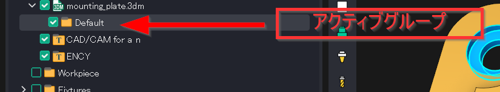

# アクティブフォルダ

一度にアクティブにできるグループは1つのみです。作業（[インポート](772.md)、詳細設定、変換など）は、現在アクティブなグループ内にあるオブジェクトに対してのみ実行可能です。アクティブなグループは1つのオブジェクトとして扱われ、分割できないものとみなされます。グループの各要素を個別に操作するには、そのグループを「開く」またはアクティブ化する必要があります。これらのルールは、Windowsなどの一般的なファイルシステムでの操作と同様です。フォルダやファイルを操作するには、それらを含んでいるフォルダを「開いて（中に入って）」作業する必要があります。

現在アクティブになっているフォルダは、[幾何モデル構造ウィンドウ](718.md)に表示されます。このウィンドウには、アクティブなフォルダ内に含まれている幾何要素および構造要素の一覧も表示されます。これらの要素は、一覧から直接選択することも、[グラフィックウィンドウ](169.md)から選択することも可能です。アクティブグループの選択は、モデル構造ウィンドウ内で該当するツリーリンクを選択するか、グラフィックウィンドウ内でオブジェクトを選択することによって行われます。
