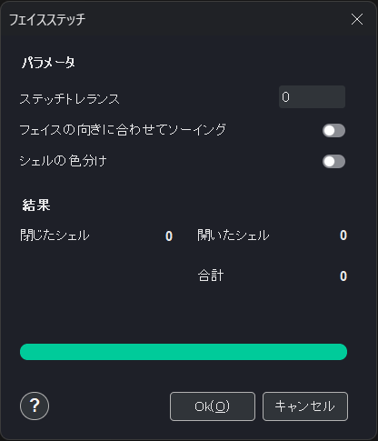
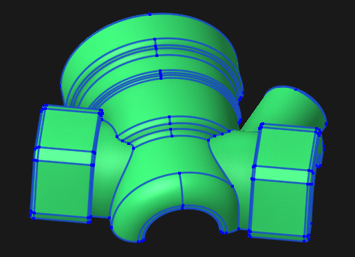
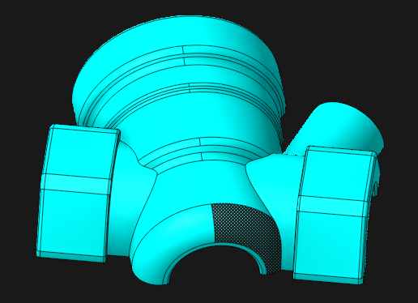
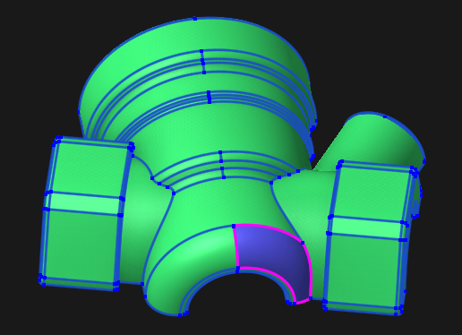

# Cucitura delle facce

La finestra **Sew faces** (cucitura delle facce) può essere aperta premendo il pulsante  nel pannello **Model** (modello), oppure tramite il menu a comparsa nella [finestra grafica](169.md) o nella [finestra della struttura geometrica](718.md). Questa funzione serve a cucire tra loro le facce del modello 3D. Nel modello geometrico vengono aggiunti gli spigoli e i vertici degli oggetti selezionati.

Come risultato della cucitura, nel modello geometrico diventano disponibili speciali oggetti parametrici: spigoli e vertici. Gli spigoli sono curve speciali che formano i bordi delle facce e delle mesh. I vertici sono punti che derivano dai limiti degli spigoli.

Gli oggetti parametrici hanno alcune proprietà particolari. Mantengono un collegamento permanente con l'oggetto di origine. Quando queste facce vengono modificate, anche gli spigoli e i vertici vengono ricostruiti. Di conseguenza, le azioni su di essi sono soggette ad alcune limitazioni: non possono essere copiati, eliminati, trasformati e così via. Per questo motivo tali oggetti non sono elencati negli [oggetti disponibili](718.md). Tuttavia, possono essere selezionati nella [finestra grafica](45.md). Pertanto, spigoli, serie di spigoli e vertici possono essere utilizzati nella modalità [Lavorazione](54.md) come [Assegnazione del lavoro](301.md), [Pezzo](330.md), [Grezzo](738.md), [Attrezzature](10283.md) in tutti i casi in cui è consentita l'aggiunta di spigoli e vertici.

Nel campo **Sew tolerance** (tolleranza di cucitura) si assegna il valore massimo di scostamento tra gli spigoli e i vertici delle facce vicine. Quando la tolleranza è 0, tale valore viene assunto automaticamente in base alle dimensioni complessive degli oggetti da cucire.

L'opzione **Sew according to face orientatin** (cucitura in base all'orientamento delle facce) consente di tenere conto della direzione della normale delle facce durante la cucitura. Per impostazione predefinita è disattivata.

In alcuni casi, durante l'importazione possono verificarsi errori per cui le normali di alcune facce risultano orientate nella direzione errata:

Non sempre è possibile cucire correttamente tali modelli:

Per risolvere questi problemi sono stati aggiunti i seguenti strumenti (compaiono selezionando una faccia):

-  - Inverte le facce selezionate.

-  - Inverte tutte le facce del guscio.

-  - Inverte tutte le facce la cui normale è diretta verso l'interno del guscio.

-  - Attiva la modalità di separazione dei gusci per colore.

L'opzione **Sew faces inside group only** (cucire le facce solo all'interno del gruppo) imposta i limiti per la ricerca delle facce durante la cucitura. Si presume che i gusci chiusi si trovino in [Gruppi](603.md) separati. È attivata per impostazione predefinita. L'opzione non viene mostrata se non vengono trovati altri gruppi con facce.

Il pannello **Result** (risultato) mostra il numero di gusci chiusi e aperti e il loro numero totale.

Se il risultato è corretto, chiudere la finestra con il pulsante **Ok**. Per annullare la cucitura, premere il pulsante **Cancel**.
