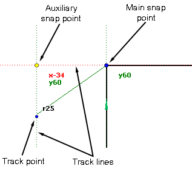
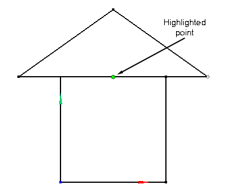
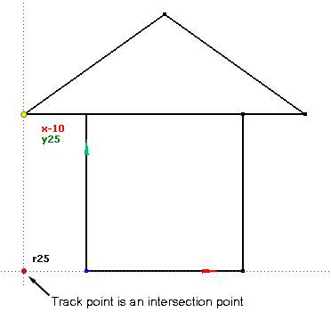
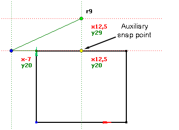
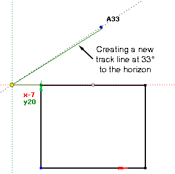
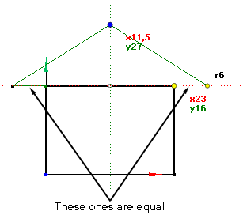

# Smart Snap

**Smart Snap**  schaltet das Fangen an Geometrie im Grafikfenster ein oder aus. Es unterstützt das Erstellen und Bearbeiten von Punkten, Linien, Konturen und Koordinatensystemen.

Damit können geometrisch präzise Zeichnungen anhand vorhandener Beziehungen erstellt werden.

Wesentliche Elemente:

- **Hervorgehobene Punkte.** Beim Überfahren geometrischer Elemente werden fangbare Punkte hellgrün angezeigt: End- und Mittelpunkte von Strecken und Bögen, Kreiszentren, Einzelpunkte und Schnittpunkte.

- **Hauptfangpunkt.** Ein Klick mit der linken oder mittleren Maustaste auf einen hervorgehobenen Punkt oder Spurpunkt erzeugt einen dauerhaften Fangpunkt mit Spurlinien. Er bleibt beim Wegbewegen des Mauszeigers erhalten und zeigt seine Koordinaten.

- **Hauptspurlinien.** Sie gehen vom Hauptfangpunkt aus und folgen dem aktuellen lokalen Koordinatensystem oder angrenzender Geometrie. An einem Streckenende werden beispielsweise parallele und senkrechte Richtungen angeboten.

- **Aktueller Spurpunkt.** Liegt auf einer Spurlinie und folgt dem Mauszeiger. Er zeigt den Abstand zum Fangpunkt. Schneidet die Spurlinie Geometrie oder eine andere Spurlinie, kann der Schnittpunkt rot markiert werden.

- **Hilfsfangpunkt.** Verweilt der Mauszeiger über einem hervorgehobenen Punkt oder Spurpunkt, entsteht ein temporärer Fangpunkt mit eigenen Spurlinien. Er verschwindet beim Verlassen seines Bereichs. Damit lassen sich Schnittpunkte zwischen Haupt- und Hilfsspurlinien bestimmen.

- **Spurlinie mit mittlerer Maustaste drehen.** Ziehen Sie eine Spurlinie bei gedrückter mittlerer Maustaste. Eine neue Linie entsteht unter einem Winkel zur ursprünglichen; der aktuelle Winkel wird angezeigt.

- **Letzte Abstände übernehmen.** Smart Snap merkt sich die letzten drei bestätigten Abstände. Entspricht der aktuelle Spurpunktabstand einem davon, wird er gelb markiert. So können beispielsweise gleich lange Strecken gezeichnet werden.

