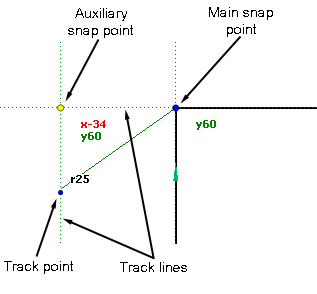
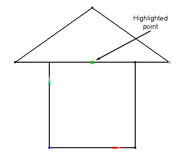
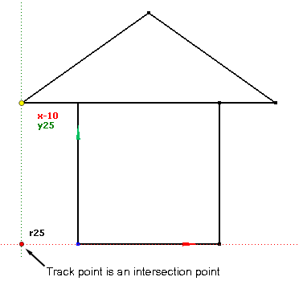
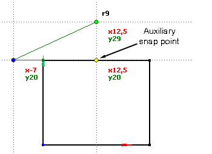
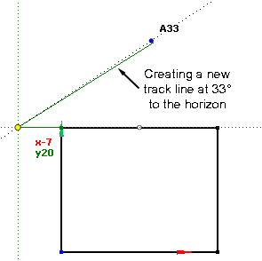
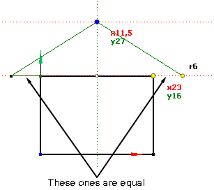

# スマートスナップ

<strong>スマートスナップ</strong>  ボタンは、グラフィックウィンドウ内の形状へのスナップを有効または無効にします。この機能は、点、線、輪郭、座標系など、新しい幾何要素を作成したり、既存の形状を編集したりするときに便利です。

たとえば、 <strong>スマート スナップ</strong> 機能を使用すると、正確で制約の多い図面をその場で簡単に作成できます。

<strong>スマートスナップ</strong> の主な構成要素は以下のとおりです。

- <strong>ハイライトポイント</strong>カーソルを要素上に移動すると、スナップできる点がライム色でハイライトされます。カットや円弧の終点、明瞭な点、円弧や円の中心点、切削の中間点、交点などです。

- <strong>メインスナップポイント</strong>：ハイライトされた点またはトラックポイント（下図参照）上でマウスの左ボタンまたは中ボタンをクリックするたびに、関連するトラックラインのセットを持つメインスナップポイントが作成されます。メインスナップポイントは永続的で、カーソルを離しても消えません。点座標のラベルが貼られています。

- <strong>本線</strong>：これらはメインスナップポイントを起点とする線です。いくつかの線は現在のローカル座標系に整列され、他の線は隣接する幾何要素に整列される（例えば、メインスナップ点がカットの終点である場合、メイントラック線はカットの方向に平行な線と垂直な線を含みます）。

- <strong>現在のトラックポイント</strong>トラックポイントとは、トラックライン上の点です。トラックライン上にカーソルを移動すると、トラックポイントも移動します。これは、現在のスナップ点からの距離でラベル付けされ、要素または別のトラック線と現在のトラック線との交点を表すこともあります。この場合、トラックポイントは赤い色で表示されます。

- <strong>補助スナップポイント：</strong>ハイライトされた点やトラックポイントの上にしばらくカーソルを置くと、そのポイントは補助スナップポイントになります。これはメインのスナップポイントと同じように動作しますが、永続的ではありません。つまり、カーソルをスナップポイントやそのトラックラインから離すと消えてしまいます。補助スナップポイントには独自のトラックラインのセットがあり、メイントラックラインと補助トラックラインの交点をその場で作ることができます。とても便利な機能です。

- <strong>トラックラインをマウスの中ボタンでドラッグ：</strong>トラックラインの上でマウスの中ボタンを押し、ボタンを押したままラインをドラッグすることができます。このアクションは、ソーストラック線に対して相対的な角度で新しいトラック線を作成します。線をドラッグしている間、画面上で実際の角度値を見ることができます。

- <strong>最後の距離を把握：</strong>作図の際、同じ長さのカットを作成したい場合があります。これを支援するために、 <strong>スマートスナップ</strong> は、図面を作成するときに受け入れた最後の3つのトラック距離を記憶します。トラックライン上にカーソルを移動させると、トラックポイントが黄色に着色されることがあるが、これはトラックポイントからスナップポイントまでの距離が、直近の3つの距離のいずれかに一致することを示しています。

