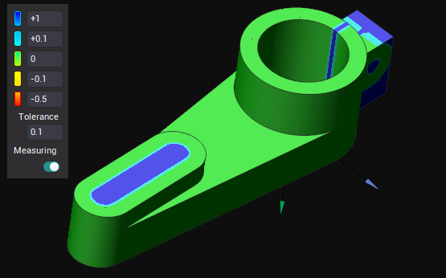
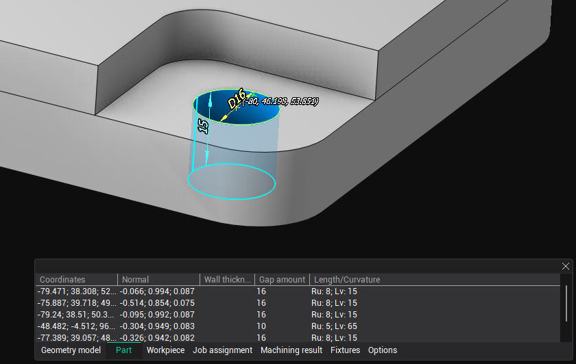
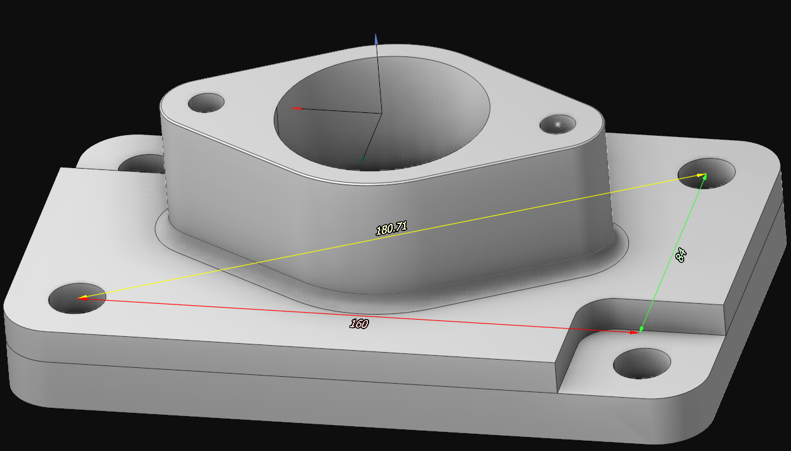

# Messen und Analysieren

Das CAM-System bietet Werkzeuge zum Messen geometrischer Modellparameter und zum Analysieren der Ergebnisse einer Bearbeitungssimulation.

## Soll-Ist-Vergleich

Die Funktion **Verify Compare** (Soll-Ist-Vergleich)  kann im Modus [Bearbeitung](10064.md) oder [Simulation](10286.md) aktiviert werden. Sie stellt die Unterschiede zwischen Sollbauteil und Bearbeitungsergebnis farblich dar. Jede Farbe entspricht einem bestimmten Abweichungsbereich.

## Geometrie messen

**Geometry Measuring** (Geometrie messen)  ermittelt die wichtigsten geometrischen Abmessungen des ausgewählten Objekts im Grafikfenster. Beim Aktivieren öffnet sich ein zusätzliches Fenster zur Auswahl des Objekttyps, beispielsweise Bauteil, Rohteil oder Bearbeitungsergebnis, und zur Einstellung der Messparameter. Nach der Auswahl eines Objekts werden seine Hauptabmessungen im Grafikfenster angezeigt. Im Messfenster wird eine Zeile mit den wesentlichen Parametern des ausgewählten Punkts ergänzt. Einige Maße hängen vom aktiven geometrischen Koordinatensystem ab.

## Abstandsmessung

Die Schaltfläche **Measure Tool** (Messwerkzeug)  aktiviert die Abstandsmessung zwischen zwei beliebigen Punkten. Wählen Sie im Grafikfenster zwei Punkte aus. Angezeigt werden drei orthogonale Abstände und der direkte Abstand zwischen den Punkten. Die Ausrichtung der Maße richtet sich nach dem aktiven geometrischen Koordinatensystem. Anschließend können weitere Punktpaare ausgewählt werden.

