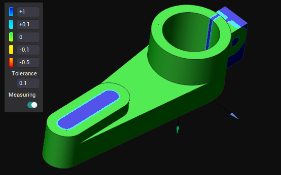
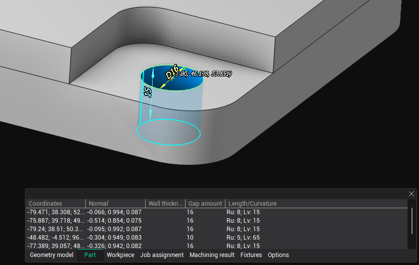
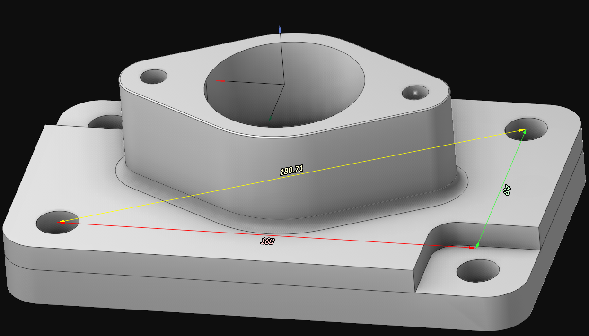

# 測定と分析

CAMシステムには、モデルの形状パラメータを便利に測定し、シミュレーション加工の結果を解析するためのツールが含まれています。

## ベリファイ比較

<strong>ベリファイ比較</strong>  機能は、 [加工](10064.md)または [シミュレーション](10286.md)モードのいずれかで有効にできます。この機能は、元の部品と加工結果の違いを色分けで視覚的に表示します。各色は、比較対象の要素間の特定の偏差範囲を表します。

## 図形データ測定

<strong>図形データ測定</strong>  機能は、グラフィックスウィンドウで選択された形状の主要な幾何学的寸法を決定するのに役立ちます。このモードをアクティブにすると、測定対象のタイプ（部品、ワーク、加工結果など）を選択し、測定パラメータを設定できる追加のウィンドウが表示されます。形状を選択すると、その主要な寸法がグラフィックウィンドウに表示され、選択したポイントに関連する主要なパラメータが表示された行が測定ウィンドウに追加されます。一部の寸法は、アクティブな座標系に依存する場合があります。

## 測定ツール

<strong>測定ツール</strong> ボタン  は、画面上の任意の2点間の距離を測定するモードを有効にします。有効にした後、グラフィックスウィンドウで任意の2点を選択します。直交する3つの寸法と1つの対角線が画面に表示されます。これらの寸法の向きは、アクティブな座標系に依存します。さらに2点を選択して、その間の距離を測定することもできます。

