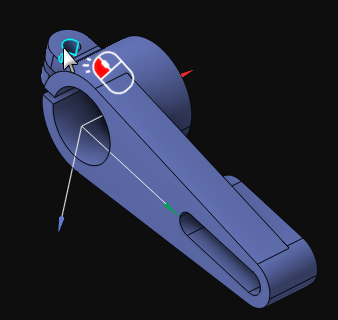
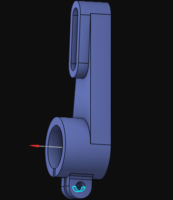
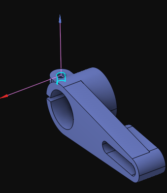
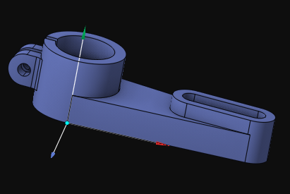
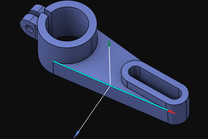
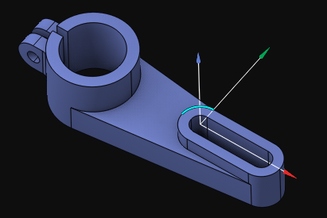
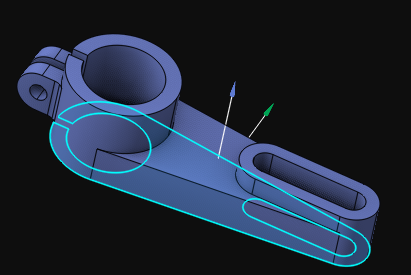
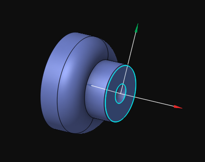
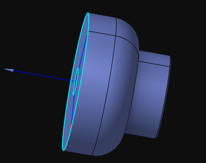

# Creazione rapida di un SC locale

È possibile creare facilmente un sistema di coordinate con circa due clic del mouse. La procedura è molto semplice.

1. Per prima cosa, selezionare nella vista grafica un elemento di progetto che definisca la posizione del nuovo sistema di coordinate. È possibile selezionare qualsiasi entità dotata di origine, di asse o di entrambi. Ad esempio, un arco di cerchio, una linea, una superficie di rivoluzione o un piano definiscono sia l'origine sia l'asse. Un punto definisce solo l'origine, mentre un vertice di un modello solido definisce l'origine, l'asse Z (ricavato dalla superficie adiacente) e la direzione dell'asse X (ricavata dallo spigolo adiacente). Uno spigolo rettilineo di un modello solido definisce l'origine posta a metà dello spigolo, con la direzione dell'asse Z ricavata dalla superficie adiacente e la direzione dell'asse X ricavata dallo spigolo stesso.

2. Poiché nessuna entità geometrica definisce completamente un sistema di coordinate locale, il sistema CAM deve stabilire come scegliere i parametri mancanti, ad esempio la direzione dell'asse Z o X del nuovo SC locale. È possibile guidare facilmente il sistema CAM ruotando la vista con il mouse. In questo modo il sistema CAM seleziona i parametri mancanti del nuovo SC locale in base all'orientamento della vista, in modo analogo a come si orienta la vista con il clic intelligente del tasto centrale del mouse.

3. Il passo finale consiste in un semplice clic sulla voce di menu  nel [pannello dei sistemi di coordinate](753.md).

Esempi di creazione rapida di un SC locale:

- SC locale da un vertice di un solido:

- SC locale da uno spigolo rettilineo di un solido:

- SC locale da uno spigolo circolare di un solido:

- SC locale al centro di una faccia piana con la direzione dell'asse Z invertita:

- SC locale XOY al centro di una faccia piana:

- SC locale XOY al centro di una faccia piana con la direzione dell'asse X invertita:

