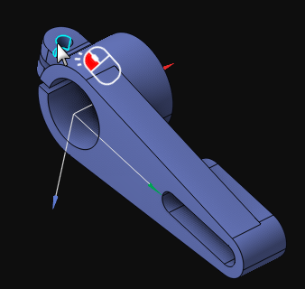
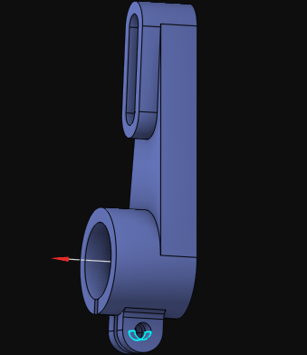
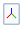
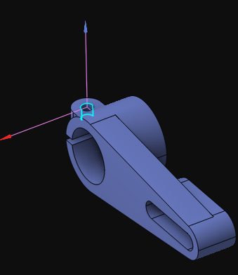
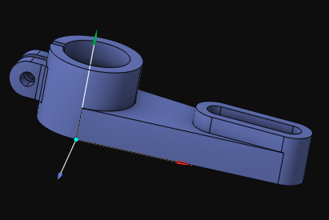
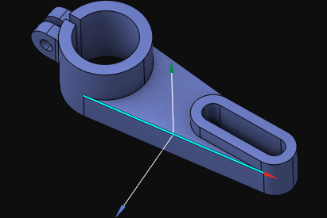
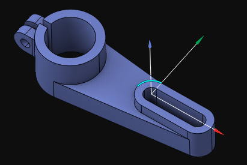
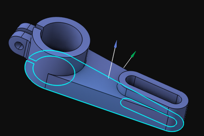
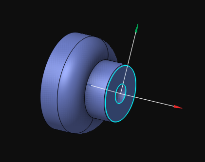
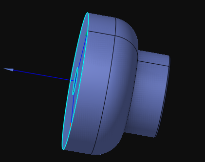

# スマートなローカル座標系の作成

マウス操作2回程度で座標系を簡単に作成できます。操作は非常に直感的です。

1.まず、グラフィックビュー上で新しい座標系の位置を決定する設計要素を選択します。原点、軸、またはその両方を持つ任意の要素を選択できます。例えば、円弧、直線、回転面、平面などは、原点と軸の両方を定義します。点は原点のみを定義しますが、ソリッドモデルの頂点は原点、Z軸（隣接するサーフェスから取得）、X軸方向（隣接するエッジから取得）の両方を定義します。ソリッドモデルの直線エッジは、エッジの中央に原点を置き、Z軸方向は隣接するサーフェスから、X軸方向はエッジ自体から取ります。

2.ローカル座標系を完全に定義する要素はないため、CAMシステムは、新しいローカル座標系のZ軸やX軸の方向など、不足しているパラメータをどのように選択するかを決定しなければならなりません。マウスでビューを回転させることで、CAMシステムを簡単にガイドすることができます。この方法により、CAMシステムはビューの向きに基づいて新しいローカル座標系の不足パラメータを自動選択します。操作感は、スマート中ボタンクリックでビューを向ける手順と同様です。

3.最後に、  [座標系パネル](753.md)上の 該当メニュー項目をクリックするだけで完了です。

スマートローカル座標系の作成例：

- ソリッド頂点によるローカル座標系：

- ソリッド直線エッジによるローカル座標系：

- ソリッド円形エッジによるローカル座標系：

- Z軸方向が反転した平面の中心におけるローカル座標系：

- 平らな面の中央にあるXOYローカル座標系：

- X軸方向が反転した平らな面の中央にあるXOYローカル座標系：

