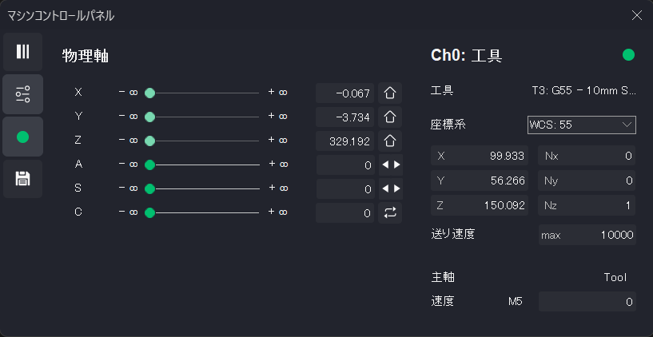
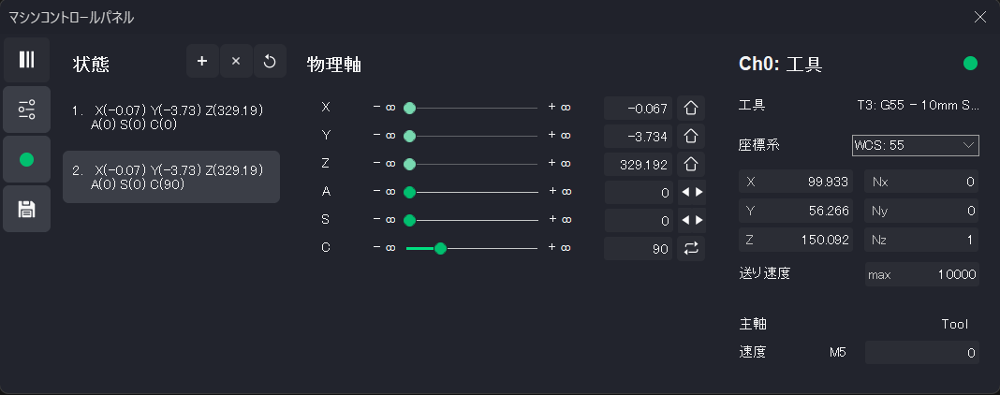

# マシン軸コントロールパネル

<strong>マシン軸コントロール</strong> ウィンドウでは、すべての機械/ロボット座標の現在値をモニターし、修正することができます。 このウィンドウを表示するには、メインツールバーの対応する ボタンをクリックします。 シミュレーションモードでのツールパスの分析、マニュアルアプローチの構築、または技術的操作を計算するための初期機械位置の決定に役立ちます。

ウィンドウはいくつかのエリアに分かれています。パネルの数とその内容は、特定のマシン構成によって異なる場合があります。上部または左側のツールバーで、これらのパネルの表示をコントロールします。

 <strong>レイアウト切替: 縦/横:</strong> はパネルのレイアウトを縦と横で切り替えます。

 <strong>物理軸パネルの表示:</strong> 物理機械軸のリストを持つパネルの表示/非表示を切り替えます。

 <strong>チャンネルパネルの表示:</strong> マシンのコントロールチャンネルに関する情報でパネルの表示/非表示を切り替えます。マシンのチャンネル数によっては、このようなボタンがいくつかある場合もあります。アイコンの色は、各チャンネルに関連する固有の色を示します。そのチャンネルに関連する情報はすべてこの色で表示されます。

 <strong>状態パネルの表示:</strong> 保存されたマシン状態のリストを表示するパネルの表示/非表示を切り替えます。

<strong>チャンネルパネル</strong> は以下の値を表示します。

- チャンネルの色、インデックス、名前
- アクティブな工具番号とチャンネル名
- アクティブWCS番号コンボ、工具座標の表示に使用する追加の座標系を選択できます。
- 指定された空間座標系内で、工具座標およびオリエンテーション角度をベクトルまたはクォータニオンとして表示します。オリエンテーション角度の種類表示される姿勢角の種類は、マシンスキーマの設定により異なります。
- 現在の送り値、測定単位（送りのタイプ、例：mm/min、mm/rev、または早送りの場合は "max"）。
- 現在のスピンドル名、回転数、回転方向（M3、M4、M5）、回転モード（RPMの場合はrev/min、CSSの場合はm/minなど）

<strong>物理軸パネル</strong> は、各機械軸の情報を表示します。以下を含みます。

- 軸名
- 軸の現在の物理値、これは、現在のWCSに依存するのではなく、軸がマシンスキーマでどのように定義されているかに依存します。軸が範囲外の場合は、この値が赤くなることがあります。
- 軸の最小値、最大値
- 軸ブレーキステータス（該当する場合）：
  -  ブレーキオフ
  -  ブレーキオン
- 軸プロパティに基づく、軸値のクイック修正ボタン：
  -  軸をホーム位置に戻す
  -  軸を最小値までに移動
  -  軸を最大値までに移動
  -  軸の値を1周期分減らす（制限内の場合）
  -  軸の値を1周期分増やす（制限内の場合）
  -  同じ工具とワークの相対位置を複数の方法で達成できる場合、機械軸を別の解決策に切り替えます。

状態パネルには、保存されているマシンの状態が表示され、以下のボタンがあります。

-  <strong>新しい状態を追加</strong>：現在のマシンの状態をリストに保存
-  <strong>選択した状態を削除</strong>: リストから選択した状態を削除
-  <strong>すべての状態を削除</strong>：保存されている状態のリスト全体をクリア

リスト内の状態をダブルクリックすると、マシンをその状態に素早く切り替えることができます。`状態を記憶` 機能を使用すると、6 軸多関節ロボットなどの複雑な軸構成を持つマシンで手動遷移を構築するときに役立ちます。
