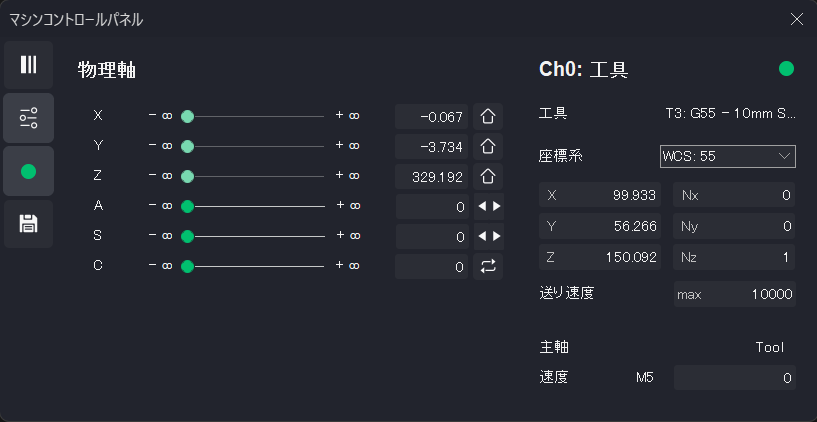
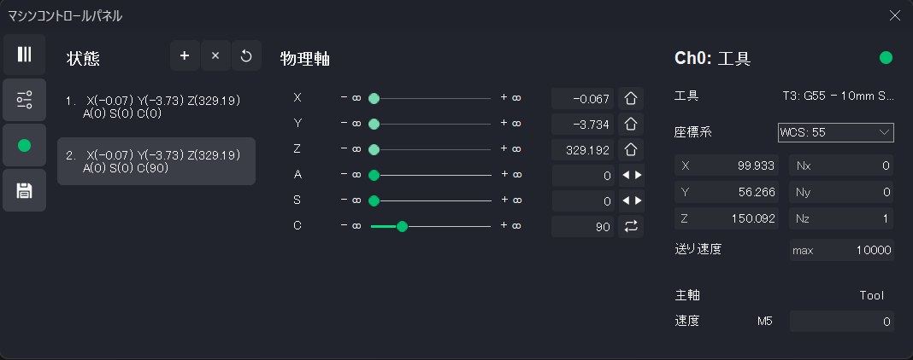

# Steuerung der Maschinenachsen

Im Fenster **Machine Axes Control** können Sie die aktuellen Maschinen- bzw. Roboterkoordinaten überwachen und ändern. Öffnen Sie es über  in der Hauptsymbolleiste. Es unterstützt die Werkzeugweganalyse in der Simulation, das Erstellen manueller Anfahrbewegungen und das Festlegen der Ausgangsstellung für die Operationsberechnung.

Das Fenster besteht aus mehreren Bereichen. Ihre Anzahl und ihr Inhalt hängen von der Maschinenkonfiguration ab. Die Symbolleiste oben oder links steuert ihre Sichtbarkeit.

-  **Anordnung wechseln: vertikal/horizontal.** Wechselt die Ausrichtung der Bereiche.

-  **Physische Achsen anzeigen.** Blendet die Liste der physischen Maschinenachsen ein oder aus.

-  **Kanalbereich anzeigen.** Blendet Informationen zum betreffenden Steuerungskanal ein oder aus. Je nach Kanalanzahl gibt es mehrere solcher Schaltflächen. Jeder Kanal besitzt eine eigene Farbe, in der auch die zugehörigen Informationen dargestellt werden.

-  **Zustandsliste anzeigen.** Blendet die gespeicherten Maschinenzustände ein oder aus.

Der **Kanalbereich** zeigt:

- Farbe, Index und Namen des Kanals;
- Nummer und Namen des aktiven Werkzeugs im Kanal;
- die Auswahl der aktiven WCS-Nummer, über die zusätzliche Koordinatensysteme für die Werkzeugkoordinaten gewählt werden können;
- Werkzeugkoordinaten und Orientierung im angegebenen räumlichen Koordinatensystem, beispielsweise als Winkel, Vektoren oder Quaternionen. Die Darstellung hängt vom Maschinenschema ab;
- aktuellen Vorschub und Einheit bzw. Vorschubart, etwa mm/min, mm/U oder „max“ für Eilgang;
- Namen, Geschwindigkeit, Drehrichtung (M3, M4, M5) und Betriebsart der aktuellen Spindel, beispielsweise U/min bei RPM oder m/min bei CSS.

Der Bereich **Physische Achsen** zeigt für jede Maschinenachse:

- Achsnamen;
- den aktuellen physischen Achswert gemäß Maschinenschema, unabhängig vom aktuellen WCS. Bei Überschreitung der Achsgrenzen kann der Wert rot angezeigt werden;
- minimale und maximale Achsgrenze;
- gegebenenfalls den Bremszustand:
  -  Bremse gelöst;
  -  Bremse aktiv;
- Schaltflächen zur schnellen Änderung, abhängig von den Achseigenschaften:
  -  Achse in Grundstellung setzen;
  -  Achse an die minimale Grenze setzen;
  -  Achse an die maximale Grenze setzen;
  -  Bei einer periodischen Drehachse eine Periode abziehen, sofern die Grenzen eingehalten werden;
  -  Eine Periode hinzufügen, sofern die Grenzen eingehalten werden;
  -  Auf eine alternative Achslösung wechseln, wenn dieselbe relative Werkzeug-Werkstück-Lage auf mehrere Arten erreicht werden kann.

Die Zustandsliste enthält gespeicherte Maschinenzustände und folgende Schaltflächen:

-  **Neuen Zustand hinzufügen.** Speichert die aktuelle Maschinenstellung.
-  **Ausgewählten Zustand löschen.** Entfernt den markierten Eintrag.
-  **Alle Zustände löschen.** Leert die Liste.

Durch Doppelklicken auf einen Eintrag wird die gespeicherte Maschinenstellung wiederhergestellt. Dies ist insbesondere beim [Erstellen manueller Verbindungsbewegungen](10267.md) für komplexe Achskonfigurationen hilfreich, beispielsweise bei 6-Achs-Gelenkrobotern.
