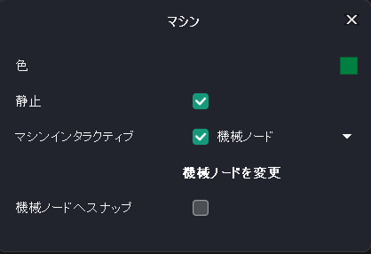
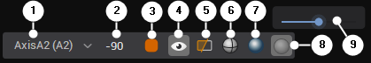
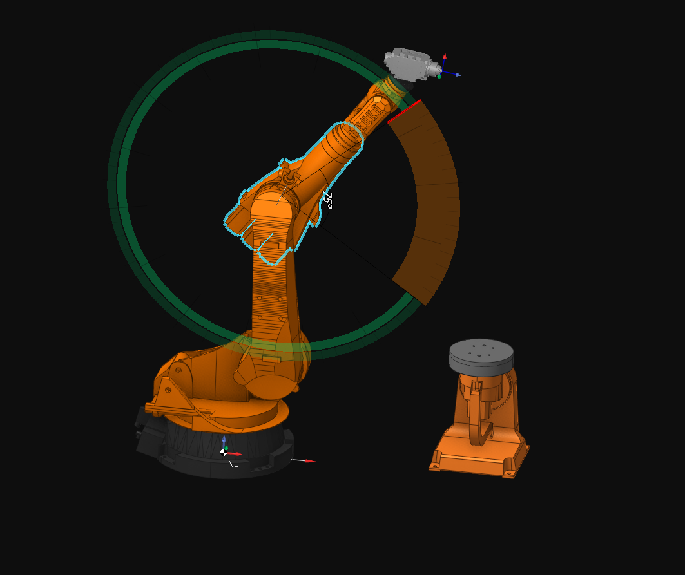

# Interaktive Maschine

Das System ermöglicht die interaktive Steuerung der Maschine und das Ändern ihrer Darstellung. Aktivieren oder deaktivieren Sie die Funktion über die entsprechende Option im Kontextmenü der Schaltfläche für die Maschinensichtbarkeit.

Maschinenkomponenten unter dem Mauszeiger werden hervorgehoben. Bei Drehachsen zeigt eine gepunktete Linie die Drehachse. Nach dem Anklicken eines Maschinenknotens erscheint das Fenster mit seinen Darstellungsparametern:

1 – **Knotenname**

2 – **Aktuelle Achsposition.** Geben Sie den gewünschten Wert ein oder ändern Sie ihn mit dem Mausrad. Das Feld wird nur bei beweglichen Maschinenknoten angezeigt.

3 – **Farbe des Maschinenknotens.** Öffnet den Farbauswahldialog.

4 – **Sichtbarkeit des Maschinenknotens**

5 – **Ghost-Modus.** In diesem Modus werden nur die ausgeblendeten Knoten angezeigt.

6 – **Darstellungsmodus.** Drahtmodell, schattiert oder schattiert mit Kanten.

7 – **Metallic-Darstellung aktivieren**

8 – **Transparente Darstellung aktivieren**

9 – **Transparenzgrad des Maschinenknotens**

Maschinenknoten können durch Ziehen verschoben werden. Ist ein Knoten nicht beweglich, wird der nächstgelegene bewegliche übergeordnete Knoten bewegt. Bei Drehknoten erscheint ein Hilfskreis, der die Drehebene darstellt. Sein Radius entspricht dem Abstand zwischen der Drehachse und dem angeklickten Punkt des Maschinenknotens.

Die gesamte Maschinenstellung kann auch über die gewünschte Werkzeugposition festgelegt werden. Das System passt die Knotenpositionen entsprechend an. Ziehen Sie dazu das Werkzeug. Ist kein aktives Werkzeug vorhanden, wird stattdessen ein gelber Punkt angezeigt. Die Bewegung erfolgt in der Ansichtsebene. Richten Sie die Blickrichtung daher entlang der X-, Y- oder Z-Achse aus, um die Position gezielt einzustellen.
