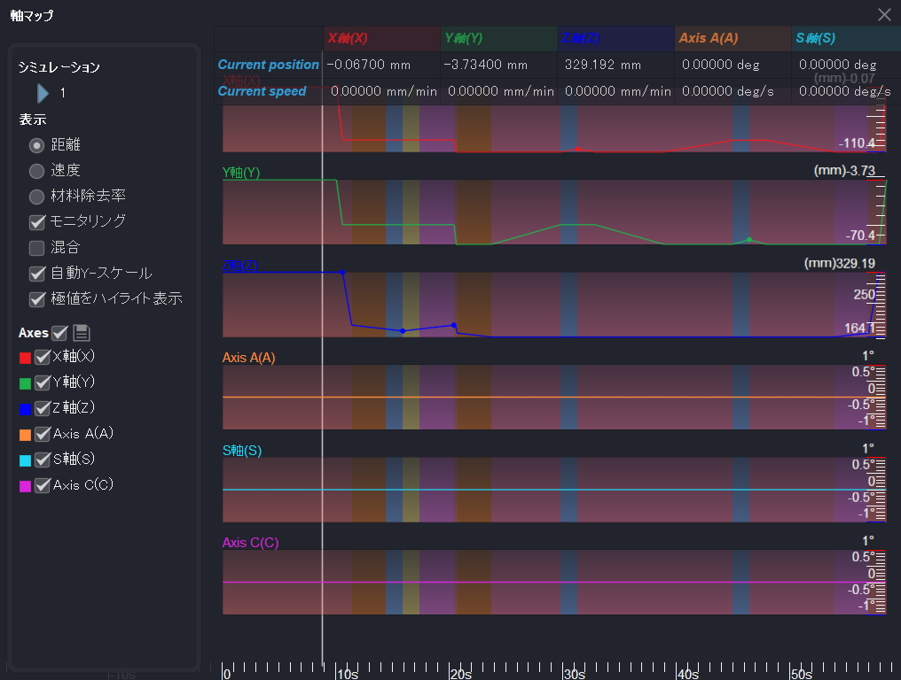
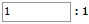
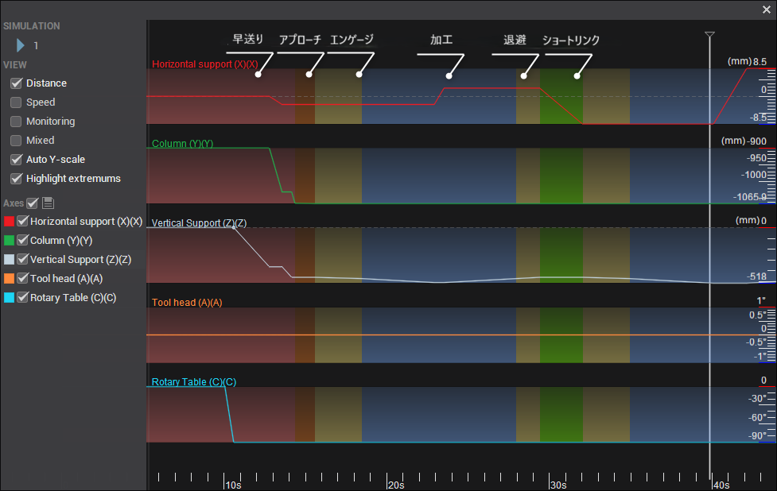

# 機械軸ウィンドウのグラフ

この機能により、工具が現在の作業のパスに沿って移動する際の機械軸の値の経時変化を、一連のグラフとして表示することができます。グラフを作成するには、操作のリストから計算された操作を選択し、メインツールバーの対応するボタン  をクリックします。

ウィンドウのレイアウトは以下の通りです。

## シミュレーション：

<strong>シミュレーション</strong> メイングラフィックスウィンドウとグラフ上で、工具と機械軸の動きを同期して開始します。移動するマーカーが現在の時刻を示します。グラフを左クリックすると、任意の時点にマーカーを配置できます。

速度欄の上でマウスホイールをスクロールするか、  欄に値を入力して、シミュレーション速度を変更します。

## ビュー：

#### グラフの種類：

<strong>距離</strong> 工具がツールパスに沿って移動する際の各機械軸の位置を表示します。直線軸の位置はミリメートルまたはインチで、回転軸の位置は度で表されます。

<strong>速度</strong> 軸位置の時間に関する1次導関数、つまり軸座標の変化率を表示します。直線軸では線速度、回転軸では角速度になります。

<strong>Material removal rate</strong>（材料除去率） 材料除去率の時間変化を表示します。各計算区間で除去された体積を、その区間の時間で割って求めます。このグラフにより、ツールパスの各区間の工具負荷を比較できます。このグラフを選択すると、計算の設定とコントロールが表示されます。

#### 表示：

<strong>モニタリング</strong> 表示されている各軸の現在の位置と速度を示す表を、ウィンドウの上部に表示します。直線軸の位置には機械の長さ単位（通常はミリメートルまたはインチ）が使用され、直線軸の速度はmm/minまたはin/minで表示されます。回転軸の位置には機械の角度単位（通常は度）が使用され、回転軸の速度はdeg/sで表示されます。値は時間マーカーの移動に合わせて更新されます。

<strong>混合</strong> 選択したすべての軸を1つのグラフに表示します。無効にすると、各軸のグラフは個別に表示されます。

<strong>自動Yスケール</strong> 縦スケールをグラフの最小値と最大値に合わせて自動的に調整します。軸を個別に表示している場合は、各軸のグラフが同じ高さいっぱいに表示されます。横スケールを変更するには、ポインタをグラフィックエリアに置いてマウスホイールを回転させます。

<strong>極値をハイライト表示</strong> 軸座標の変化方向が反転する点を表示します。このオプションは<strong>距離</strong>グラフでのみ使用でき、<strong>速度</strong>および<strong>Material removal rate</strong>では使用できません。

<strong>軸</strong> 色の付いた四角形をクリックすることで、個々の軸を非表示にしたり、色を変更したりできます。

軸グラフ下の背景色は、送りタイプ（切削送り、早送り、アプローチ、リターンなど）を示します。

#### 材料除去率の計算：

<strong>Tool load threshold</strong>（工具負荷のしきい値） 材料除去率のしきい値を設定します。工具負荷が高いグラフ区間は、このしきい値を基準に強調表示されます。値を入力して<strong>Enter</strong>キーを押すと適用されます。グラフ上のしきい値の線をドラッグして調整することもできます。

<strong>Calculation step</strong>（計算ステップ） グラフの計算時のツールパスに沿った最大ステップを設定します。新しいステップをグラフに適用するには、<strong>Recalculate graph</strong>をクリックします。

<strong>High model resolution</strong>（高解像度モデル） 計算に高解像度のシミュレーションモデルを使用します。無効にすると、シミュレーション設定で指定した解像度が使用されます。このオプションを変更した後は、グラフを再計算してください。

<strong>Recalculate graph</strong>（グラフの再計算） 指定したステップとモデル解像度で計算を開始します。計算の開始時に、以前のグラフデータは消去されます。

<strong>Break process</strong>（処理の中断） 計算の実行中は<strong>Recalculate graph</strong>の代わりに表示され、クリックすると計算を停止します。
