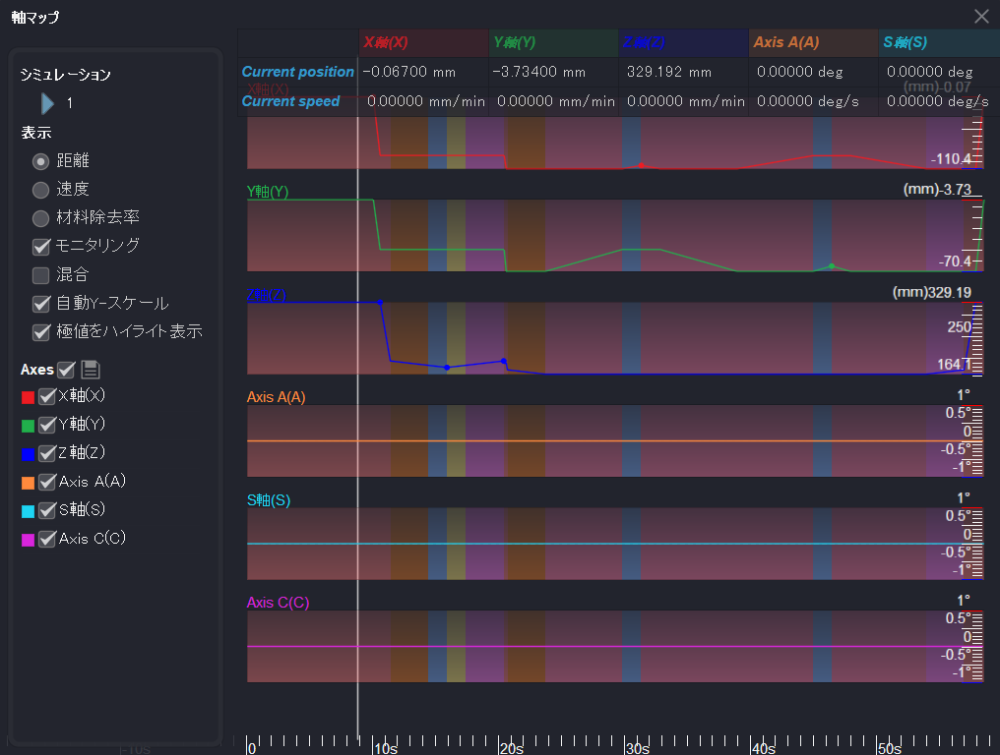
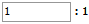
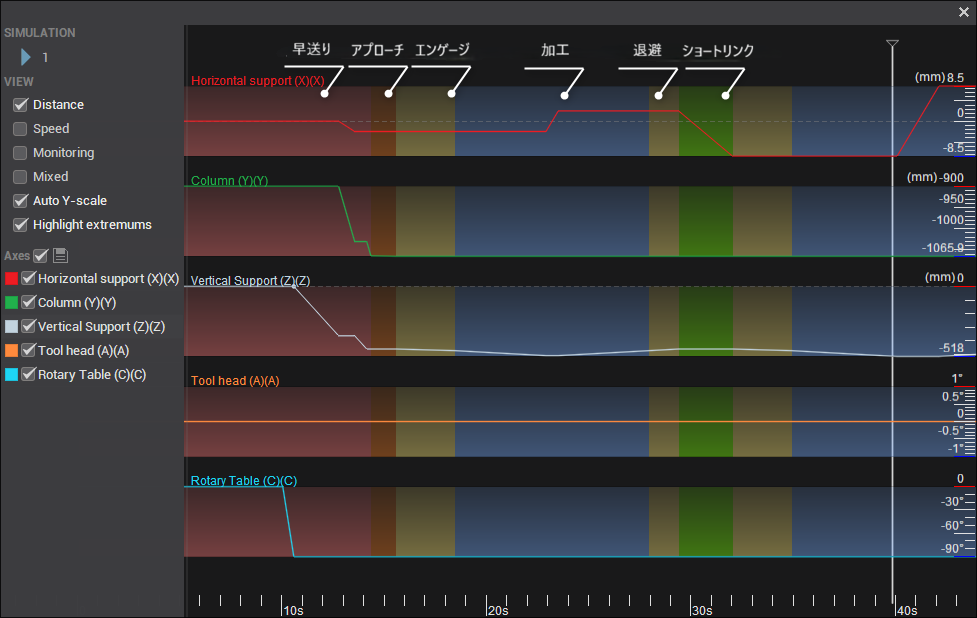

# Janela de gráficos dos eixos da máquina

Este recurso permite visualizar, como um conjunto de gráficos, a variação dos valores dos eixos da máquina ao longo do tempo enquanto a ferramenta percorre o percurso da operação atual. Para gerar um gráfico, selecione a operação calculada na lista de operações e clique no botão correspondente  na barra de ferramentas principal.

A janela tem a seguinte disposição:

- <strong>Simulation</strong>: o botão Simulation inicia a simulação sincronizada do movimento da ferramenta e de todos os eixos da máquina, tanto na janela gráfica principal quanto no gráfico dos eixos. Um marcador móvel mostra a posição atual no gráfico dos eixos. É possível posicionar o marcador em um instante arbitrário clicando com o botão esquerdo do mouse no gráfico. Também é possível alterar a velocidade da simulação girando a roda do mouse ou informando manualmente um valor no campo .
- <strong>Distance</strong>: exibe a posição de cada eixo da máquina ao longo de todo o processo de usinagem. Para eixos lineares, a posição é mostrada em milímetros ou polegadas; para eixos rotativos, em graus. Essa propriedade permite acompanhar a posição exata de cada eixo enquanto a ferramenta se move ao longo do percurso da ferramenta, oferecendo uma visão detalhada dos movimentos dos eixos durante a operação.
- <strong>Speed</strong>: representa a primeira derivada de <strong>Distance</strong>, indicando a taxa de variação da posição de cada eixo da máquina ao longo do tempo. Para eixos lineares, é exibida como velocidade linear em milímetros por segundo (mm/s) ou polegadas por segundo (in/s); para eixos rotativos, como velocidade angular em graus por segundo (deg/s). Essa propriedade permite monitorar a rapidez com que cada eixo se move ou gira durante a usinagem, fornecendo informações valiosas sobre a dinâmica da máquina e garantindo um controle preciso.
- <strong>Monitoring</strong>: quando ativado, exibe na parte superior da janela uma tabela com dados em tempo real de cada eixo da máquina. A primeira linha mostra a posição atual de cada eixo em graus (deg), e a segunda, a velocidade atual de cada eixo em graus por segundo (deg/s). Esse recurso é útil para acompanhamento e análise em tempo real durante as operações.
- <strong>Mixed</strong>: quando ativado, os dados de todos os eixos são exibidos em um único gráfico, permitindo monitoramento e comparação abrangentes. Essa opção simplifica a visualização ao consolidar as informações, facilitando a observação da relação entre os movimentos dos eixos em uma visão unificada.
- <strong>Auto Y-scale</strong>: para facilitar a visualização, o tamanho vertical do gráfico de cada eixo é ajustado à mesma altura. Quando ativado, a escala vertical é ajustada automaticamente com base nos valores máximo e mínimo dos eixos. A escala horizontal pode ser alterada girando a roda do mouse com o ponteiro na área gráfica.
- <strong>Highlight extremums</strong>: exibe os pontos em que o sentido de movimento do eixo é invertido.
- <strong>Axes</strong>: permite desativar a visibilidade de eixos individuais e atribuir uma cor a eles clicando no quadrado colorido.

A cor de fundo abaixo do gráfico indica o tipo de avanço utilizado: de trabalho, rápido, de aproximação, de retorno etc.

