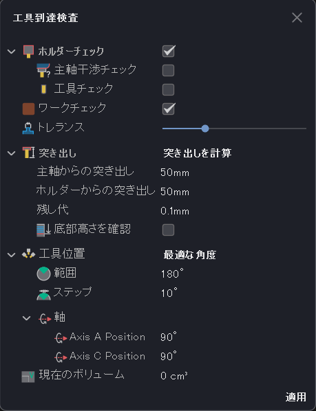
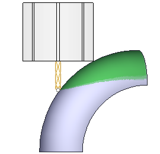
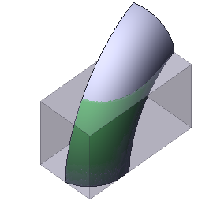
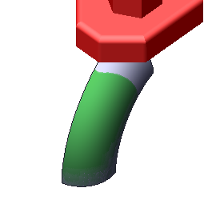
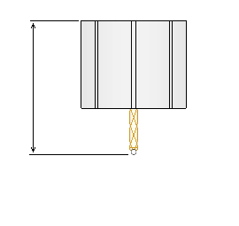

# ホルダー閉塞チェックユーティリティ

<strong>ホルダー閉塞チェック</strong>パネルでは、工具ホルダーが衝突しない部品の領域を表示し、部品加工に最適な角度を決定できます。

この機能は、部品製造時の技術プロセスの準備に役立ちます。

このウィンドウを表示するには、メインパネルの［コントロール］タブにある  ボタンをクリックします。

ウィンドウは視覚的に2つのエリアに分かれています。これらの内容は、特定のマシン構成によって異なる場合があります。

<strong>トップパネル</strong> には、工具ホルダーの安全領域サイズに影響する主な操作パラメータが表示されます。

- <strong>ホルダーチェック</strong>：ツールパスで工具ホルダーが部品と衝突するセグメントを検出し、指定された戦略に従ってそのセグメントを修正します。この機能は、工具ホルダーとワークの接触を避けるようにツールパスを調整することで衝突を防ぎ、複雑な領域でも安全で効率的な加工を実現します。

- <strong>ワークチェック：</strong>加工中の工具とワークの衝突を検出します。この機能を使用することで、特に複雑な形状の加工を行う場合に、ワークを傷つけることなく、工具が部品の必要な部分に安全にアクセスできるようになります。

- <strong>治具チェック：</strong>加工中の工具と治具の衝突の可能性をチェックします。この機能を使用することで、工具がクランプ、チャック、または他の治具と衝突するのを確実に避けることができます。

- <strong>突き出し：</strong>主軸から延びる工具ホルダーの長さを設定できます。適切な張り出し値を設定することは、工具ホルダーに十分なクリアランスを確保して衝突を回避し、たわみと工具振動を最小限に抑えて加工性能を最適化するために極めて重要です。

ウィンドウの下部にある <strong>回転軸</strong> パネルは、現在の機械軸の状態に関する情報を表示し、加工に最適な工具の角度を見つけるための機能を提供します。
