# オペレーションパラメータ

## 適用分野：

このタブには、パート、ワーク、治具、およびその他の項目を制御するための主要なパラメータが含まれており、これらの設定を変更することで工具経路を変更できます。

<em>以下にすべてのパラメータを示します。ただし、使用する加工オペレーションによっては、一部のパラメータのみが使用可能となります。</em>

### パーツチェック

ツールパスの計算時にパート形状を考慮します。これにより、パートへの食い込みのないツールパスが保証されます。ただし、形状が複雑な場合は、計算時間が長くなることがあります。

詳細を表示

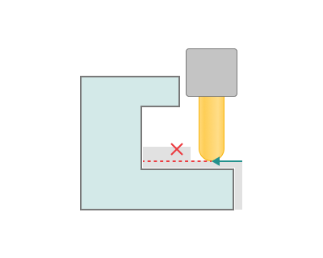

<strong>トレランス</strong> この機能では、「理想的なツールパス」と「近似されたツールパス」との間で許容される最大偏差を設定します。許容差を大きくすると、ツールパスの移動点数（ツールパスのセグメント数）が減少します。ツールパスの計算では、パート形状からの偏差が指定した許容差を超えないようにツールパスが生成されます。

<strong>トレランスを小さくすると、計算時間が長くなり、</strong> NCプログラムのサイズも大きくなることがあります。

<strong>トレランス</strong>は <strong>0 より大きい値</strong> に設定する必要があります。0 以下を設定すると、近似されたツールパスを生成することができません。

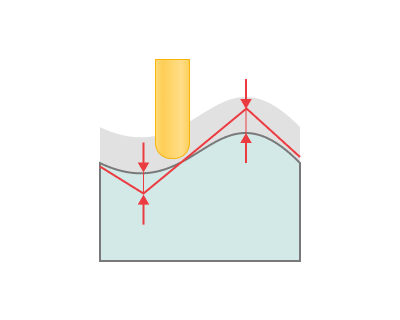

<strong>径方向残し代</strong> 工具の半径方向における加工代を設定します。この加工代は、後続の加工で除去されることを前提としています。

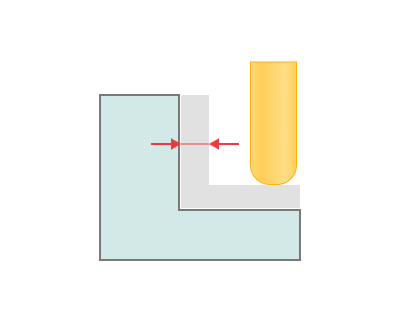

<strong>軸方向残し代</strong> 工具の軸方向における加工代を設定します。この加工代は、後続の加工で除去されることを前提としています。

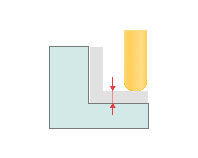

<strong>高速計算を使用</strong> より高速なアルゴリズムを使用してツールパスを計算します。生成されたツールパスの許容差が要求を満たさない場合は、このオプションを無効にしてください。 <strong>高速計算を使用</strong>を有効にすると、ツールパスの計算時間を大幅に短縮できます。複雑な形状では、計算速度が <strong>10～20倍</strong> 向上する場合があります。

現在、高速ツールパス計算では、入力データとして三角形メッシュ化されたサーフェスを使用しています。そのため、ツールパス生成時にはいくつかの制限事項を考慮する必要があります。まず、生成されるツールパスの品質は、従来の厳密な計算方法と比べて低下する場合があります。ツールパスの最大偏差は、加工パラメータダイアログの<strong>トレランス</strong>で設定した値に大きく依存します。この値は、モデルを三角形メッシュ化する際の許容差を決定します。また、三角形メッシュ化されたサーフェスは、多くのメモリを必要とします。

これらの制限は、現在では多くのCAMシステムに共通するものです。しかし、本CAMシステムでは、近似計算による高速性と厳密計算による高品質のいずれかを選択できる点が特長です。

<strong>新しい計算方法を使用</strong> 新しいアルゴリズムを使用して、高速なマルチコア計算を実行します。また、サーフェス法線ベクトルおよび側面角度を考慮することで、滑らかなツールパスを生成します。 [詳細を見る](100125.md)

<strong>ディスク径残し代</strong> 部品の壁面に加工代を残す量を設定します。これにより、後続の加工や仕上げ加工に必要な素材を確保できます。

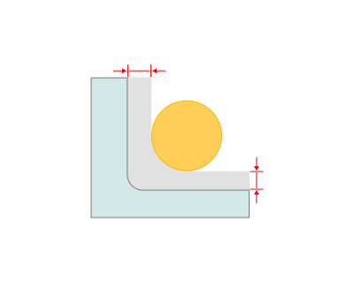

<strong>ディスク厚さ残し代</strong> ディスクの側面に接する部品の壁面に加工代を残すことができます。

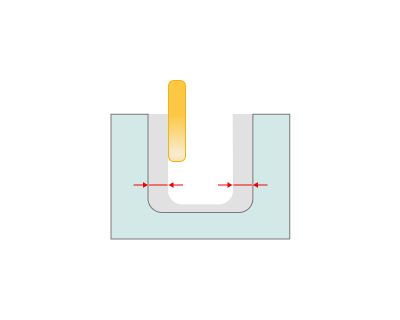

### 加工パスの補間

詳細を表示

<strong>自動</strong> 加工機の機能およびツールパスの種類に応じて、補間モードを自動的に選択します。

- 空間円弧に対応しており、ツールパスが5軸または6軸加工の場合は、「空間円弧」 が使用されます。
- 平面円弧（XY、YZ、ZX）のみに対応しており、ツールパスが3D加工の場合は、<strong>「</strong>平面円弧およびヘリックス<strong>」</strong> が使用されます。
- 円弧補間に対応していない場合は、「偏差ベース」 による分割が使用されます。

<strong>オフ</strong> ツールパスをそのまま使用します。補間は行いません。

<strong>偏差ベース</strong> 指定した直線偏差および角度偏差の範囲内で、直線セグメントを用いてツールパスを補間します。

詳細を表示

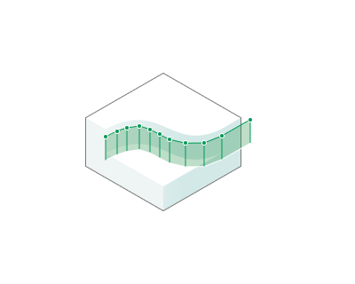

<strong>最大直線偏差</strong> 生成される直線セグメントが、元の空間軌跡からどの程度まで離れることができるかを設定します。値を小さくすると、より高精度に近似されます。値を大きくすると、近似は粗くなり、セグメント数が減少して計算速度は向上しますが、ツールパス形状に目立った誤差が生じる場合があります。

<strong>最大角度偏差</strong> 近似された隣接する直線セグメント間で許容される最大角度を設定します。値を小さくすると、曲率の大きい部分でより多くのセグメントが生成され、滑らかなツールパスになります。値を大きくすると、セグメント間の角度が大きくなり、より急な折れ曲がりが許容されます。

<strong>固定セグメント長</strong> ツールパスを一定長さのセグメントに分割します。滑らかな軌跡に適していますが、鋭いコーナーでは形状が切り取られる（丸められる）場合があります。

詳細を表示

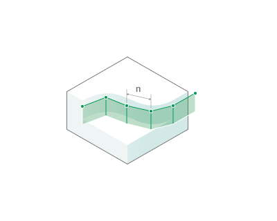

<strong>セグメント長</strong> 補間時に、元のツールパスを分割する直線セグメントの固定長を指定します。

<strong>平面円弧／ヘリックス</strong> XY、YZ、ZX の各平面上で、円コマンド（オペレーションに応じて使用）による円弧補間を行います。

詳細を表示

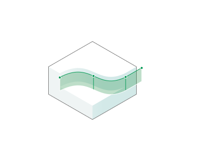

<strong>最大直線偏差</strong> 生成される直線セグメントが、元の空間軌跡からどの程度まで離れることができるかを設定します。値を小さくすると、より高精度に近似されます。値を大きくすると、近似は粗くなり、セグメント数が減少して計算速度は向上しますが、ツールパス形状に目立った誤差が生じる場合があります。

<strong>最大角度偏差</strong> 近似された隣接する直線セグメント間で許容される最大回転角度を設定します。値を小さくすると、曲率の大きい箇所でより多くのセグメントが生成され、滑らかなツールパスになります。値を大きくすると、セグメント間の角度が大きくなり、より急な方向変化が許容されます。

### リンク移動の補間

### 最大動作長さ

詳細を表示

<strong>有効:</strong> ツールパスの移動が、指定した長さを超えないように分割されます。軌跡をより短いセグメントに分割することで、特に高精度な工作機械において輪郭追従性が向上します。

<strong>無効:</strong>. ツールパスの移動は分割されません。

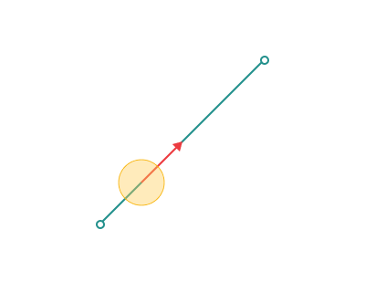 

### 最大動作回転

詳細を表示

<strong>有効:</strong> 工具の移動軌跡は、各セグメントの回転角度が指定した値を超えないように分割されます。計算されたセグメントの回転角度が最大動作回転の設定値を超える場合、CAMシステムは中間回転点を自動的に挿入します。

<strong>無効:</strong>. 工具の移動は分割されません。

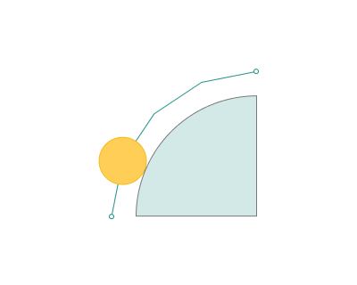 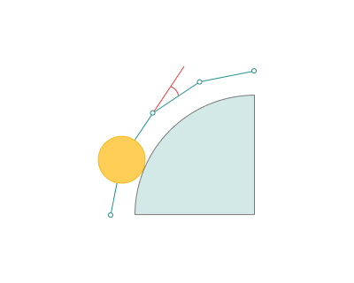

### ワークチェック

現在のオペレーションにおけるワークの計算方法を設定するためのパラメータグループです。

詳細を表示

.png) .png)

<strong>径方向厚さ無視</strong> <strong>パーツチェック</strong>グループの<strong>残し代</strong>とは異なり、このアルゴリズムでは前工程後のワーク形状を解析してツールパスを生成します。<strong>半径方向残り代</strong>が指定値未満となる領域では、ツールパスは生成されません。なお、このパラメータの値は、<strong>深さステップ</strong>および<strong>安全距離</strong>より小さく設定する必要があります。

最初のポケット加工で、<strong>半径方向残り代</strong>および<strong>軸方向残り代</strong>を 1 mm に設定し、工具径がポケットのコーナーR（フィレット半径）より大きい場合、残される加工代は均一になりません。直線壁面では加工代は 1 mm となりますが、コーナー部では 1 mm を超える加工代が残ります。

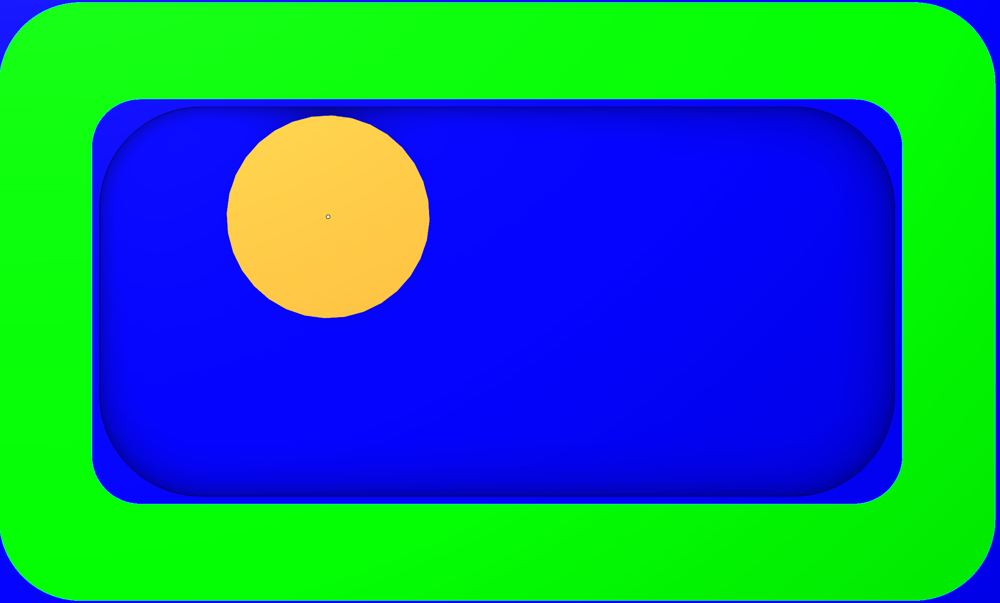

2回目の加工では、<strong>径方向厚さ無視</strong>および<strong>軸方向厚さ無視</strong>を 1.1 mm に設定できます。この状態で、工具径がポケットのコーナーR（フィレット半径）より小さい工具を使用すると、加工代が 1 mm を超えて残っているコーナー部のみが加工対象となります。

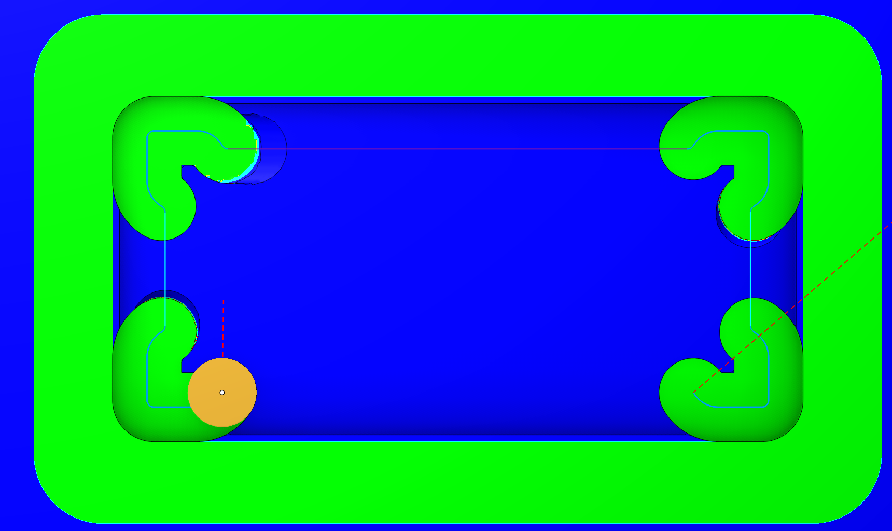

<strong>軸方向厚さ無視 パーツチェック</strong>グループの<strong>残り代</strong>とは異なり、このアルゴリズムでは前工程後のワーク形状を解析してツールパスを生成します。<strong>軸方向残り代</strong>が指定値未満となる領域では、ツールパスは生成されません。なお、このパラメータの値は、<strong>深さステップ</strong>および<strong>安全距離</strong>より小さく設定する必要があります。

<strong>ツールパス延長</strong> 切削がワークの端部より手前から開始されるように、ツールパスを延長します。この機能は主に、<strong>ウォーターライン仕上げ</strong>および<strong>平面仕上げ加工</strong>で使用されます。<strong>ワークチェック</strong>オプションが有効で、ワーク形状に基づいてツールパスが制限されている場合に適用されます。

このパラメータは、<strong>リンク/リード</strong>タブの<strong>安全距離</strong>設定と同様の機能です<strong>。</strong>[詳細を見る](100139.md)

<strong>安全距離</strong>では切削開始点から接線方向にアプローチ経路を延長するのに対し、<strong>ツールパス延長</strong>ではワークの輪郭に沿ってツールパスを延長する点です。

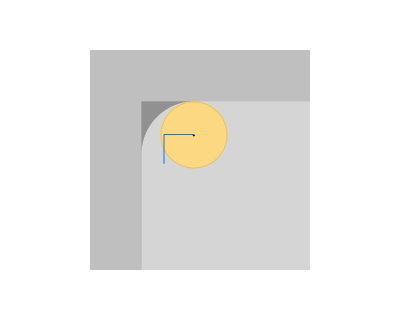 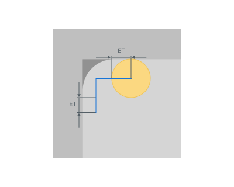

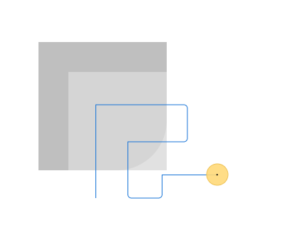 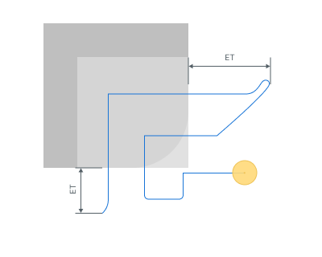

<strong>ET</strong> - ツールパス延長

<strong>理論上の無視厚さ</strong> このオペレーションでは、計算に仮想ワークを使用します。この仮想ワークには、前工程で工具が到達できなかった領域が含まれます。前工程で生成された実際のツールパスは考慮されず、使用した工具形状のみが計算に使用されます。

詳細を表示

<strong>工具径に基づく</strong> 指定した工具径を使用して、仮想ワークを計算します。

<strong>コーナーRを考慮</strong> トロイダル工具またはボールエンドミルを考慮して、仮想ワークを計算します。

<strong>モデル解像度</strong>

### 治具チェック

ツールパスの生成時には、治具は衝突を防ぐための進入禁止領域として扱われます。

詳細を表示

.png) .png)

### ウィービング

メカニカルウィービングは、例えば、公差の補正や継ぎ目（シーム）の隙間を埋めるために使用されます。この場合、トーチは継ぎ目を横切るように移動し、継ぎ目に沿った移動にウィービング（往復振動）動作が重ね合わせられます。また、溶接面（溶接方向）に対してトーチを回転させることも可能です。なお、この機能は研磨加工にも使用できます。 [詳細を見る](100114.md)

### フィーチャー

<strong>フィーチャー認識</strong>で生成されるツールパスの出力方法を設定します。 [詳細を見る](100152.md)

詳細を表示

<strong>サイクルフォーマット</strong>

<strong>なし</strong> 単純なNCコマンドのみを出力します（固定サイクルや認識されたフィーチャは出力されません）。

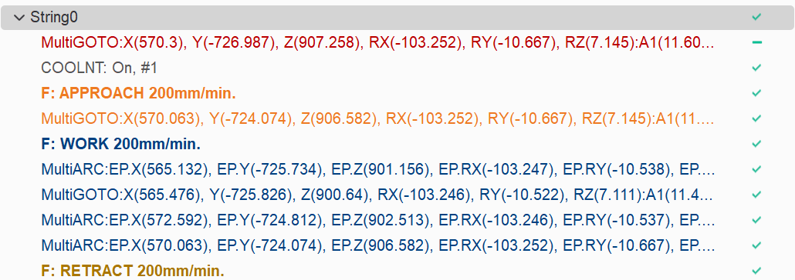

<strong>内部移動なし (EXTCYCLEのみ)</strong> 固定サイクルを使用して出力し、認識された加工フィーチャを識別します。内部の移動経路は出力されず、<strong>EXTCYCLE</strong> コマンドのみが出力されます。

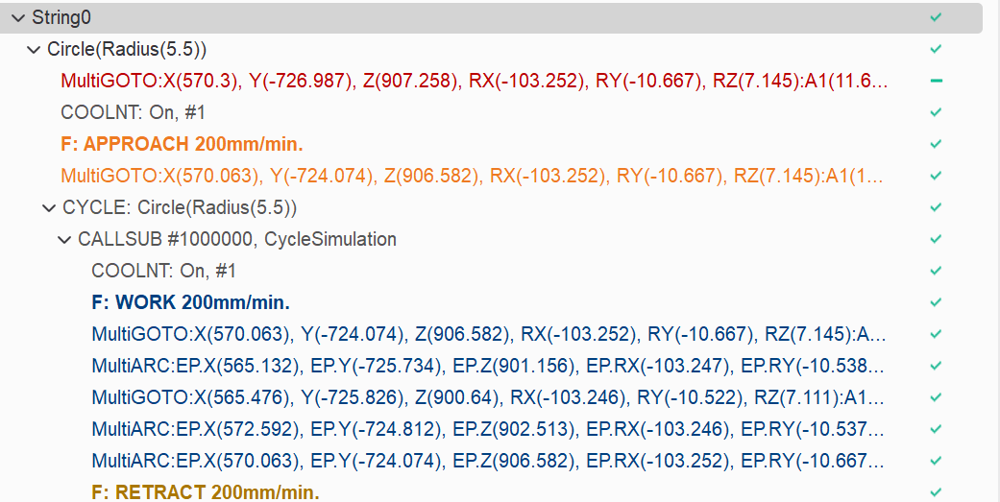

<strong>内部移動あり</strong> 認識された加工フィーチャ情報を含む、単純なNCコマンドを出力します。内部の移動経路もあわせて出力されます。

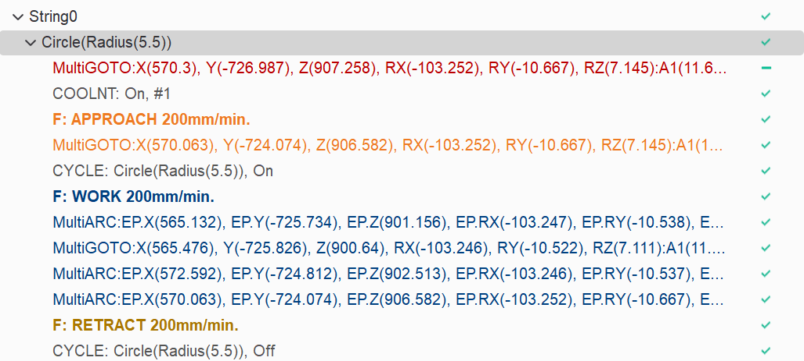

<strong>Start and end at center。</strong> ツールパスをフィーチャの中心で開始し、終了します。無効にした場合は、壁面のエッジから切削を開始します。

 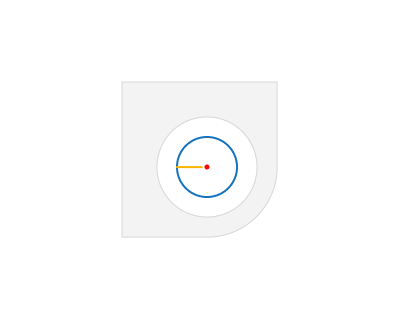

### ホルダーチェック

工具ホルダーがパーツと干渉するツールパス区間を検出し、指定した加工設定に従ってその区間のツールパスを修正します。 [詳細を見る](11211.md)

### プランジ荒加工

現在のツールパスに基づいて、プランジ加工パスを生成します。 [詳細を見る](10122.md)

### アドバンス

詳細を表示

<strong>小さなギャップ距離</strong> アンダーカット検査後に生じた小さな隙間を結合します。

<strong>裏面</strong> サーフェス法線を反転します。

### シミュレーション

現在の加工操作のシミュレーションオプションを設定するためのパラメータグループです。

詳細を表示

<strong>食込みの確認。</strong>

<strong>有効:</strong> このオペレーションのツールパスがワークに食い込んだ場合、食い込みが発生している動作が赤色で強調表示されます。

<strong>無効:</strong> このオペレーションのツールパスがワークに食い込んだ場合でも、食い込みが発生している動作は強調表示されません。

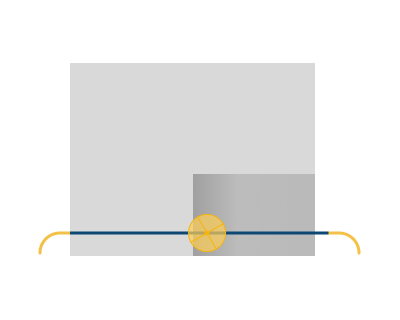 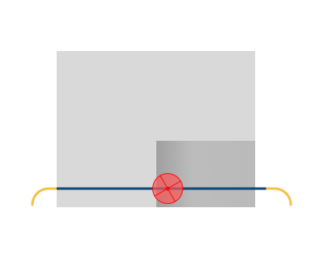

<strong>シミュレーションの種類。</strong>

<strong>自動</strong> 選択した加工操作の種類に応じて、シミュレーションタイプが自動的に設定されます。

<strong>除去</strong> 素材を除去することでモデリングを行います。

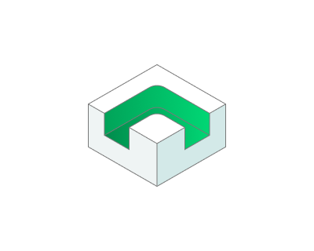

<strong>アディティブ</strong> 工具高さまで素材を追加することでモデリングを行います。

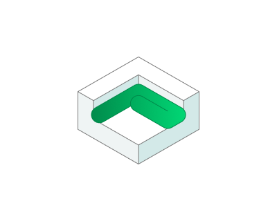

<strong>ペインティング</strong> 素材を層ごとに積み重ねることでモデリングを行います。 [詳細を見る](10330.md)

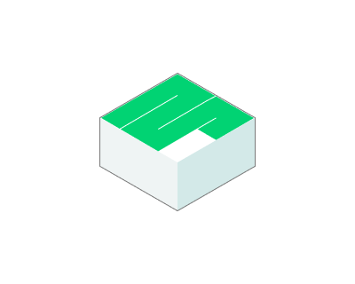

<strong>エフェクター送り速度</strong> 送り条件に基づいた溶接肉盛りプロセスをモデリングできます。

<strong>早送りなし</strong> 現在の送りタイプが「早送り」でない場合、素材が追加されます。

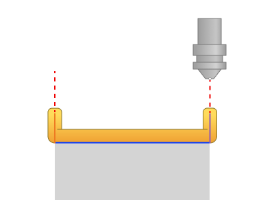

<strong>ワーク送りのみ</strong> 現在の送りタイプが 「ワーク送り」、「仕上げパス」、または 「最初のパス」 の場合に、素材が追加されます。

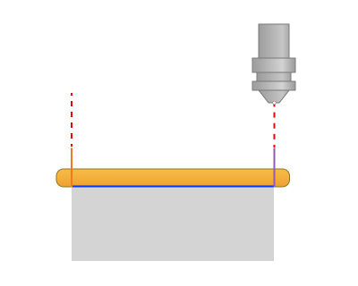

<strong>ワーク送り、退避、切り込み</strong> 現在の送りタイプが「ワーク送り」、「退避」、または 「切込み」 の場合に、素材が追加されます。

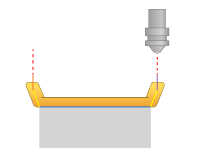

(<strong>ワーク送り、切込み送り、退避送り、ショートリンク送り。ロングリンク送り、仕上げ送り、 最初の送り、アプローチ送り、リターン送り、プランジ送り</strong>)

<strong>ペインティングタイプ</strong> 塗装プロセスのモデリング方法を指定します。 [詳細を見る](10330.md)

<strong>厚さ測定</strong> この塗装シミュレーションでは、塗装される領域だけでなく、塗膜の推定厚さも表示されます。塗装後の塗膜厚さを確認するには、シミュレーション画面上部のツールバーで<strong>ベリファイ比較</strong>を有効にしてください。

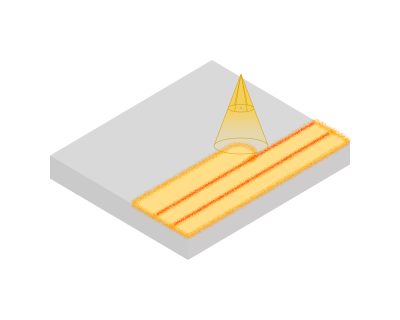

<strong>塗料流量</strong> 塗料流量は、均一で高品質な塗装を実現するために必要です。

<strong>シンプル</strong> この塗装シミュレーションでは、モデルのどの領域が塗装されるかを表示します。

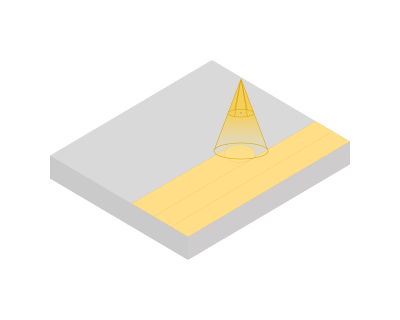

<strong>チップを削除</strong>

オペレーションのシミュレーション終了時に、切りくずが自動的に削除されます。

<strong>無効</strong> チップ削除を無効にします。

.png) .png)

<strong>プランジチェック</strong> シミュレーションで、不適切な工具の下降動作（プランジ）をチェックします。

<strong>許容ランプ角度</strong> ツールパスのランプ角度がこの値を超える場合、シミュレーションで該当するツールパスがエラー表示されます。

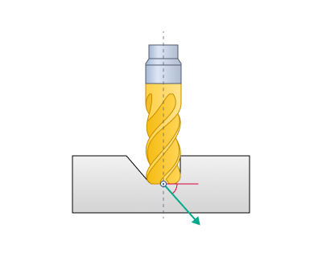

<strong>軸方向プランジを許可</strong> 工具が材料内へ垂直に下降する距離がこの値を超える場合、ツールパスにエラーマークが表示されます。

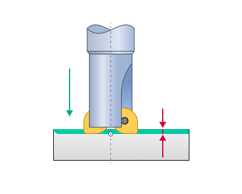

### トレランス

この機能では、「理想的なツールパス」と「近似されたツールパス」の間で許容される最大偏差を設定します。許容差を大きくすると、ツールパスの移動数が減少します。

### 工具の向き優先

旋削加工では、ワークの回転軸に対する切削工具の基準位置を定義します。

詳細を表示

<strong>未設定</strong> 工具の向きは、ワークの回転軸に対して固定されません。工具の向きは、ユーザーが指定するか、ワーク形状および実行するオペレーションの種類に基づいて自動的に決定されます。

<strong>外径</strong> 工具は外径側から半径方向に配置されます。工具は回転軸に対して垂直な方向からワークの側面へアプローチし、外径加工を行います。

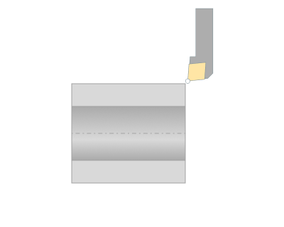

<strong>内径</strong> 工具は内径側から半径方向に配置されます。工具は穴内部へ進入し、内径面を加工します。

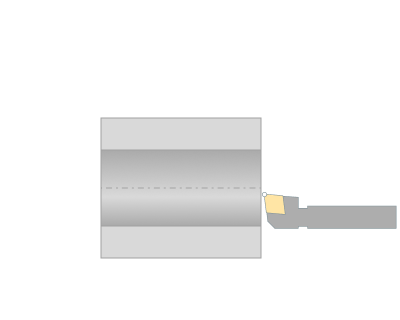

<strong>軸方向</strong> 工具は回転軸（Z軸）方向に配置され、送り方向はワーク軸と平行になります。

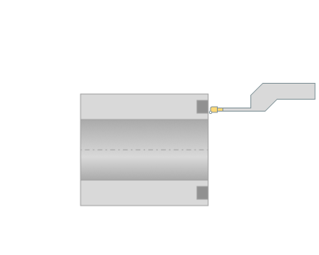

### 最小レイヤー時間

このパラメータグループでは、1つのレイヤーを造形する際の最小許容時間（秒）を設定できます。 [詳細を見る](100113.md)

### 押出量

このオプションでは、レイヤー高さに応じて押出機の速度を調整し、押出量（材料供給量）パラメータを変更します。 [詳細を見る](202012.md)
