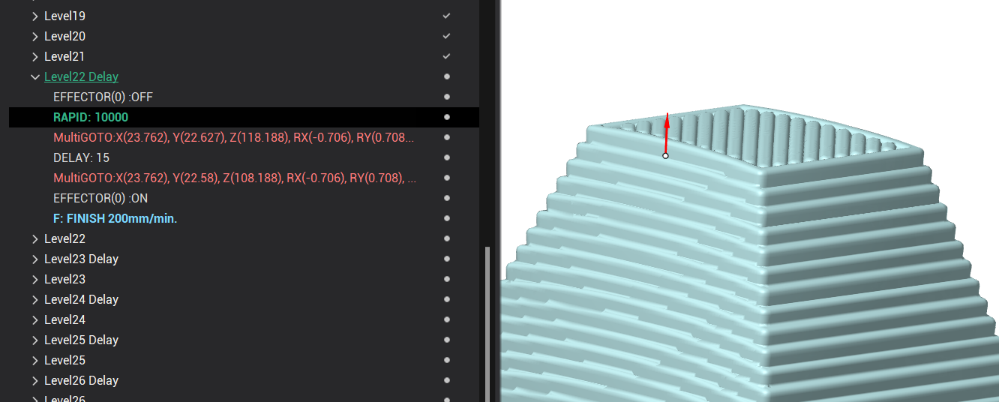

# レイヤー時間

このページでは、アディティブ加工（積層造形）において、1層あたりの造形時間を制御するためのパラメータについて説明します。「最小レイヤー時間」 を使用すると、造形時間の短いレイヤーでも、次のレイヤーを造形する前に十分な冷却時間を確保できます。一方、「最大レイヤー時間」 を使用すると、1層の造形時間が長くなりすぎることを防ぎ、次のレイヤーの造形開始前に材料が過度に冷えてしまうことで発生するコールドジョイント（層間接合不良）を防止できます。これら2つの設定グループは、それぞれ単独で使用することも、組み合わせて使用することも可能です。

> Note
>
> これらのパラメータは、「積層造形」オペレーションの「パラメータ」ページ内にあるレイヤー時間グループで設定できます。

## 最小レイヤー時間

.png) -1.png)

### 説明

このパラメータグループでは、1 層の造形に対して許容される最小時間（秒単位）を設定できます。積層造形が指定時間より速い場合、設定された時間に達するまで、オペレーションは一時停止されます。また、"リフトヘッド "や "最小送り "などの追加パラメータを使用することも可能です。

.png) -1.png)

<strong>DW -</strong> ドウェル

### リフトヘッド:

このパラメータを使用すると、待機時間中にエクストルーダーを指定した距離だけ追加で退避させることができます。

).png) ).png)

<strong>DW -</strong> ドウェル

<strong>LH</strong> - リフトヘッド

### 最小送り速度：

このパラメータは、送り速度を低減して層の積層する時間を延ばし、「遅延」 コマンドの挿入を回避するために使用します。最小送り速度値は、送り速度の最小値を定義します。すべての送り速度がこの最小値まで低減されても、レイヤーの造形時間が依然として最小層時間を下回る場合、「遅延」コマンドが挿入されます。

).png) ).png)

> 例
>
> >
> 仮に、最小レイヤー時間が100秒で、実際のレイヤー時間が75秒、送り速度が180 mm/分（3 mm/秒）だったとします。このパラメータがオフの場合、25秒の遅延が挿入されます。ただし、このパラメータを100 mm/分に設定すると、送り速度は135 mm/分（2.25mm/秒）に低下します。その結果、層時間は100秒になり、遅延は挿入されません。

> 注意
>
> >
> システムは「早送り」の送り速度を減速しません。さらに、もし「安全サーフェスからのアプローチ送り」、「安全サーフェスへのリターン送り」、「安全サーフェス上の移動送り」が「早送り」に設定されている場合、それらも減速されません。

<strong>結果：</strong>

結果は「シミュレーション」ページで見ることができます。遅延コマンドと追加コマンドは、CLDATA内の別のグループとして追加され、このグループは次の層を造形する前に挿入されます。

「… Delay」(遅延)という名前が追加されたこのグループの中では、「エフェクタオフ（Effector off）」コマンド、退避（retract）コマンド、遅延DELAYコマンド、アプローチ（approach）コマンド、そして「エフェクタオン（Effector on）」コマンドが確認できます。

DELAYコマンドには秒単位の時間値が挿入されます。この時間値は、最小層時間と現在の層時間の差に相当します。つまり、遅延時間とは、最小層時間に達するまで待つ必要がある時間のことです。

> 注意
>
> リフトヘッドパラメータがオフの場合、退避コマンドとアプローチコマンドは挿入されません。
>
> 「最小送り速度」パラメータを使用すると、このツリー内で送り速度が低下した値が確認でき、場合によっては遅延が不要になることもあります。

## 最大レイヤー時間

### 説明:

このパラメータグループでは、1レイヤーの積層に許可される最大時間（秒）を設定できます。レイヤーを積層する時間がこの設定値を超える場合は、制限時間内に収まるよう、加工送り速度が指定した「最大送り速度」まで自動的に引き上げられます。それでも「最大送り速度」では制限時間内に収めることができない場合は、そのまま処理が続行され、CLDataツリー内の該当レイヤーに警告が追加されます。

### 最大送り速度:

このパラメータは、レイヤーを積層する時間を許容される最大時間内に収めるために使用する送り速度の上限を設定します。レイヤー内の加工送り速度は自動的に引き上げられますが、この値を超えることはありません。なお、このパラメータには「最小送り速度」のような有効／無効の切り替えはなく<strong>、</strong>「最大レイヤー時間」が有効になっている間は常に適用されます。

> 例
>
> >
> 例えば、最大レイヤー時間を10秒に設定し、実際の積層する時間が20秒、加工送り速度が180 mm/分（3 mm/秒）であるとします。このとき、「最大送り速度」を360 mm/分（6 mm/秒）に設定すると、レイヤー内のすべての加工送り速度は2倍に引き上げられます。その結果、レイヤーを積層する時間は10秒となり、設定した最大レイヤー時間内に収まります。

> Note
>
> >
> システムは早送り速度を増加させることはありません。また、安全サーフェスからのアプローチ送り速度、安全サーフェスへの戻り送り速度、および安全サーフェス上の移動送り速度が早送りに設定されている場合も、それらの送り速度は増加しません。

### 結果

結果は「シミュレーション」ページで確認できます。CLDATAツリーでは、対象レイヤーの加工送り速度が、レイヤーを積層する時間を許容される最大時間内に収めるために計算された、より高い送り速度の値に置き換えられます。

それでも最大送り速度では制限時間内に収めることができない場合は、CLDATAツリー内の対象レイヤーの近くに追加の項目が表示され、実際の経過時間と設定した制限時間が示されます。例えば、「MaxTimeExceeded: 117>100sec」は、レイヤーの積層する時間が117秒となり、設定した上限の100秒を超えたことを意味します。また、操作ログにも警告が表示されます。積層造形は停止せず、レイヤーは可能な限り最大の送り速度で印刷が続行されます。
