# ウィービング

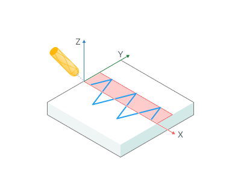

## 適用分野：

機械的ウィービングは、例えば公差の補正や縫い目の隙間を埋めるために使用されます。この場合、トーチは縫い目に沿って移動し、ウィービングの振動が縫い目の動きに重ね合わされることになります。また、 <strong>溶接</strong>の平面（溶接方向）に対してトーチを回転させることも可能です。<strong>研磨</strong>にも使用できます。

## ウィービング

<strong>NCコード形式</strong>

軌跡の出力方法を定義します。

拡大

<strong>ロングハング</strong> 軌道はパラメータに従って変換されて出力されます。

<strong>固定サイクル</strong> 軌跡は、加工順序から線として出力されます。各セクションの開始時にはサイクル開始コマンドが、終了時にはサイクル終了コマンドが出力されます。これが機能するためには、ポストプロセッサーに対応するコマンドを登録する必要があります。

<strong>パターン</strong> ウィービングの種類を定義するパターン

拡大

<strong>三角</strong> 溶接トーチの1方向への偏向を三角形とします。

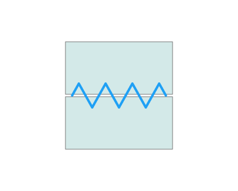

<strong>台形</strong> 二重周波数による溶接トーチの一方向への偏向

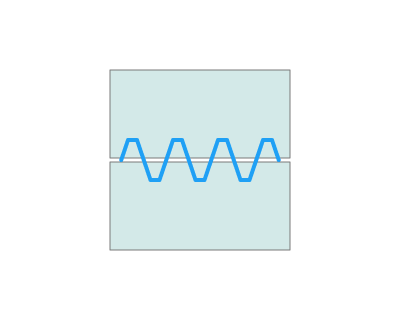

<strong>非対称台形</strong> ロボットサイクルで動作します。

<strong>渦巻き</strong> 溶接トーチの2方向へのたわみ（振幅＝ウィーブ長さ/2）

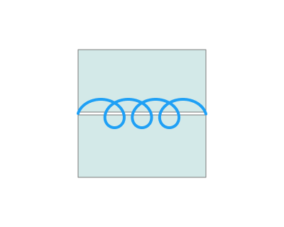

<strong>ダブル8字形</strong> 8の字形のウィービングパターン

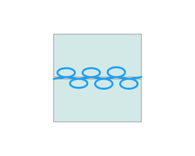

<strong>シーム上</strong> ロボットサイクルで動作します。

<strong>エッジ底部</strong> ロボットサイクルで動作します。

<strong>エッジ上部</strong> ロボットサイクルで動作します。

<strong>カーブ形状</strong> 曲線状のジグザグツールパス（円弧）を作成します。

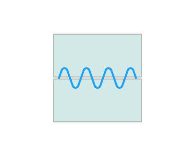

<strong>三日月形</strong> 三日月形のテンプレートを生成します。

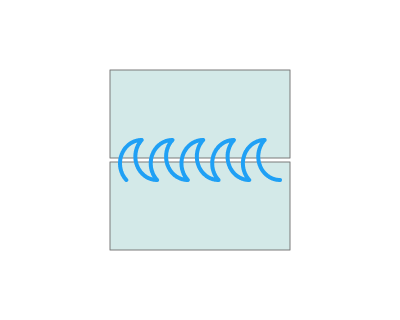

<strong>ウィーブ長さ</strong> 振動ステップ

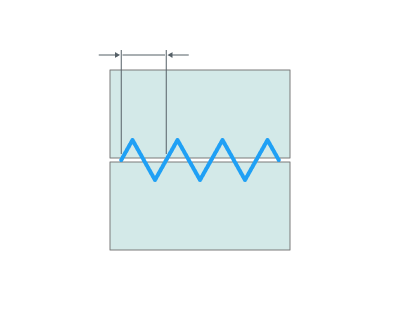

<strong>振幅</strong> 波上の点の平衡位置からの最大変位

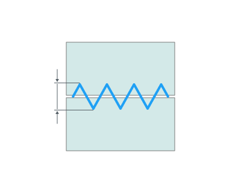

<strong>ウィーブ平面</strong> ウィービングが決定される平面

拡大

<strong>工具軸</strong> 平面の法線ベクトルは <strong>工具ベクトルに対応します</strong>。

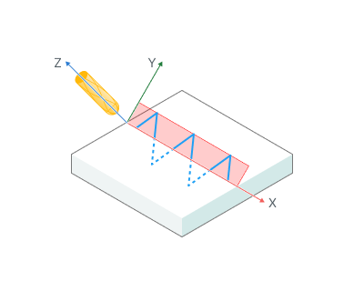

<strong>サーフェスに垂直</strong> 平面の法線ベクトルは<strong>面のベクトルに対応します。5D曲線では動作しません。</strong>

<strong>平面角度</strong> 平面の追加回転角度を定義します。

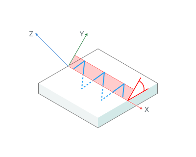

<strong>半径</strong> 三日月形の半径

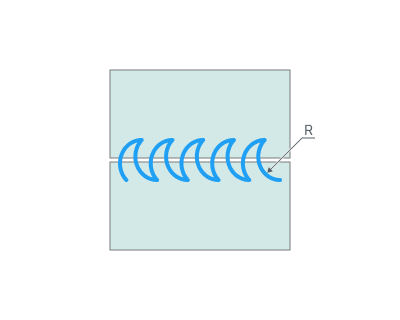

<strong>カーブ上に投影 有効な場合</strong>：軌跡のすべての曲線に沿います。

<strong>無効の場合：</strong>振動は、振動の長さと等しい直線セグメント上に構築されます。

