# Oscillazione

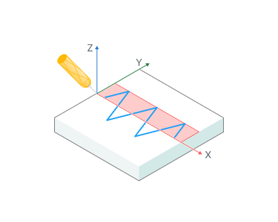

## Ambito di applicazione:

L'oscillazione meccanica (saldatura pendolata) viene utilizzata, ad esempio, per compensare le tolleranze o per colmare le luci in un giunto. In questo caso la torcia si muove trasversalmente al giunto e l'oscillazione si sovrappone quindi al movimento lungo il giunto. È anche possibile ruotare la torcia rispetto al piano della <strong>saldatura</strong> (direzione di saldatura). Può essere utilizzata anche per la <strong>lucidatura.</strong>

## Oscillazione.

<strong>NC Code Format.</strong> (formato del codice NC)

Definisce il modo in cui viene emesso il percorso utensile.

Fare clic qui per espandere..

<strong>Long Hang.</strong> Il percorso utensile viene emesso con la trasformazione definita dai parametri.

<strong>Canned Cycle.</strong> (ciclo fisso) Il percorso utensile viene emesso come linee dell'assegnazione del lavoro. All'inizio di ogni tratto viene emesso il comando di avvio del ciclo e alla fine il comando di fine ciclo. Affinché ciò funzioni, è necessario registrare i comandi corrispondenti nel postprocessore.

<strong>Pattern.</strong> (schema) Schema che definisce il tipo di oscillazione.

Fare clic qui per espandere..

<strong>Triangle.</strong> (triangolo) Deviazione della torcia di saldatura in 1 direzione a forma di triangolo.

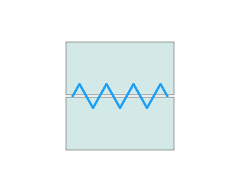

<strong>Trapezoid.</strong> (trapezio) Deviazione della torcia di saldatura in 1 direzione con doppia frequenza.

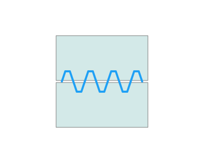

<strong>Unsymetric Trapecoid.</strong> (trapezio asimmetrico) Funziona con i cicli del robot.

<strong>Spiral.</strong> (spirale) Deviazione della torcia di saldatura in 2 direzioni (ampiezza = lunghezza di oscillazione/2).

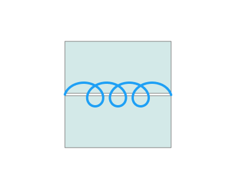

<strong>Double 8.</strong> (doppio 8) Oscillazione a forma di otto.

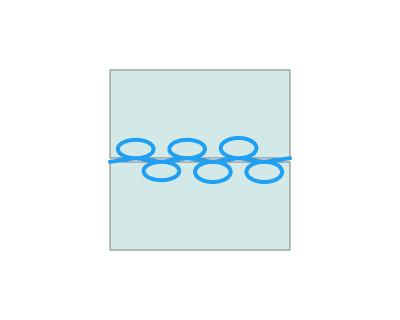

<strong>On Seam.</strong> (sul giunto) Funziona con i cicli del robot

<strong>Edge Bottom.</strong> (bordo inferiore) Funziona con i cicli del robot

<strong>Edge Top.</strong> (bordo superiore) Funziona con i cicli del robot

<strong>Curvy.</strong> (curvilineo) Crea sul pezzo un percorso utensile a zigzag curvilineo (con archi).

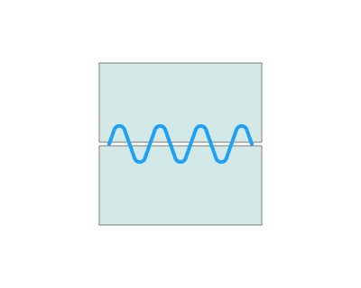

<strong>Crescent.</strong> (mezzaluna) Genera uno schema a forma di mezzaluna.

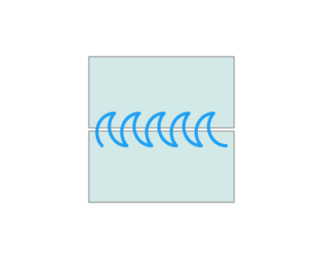

<strong>Weave length.</strong> (lunghezza di oscillazione) Passo dell'oscillazione

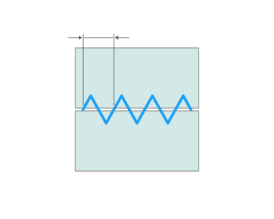

<strong>Amplitude.</strong> (ampiezza) Spostamento massimo di un punto dell'onda dalla sua posizione di equilibrio.

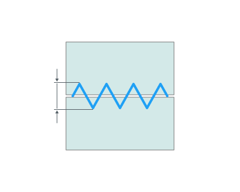

<strong>Weave plane.</strong> (piano di oscillazione) Piano nel quale viene definita l'oscillazione.

Fare clic qui per espandere..

<strong>Tool axis.</strong> (asse utensile) Il vettore normale del piano corrisponde al <strong>vettore dell'utensile.</strong>

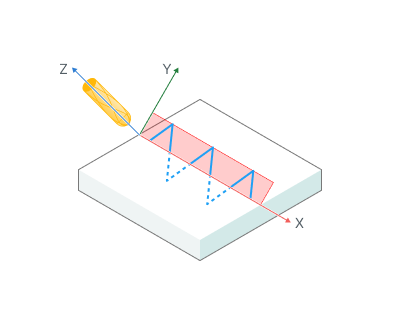

<strong>Normal to surface.</strong> (normale alla superficie) Il vettore normale del piano corrisponde al <strong>vettore delle superfici. Non funziona con 5d Curve</strong>

<strong>Plane angle.</strong> (angolo del piano) Definisce un angolo di rotazione aggiuntivo del piano

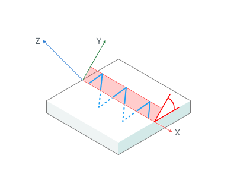

<strong>Radius.</strong> (raggio) Raggio per lo schema a mezzaluna.

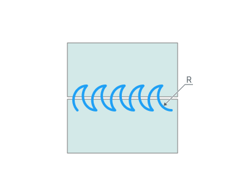

<strong>Project Onto Curve. <strong>Se attivato:</strong></strong> (proietta sulla curva) Segue tutte le curve del percorso utensile

.png)

<strong>Se disattivato:</strong> le oscillazioni vengono costruite su segmenti rettilinei di lunghezza pari alla lunghezza dell'oscillazione.

.png)
