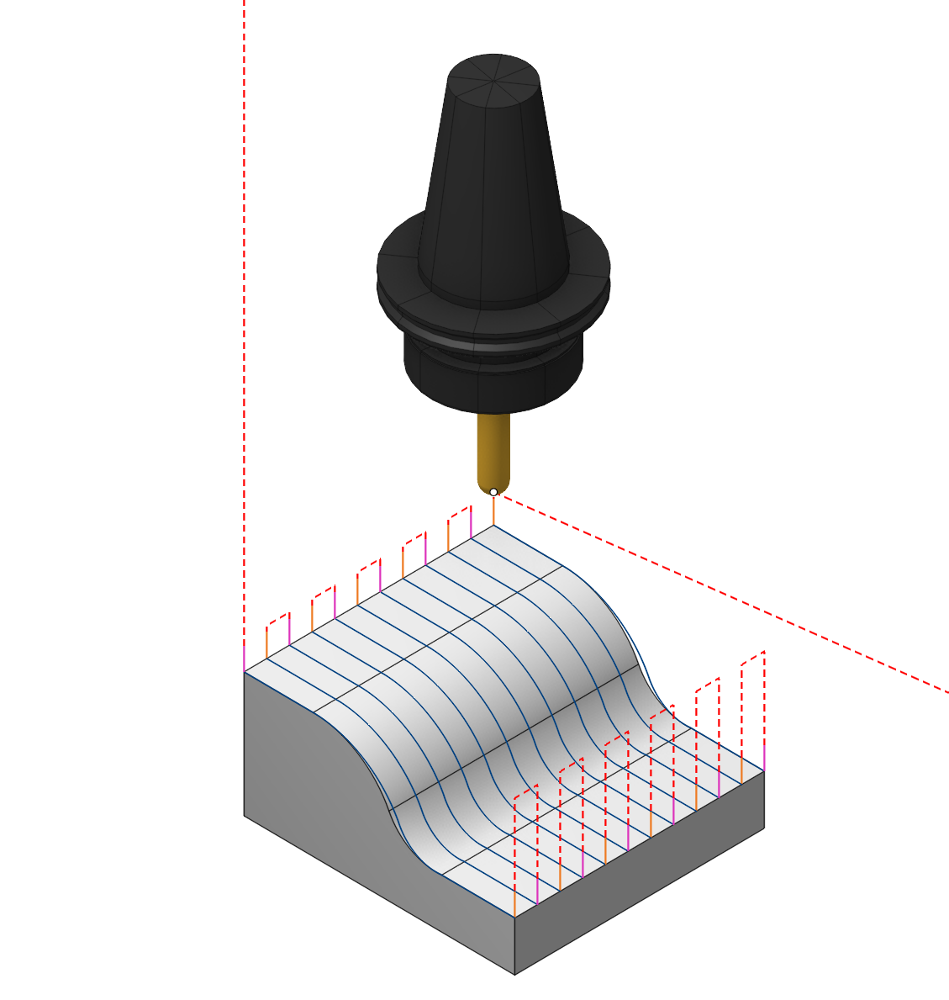

# Ligações e entradas/saídas

## Área de aplicação:

Na aba <strong>Links/Leads</strong>, você define os parâmetros dos movimentos rápidos. Esses movimentos incluem aproximação da ferramenta a partir da posição de troca de ferramenta, engate até o início do curso de trabalho, retração após o movimento de corte final, transições entre passadas de trabalho e retorno ao ponto de troca de ferramenta. Você pode configurar a sequência de movimentos ao longo das coordenadas, a trajetória desses movimentos e a magnitude dos deslocamentos.

Normalmente, os percursos dos movimentos sem corte (movimentos em vazio) consistem em:

- <strong>Aproximação</strong> significa o caminho que a ferramenta percorre para chegar ao primeiro ponto de um movimento de engate ou mergulho a partir de uma posição de troca de ferramenta ou da última posição da operação anterior.
- <strong>Lead In (Engage)</strong> envolve uma série de movimentos da ferramenta que facilitam uma transição suave para o ponto inicial do curso de trabalho.
- <strong>Transitions</strong> são os trechos do percurso da ferramenta entre as passadas de trabalho.
- <strong>Lead Out (Retract)</strong> descreve uma sequência de movimentos da ferramenta que permite sua saída suave do último ponto do percurso de trabalho até uma superfície segura ou até uma distância segura.
- <strong>Return</strong> envolve uma série de movimentos de ferramenta que fazem a transição da ferramenta do ponto de saída da última operação para o ponto de troca de ferramenta através de um plano seguro.()
