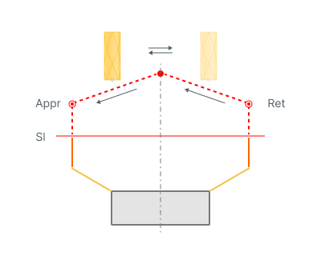
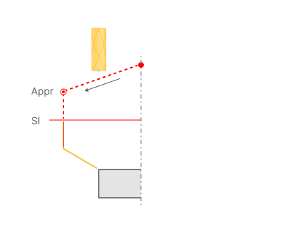
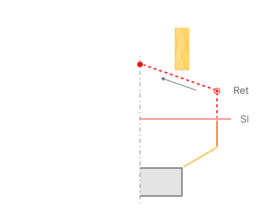
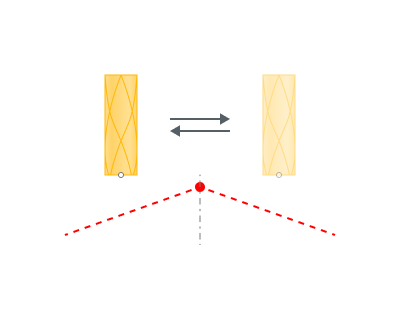

# アプローチ/リターン

<strong>Appr -</strong> アプローチ

<strong>Ret -</strong> リターン

<strong>Sl -</strong> 安全高さ

## 適用分野：

このパラメータグループは、工具交換位置から切込み開始パスへの工具の移動、そして戻りの動作を管理します。

## アプローチ

このアプローチでは、工具交換位置から、または前のオペレーションの最終位置から、最初の加工パスの切り込み、または進入点への移動を容易にするツールパスのセクションを記述します。[詳細を見る](https://confluence.encycam.com/pages/viewpage.action?pageId=153783665)

通常、アプローチは2つの動きに分かれます。

1. 安全サーフェス(<strong>安全高さ</strong>）、安全な距離、ままたは指定高さまでの空移動です。<strong>安全動作</strong> グループで安全サーフェスとその位置を指定し、5軸オペレーションの場合は<strong>リンク</strong>グループを使用します。アプローチ中に複数の軌道セグメントを作成できます。軌道を形成する方法には、次のようなものがあります。`ショート`、`衝突を回避`、`カスタム,`、`前／ルート／サブマシンからのルール`[詳細を見る](https://confluence.encycam.com/display/SC1/.Approach+return+rules+v19.1)
2. 機械のZ軸（3Dフライス加工の場合）または工具軸（5Dフライス加工の場合）に沿って、最初の加工パスの送り距離まで加速送り速度で移動します。 <strong>リンク</strong>と<strong>距離</strong> グループで最終的なアプローチ目標と対応する距離の値を指定します。

<strong>Appr -</strong> アプローチ

<strong>Sl -</strong> 安全高さ

## リターン：

リターンとは、最終作業行程の出発点から、安全サーフェスまたは安全距離を通過して、工具の交換点までの工具の移行を促進する一連の工具の動きを表す。[詳細を見る](https://confluence.encycam.com/display/SC1/.Return+v20)

通常、リターンは2つの動きに分かれます。

1. 最後の作業行程の引き込み点から、加速送りで機械のZ軸に沿って安全サーフェス、安全距離、送り切替高さ、または指定された高さまで移動します。 引き込みの形成原理は、アプローチの場合と同じです。
2. 工具交換位置へ空移動します。

<strong>Ret -</strong> リターン

<strong>Sl -</strong> 安全高さ

## 工具交換位置

工具交換ポイントは、工具交換が行われる機械位置です。CAM システムでは、技術プロセス全体または個別の作業に対して、工具交換位置を定義することができます。[詳細を見る](10067.md)

