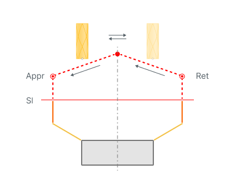
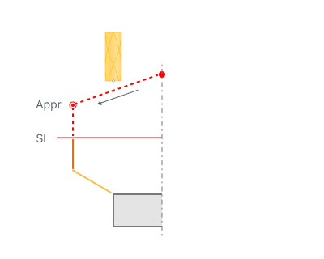
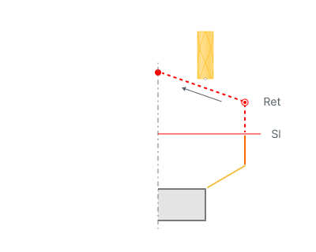

# Aproximação/Retorno

<strong>Appr -</strong> Aproximação

<strong>Ret -</strong> Retorno

<strong>Sl -</strong> Nível seguro

## Área de aplicação:

Este grupo de parâmetros controla os movimentos da ferramenta desde a posição de troca de ferramenta até o início dos percursos de entrada e de volta.

## Aproximação:

A aproximação é o trecho do percurso da ferramenta que leva a ferramenta, a partir da posição de troca de ferramenta ou da última posição da operação anterior, até o ponto de entrada ou de lead-in da primeira passada de trabalho.

Normalmente, a aproximação é dividida em dois movimentos:

1. Movimento em vazio até uma superfície segura (<strong>nível seguro</strong>), uma distância segura ou um nível definido. Especifique a superfície segura e sua posição no grupo <strong>Safe Motions</strong> e, nas operações de cinco eixos, no grupo <strong>Links</strong>. Durante a aproximação, é possível criar vários segmentos de trajetória. Os métodos de formação da trajetória incluem: **Short**, **Avoid Collisions**, `Custom,` e `Rule from Previous/Root/Submachines`. [Detalhes.](10071.md)
2. Movimento em avanço acelerado até a distância de avanço de trabalho da primeira passada de trabalho, ao longo do eixo Z da máquina (nas operações de fresamento 3D) ou ao longo do eixo da ferramenta (nas operações de fresamento 5D). Especifique o destino final da aproximação e os valores de distância correspondentes nos grupos <strong>Links</strong> e <strong>Distances</strong>.

<strong>Appr -</strong> Aproximação

<strong>Sl -</strong> Nível seguro

## Retorno:

O retorno é a sequência de movimentos da ferramenta que a leva do ponto de saída da última passada de trabalho até o ponto de troca de ferramenta, passando por uma superfície segura ou por uma distância segura.

Normalmente, o retorno é dividido em dois movimentos:

1. Movimento em avanço acelerado a partir do ponto de recuo da última passada de trabalho, ao longo do eixo Z da máquina, até uma superfície segura, uma distância segura, o nível de mudança de avanço ou um nível definido. O princípio de formação do recuo é o mesmo da aproximação.
2. Movimento em vazio até a posição de troca de ferramenta.

<strong>Ret -</strong> Retorno

<strong>Sl -</strong> Nível seguro

## Posição de troca de ferramenta:

O ponto de troca de ferramenta é a posição da máquina em que ocorre a troca de ferramenta. No sistema CAM, é possível definir a posição de troca de ferramenta para todo o processo tecnológico ou para operações individuais. [Detalhes.](10067.md)

