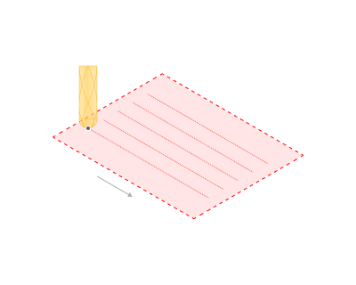
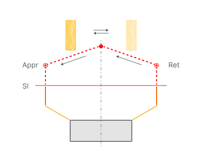
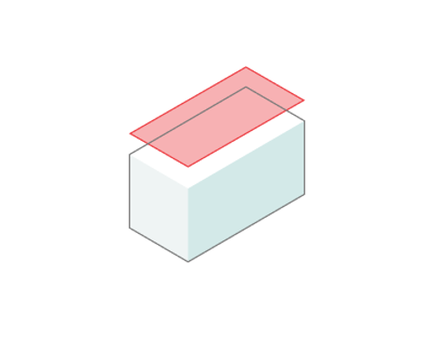
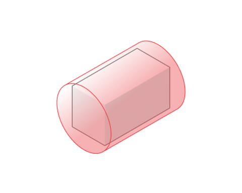
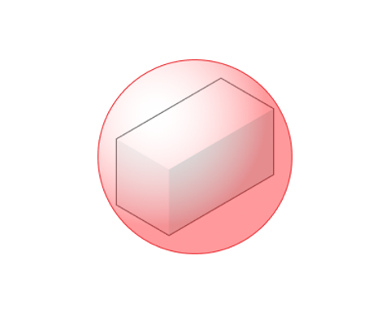
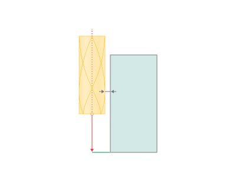

# Safe Motions

## Application Area:

Defines the type of **Safety Surface** and the distance from the workpiece to it. This surface facilitates transitions between the processed surfaces or tool paths, and the first stage of approach or return occurs toward it.

## Safe Level:

By default, sets the distance from the most protruding part of the workpiece to the **Safe surface**.

Click here to expand..

**Appr** - Approach **Ret** - Return **Sl** - Safe level

## Safe Surface:

Defines the surface shape that determines the transition path between the working passes of the tool if the links type is specified as **On Safe Surface**.

Click here to expand..

**Plane.** The path for transitions is set on a plane located at the **Safe Level** above the workpiece. This type of surface is the only option for three-axis operations.

**Cylinder**. The transition path is set on the cylindrical surface located at a **Safe Level** above the most protruding part of the workpiece. This surface option is applicable for four- and five-axis operations.

**Sphere.** The transition path is set on the surface of a sphere located at a **Safe Level** above the most prominent part of the workpiece. This surface option is applicable for five-axis operations.

**From group.** The surface parameters are taken from the nearest group. [Details](#safe-motions-from-a-group)

The following options can be used to define surfaces:

**Origin**.

For a **Plane**, it establishes the base point from which the **Direction** vector begins, aligned with the normal to the plane. For a **Cylinder**, it sets the starting point of the axis. For a **Sphere**, it defines the sphere's center.

**Center of the Part.**

The **Origin** point is located at the geometric center of the part.

**Custom Point.**

The **Origin** point is defined by its X, Y, Z coordinates.

**Direction.**

For a **Plane**, it sets the direction of the normal vector to the plane. For a **Cylinder**, it sets the axis vector.

**Auto**.

The system automatically sets the direction vector: for a **Plane**, it runs along the tool axis; for a **Cylinder**, it follows the part axis or the machine axis with rotational coordinates.

**Custom Vector.**

The **Direction** results from projecting the unit vector onto the X, Y, and Z axes.

## Safe motions from a group:

The safe surface and the safe level can be set not only in an operation but also in a group: a setup stage, a part, an ordinary group and the root of the operations tree. The operations of the group take them from the group, so they can be changed for all those operations in one place.

**Setting them in a group.** Select the group. On the **Links/Leads** tab, in **Safe motions**, set the **Safe surface** (Plane, Cylinder or Sphere, with its Origin and Direction) and the **Safe level**. A group keeps these parameters even when it has no operations yet. The surface of a group is shown in the 3D view in the same way as the surface of an operation.

**Which group.** An operation takes the parameters from its nearest group, the one it lies in: an ordinary group, a part, a setup stage or the root. Groups do not inherit from each other: a nested group has its own surface and level.

**Operations with a choice of safe surface** (multi-axis). Select **From group** in **Surface type**. The origin, direction and safe level of the operation are hidden. Read-only rows are shown instead:

- **Source group**: the group the parameters come from;

- **Surface type**: the type of surface in that group;

- **Inherited level**: the level of the group, for example "10 mm from the part" or "125 mm from origin".

**Other operations** (their safe surface is always a plane). **Safe level** has a choice:

- **From group (&lt;group name&gt;)**: the level is taken from the group, with the "Inherited level" row below;

- **Custom**: the operation's own level; set the distance in **Value** (mm from the part or mm from origin).

**What is inherited.** An operation inherits the parameters, not a ready surface. It calculates the surface itself, for its own part, coordinate system and tool axis, exactly as if the same values had been entered in the operation. So the surface of an operation in the 3D view may differ from the surface of its group: "10 mm from the part", for example, is measured from the part of this operation. An inherited surface cannot be moved from the operation: it has no drag handles, and it is changed in the group. When the parameters of a group change, the operations that take them from it are reset and must be calculated again.

**New operations.** The safe level of a new operation without a choice of surface is **From group** by default. An operation with a choice of surface gets **From group** when its default surface type is the same as the type in its nearest group. The level, origin and direction are then taken from the group too. When the types differ, the operation keeps its own parameters.

**Projects of earlier versions.** When such a project is opened, the safe surfaces and levels of the operations in each group are compared. When they are the same for all operations of a group, these values are written into the group and the operations switch to **From group**. When they differ, the operations keep their values in **Custom** mode.

**Limitations.**

- When a group has a cylinder or a sphere, an operation without a choice of surface takes only the safe level from
  the group. Its safe surface remains a plane.

- **5D Roughing waterline** has its own safe level parameter, which is not taken from the group.

## Max Retraction Distance:

It enables the restriction of the maximum retraction height. This option applies only to certain operations, including Hole Machining and Probing.

## Avoid Collisions at Safe Plane:

When the flag is set, the system automatically generates a trajectory for transitions within the operation while avoiding collisions. This option applies only to certain operations, including Chamfering, 5D Cladding, Point Welding, 6D Welding, and Spraying, mainly in robotic applications.

Click here to expand..

**Check Workpiece.**

If the option is active, the system considers collisions with the workpiece when generating transitions that avoid collisions.

If the option is inactive, the transition paths consider only collisions with the part during collision avoidance. Use this option if the workpiece and the part of the operation differ slightly (or differ within a safe distance). This parameter also affects the approach and return with collision avoidance.

.png) .png)

**Safe distance.**

If the collision avoidance for links is enabled, the parameter defines the minimum allowed distance between the tool, part (workpiece) and the machine parts. This parameter also influences the approach/return with collision avoidance.

