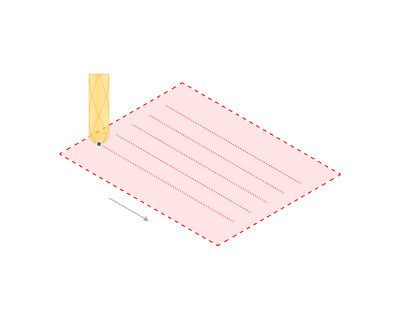
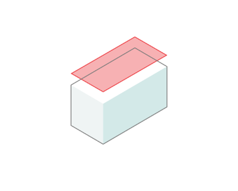
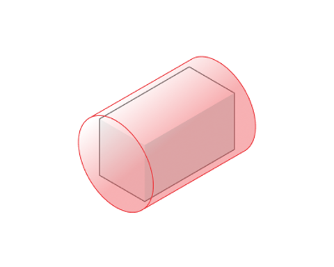
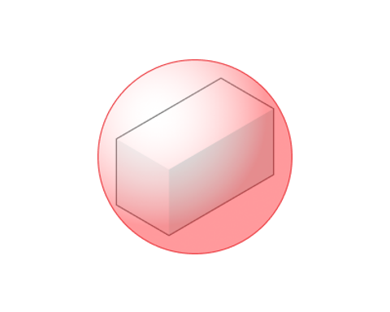
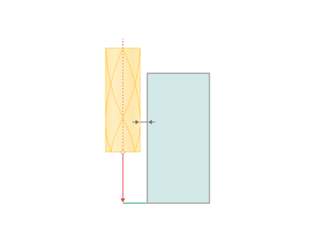

# Movimenti di sicurezza

## Ambito di applicazione:

Definisce il tipo di <strong>Safety Surface</strong> (superficie di sicurezza) e la distanza da essa al grezzo. Questa superficie facilita le transizioni tra le superfici lavorate o i percorsi utensile, e verso di essa avviene la prima fase di avvicinamento o di ritorno.

## Safe Level (livello di sicurezza):

Per impostazione predefinita, imposta la distanza dalla parte più sporgente del grezzo alla <strong>Safe surface</strong> (superficie di sicurezza).

Fare clic qui per espandere..

<strong>Appr</strong> - avvicinamento <strong>Ret</strong> - ritorno <strong>Sl</strong> - livello di sicurezza

## Safe Surface (superficie di sicurezza):

Definisce la forma della superficie che determina il percorso di passaggio tra le passate di lavoro dell'utensile se il tipo di collegamenti è impostato su **On Safe Surface**.

Fare clic qui per espandere..

<strong>Plane</strong> (piano). Il percorso per i passaggi è definito su un piano situato al <strong>Safe Level</strong> sopra il grezzo. Questo tipo di superficie è l'unica opzione per le operazioni a tre assi.

<strong>Cylinder</strong> (cilindro). Il percorso di passaggio è definito sulla superficie cilindrica situata a un <strong>Safe Level</strong> sopra la parte più sporgente del grezzo. Questa opzione di superficie è applicabile alle operazioni a quattro e cinque assi.

<strong>Sphere</strong> (sfera). Il percorso di passaggio è definito sulla superficie di una sfera situata a un <strong>Safe Level</strong> sopra la parte più sporgente del grezzo. Questa opzione di superficie è applicabile alle operazioni a cinque assi.

Per definire le superfici è possibile usare le seguenti opzioni:

<strong>Origin</strong> (origine).

Per un <strong>Plane</strong>, stabilisce il punto base da cui parte il vettore <strong>Direction</strong>, allineato alla normale al piano. Per un <strong>Cylinder</strong>, imposta il punto iniziale dell'asse. Per una <strong>Sphere</strong>, definisce il centro della sfera.

<strong>Center of the Part</strong> (centro del pezzo).

Il punto <strong>Origin</strong> si trova nel centro geometrico del pezzo.

<strong>Custom Point</strong> (punto personalizzato).

Il punto <strong>Origin</strong> è definito dalle sue coordinate X, Y, Z.

<strong>Direction</strong> (direzione).

Per un <strong>Plane</strong>, imposta la direzione del vettore normale al piano. Per un <strong>Cylinder</strong>, imposta il vettore dell'asse.

<strong>Auto</strong>.

Il sistema imposta automaticamente il vettore di direzione: per un <strong>Plane</strong> corre lungo l'asse utensile; per un <strong>Cylinder</strong> segue l'asse del pezzo o l'asse macchina con coordinate rotative.

<strong>Custom Vector</strong> (vettore personalizzato).

La <strong>Direction</strong> risulta dalla proiezione del vettore unitario sugli assi X, Y e Z.

## Max Retraction Distance (distanza massima di retrazione):

Consente di limitare la quota massima di retrazione. Questa opzione si applica solo ad alcune operazioni, tra cui Hole Machining (lavorazione di fori) e Probing (tastatura).

## Avoid Collisions at Safe Plane (evitare le collisioni al piano di sicurezza):

Quando la casella è selezionata, il sistema genera automaticamente un percorso utensile per i passaggi all'interno dell'operazione evitando le collisioni. Questa opzione si applica solo ad alcune operazioni, tra cui Chamfering (smussatura), 5D Cladding (riporto 5D), Point Welding (saldatura a punti), 6D Welding (saldatura 6D) e Spraying (spruzzatura), principalmente nelle applicazioni robotiche.

Fare clic qui per espandere..

<strong>Check Workpiece</strong> (controllo del grezzo).

Se l'opzione è attiva, il sistema tiene conto delle collisioni con il grezzo durante la generazione dei passaggi che evitano le collisioni.

Se l'opzione è disattiva, i percorsi di passaggio considerano solo le collisioni con il pezzo durante l'anticollisione. Usare questa opzione se il grezzo e il pezzo dell'operazione differiscono di poco (o differiscono entro una distanza di sicurezza). Questo parametro influisce anche sull'avvicinamento e sul ritorno con anticollisione.

.png) .png)

<strong>Safe distance</strong> (distanza di sicurezza).

Se l'anticollisione per i collegamenti è abilitata, il parametro definisce la distanza minima consentita tra l'utensile, il pezzo (grezzo) e le parti della macchina. Questo parametro influisce anche sull'avvicinamento/ritorno con anticollisione.

