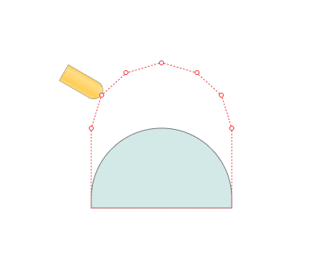

# Impostazioni avanzate dei collegamenti

## Ambito di applicazione:

Questo gruppo di parametri specifica le caratteristiche della formazione del percorso utensile, principalmente per le operazioni a cinque assi, tenendo conto dei movimenti ottimali degli assi rotativi.

## Movimenti di sicurezza approssimati:

Questo parametro gestisce la composizione del percorso utensile per i movimenti di sicurezza su superfici come cilindri e sfere, nelle operazioni a cinque coordinate, in cui i movimenti di sicurezza utilizzano le coordinate rotative.

Fare clic qui per espandere..

<strong>Off</strong>. I movimenti di sicurezza sulla superficie di sicurezza vengono eseguiti in un unico blocco.

<strong>Always</strong>. Il percorso utensile sulla superficie di sicurezza viene suddiviso in movimenti elementari, in modo che lo spostamento della coordinata angolare non superi il valore specificato.

<strong>When Needed</strong>.

## Controllo avanzato dei limiti degli assi:

L'uso di questa opzione evita due problemi specifici nel percorso utensile a cinque assi:

1. Il sistema esclude, quando possibile, il ribaltamento durante la passata di lavoro. I ribaltamenti non avvengono durante le passate di lavoro, ma nei tratti del percorso utensile con movimenti rapidi.

2. Il sistema crea un percorso regolare nelle zone di singolarità. Una zona di singolarità è una posizione della macchina in cui non è possibile calcolare la coordinata di un asse. Ad esempio, se l'asse A è uguale a zero, l'asse C può assumere qualsiasi valore.

Fare clic qui per espandere..

<strong>Avoid Singularity on Safe Surface.</strong>

<strong>Allowed Axis Deviation in Singularity.</strong>

Il parametro definisce l'angolo di cui i giunti della macchina o del robot possono discostarsi dalla posizione nominale calcolata per evitare la zona di singolarità.

## Transizioni ottimizzate per la macchina:

Quando l'opzione è disattivata, le transizioni al livello definito da **Rapid Distance** (distanza di rapido) vengono eseguite lungo il **percorso più breve nello spazio euclideo**. Si supponga di voler passare dal punto1(X1,Y1,Z1,Nx1,Ny1,Nz1) al punto2(X2,Y2,Z2,Nx2,Ny2,Nz2), dove X, Y, Z sono le coordinate del centro dell'utensile e Nx, Ny, Nz sono le coordinate del vettore di direzione dell'asse utensile. Il percorso euclideo più breve è un'interpolazione lineare di questi vettori geometrici. Ciò significa che la curva di collegamento è un segmento rettilineo, lungo il quale il vettore di direzione dell'asse utensile viene interpolato linearmente.

Quando l'opzione è attivata, le transizioni al livello definito da **Rapid Distance** vengono eseguite lungo il **percorso più breve nello spazio macchina**. Si supponga di voler passare dal punto1(A1,C1,X1,Y1,Z1) al punto2(A2,C2,X2,Y2,Z2), dove X, Y, Z, A, C sono gli assi della macchina. Il percorso più breve nelle coordinate macchina è un'interpolazione lineare di questi assi. Ciò significa che la forma della curva di collegamento dipende dall'effettiva configurazione dello schema cinematico della macchina. Le transizioni ottimizzate per la macchina appaiono più lunghe, ma in molti casi sono in realtà più ottimali di quelle geometriche.
