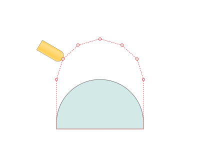

# リンクの詳細設定

## 適用分野：

このパラメータはグループは、回転軸の最適な動きを考慮した、主に5軸オペレーションのための軌道形成の特徴を規定します。

## おおよその安全動作

このパラメータは、5軸加工において回転座標を用いた安全移動 の際に、円筒や球などのサーフェス上での 移動経路の構成を管理します。

拡大

<strong>オフ</strong> 安全サーフェス上の安全な動作は、1つのブロックで実行されます。

<strong>常に</strong> 安全サーフェス上の経路は基本的な移動に分割され、角度座標の変位が指定された値を超えないようになっています。

<strong>必要な場合</strong>

## 高度な軸制限制御 ：

このオプションを使用することで、5軸軌道における2つの特定の問題を防ぐことができます。

1. システムは、可能な限り加工中の反転（オーバーターン）を回避 します。オーバーターン加工中ではなく、高速移動の経路セグメントで発生します。

2. システムは、特異点ゾーン においても滑らかな経路を作成します。特異点ゾーンとは、ある軸の座標を計算できない機械の位置を指します。例えば、軸Aがゼロに等しい場合、軸Cは任意の値を取ることができます。

拡大

<strong>安全サーフェスでの特異点の回避</strong>

<strong>特異点の許容軸偏差</strong>

このパラメータは、特異点ゾーンを回避するために、機械やロボットの関節が標準計算位置からどれだけ角度的に偏位できるかを定義します。

## マシン最適化移行：

このオプションを無効にすると、`早送り距離`で定義された高さでの移行は`ユークリッド空間上の最短経路`によって行われます。例えば、1つ目の点(X1, Y1, Z1, Nx1, Ny1, Nz1) から2つ目の点(X2, Y2, Z2, Nx2, Ny2, Nz2) へ移動するとします。ここで、X, Y, Z は 工具中心の座標、Nx, Ny, Nz は 工具軸方向ベクトルの座標です。ユークリッド最短経路 は、これらの 幾何ベクトルを線形補間したものです。これは、連結曲線の形状が直線であり、それに沿って工具軸方向ベクトルが直線補間されていることを意味します。

このオプションを有効にすると、`早送り距離`で定義された高さの移行は`機械空間上の最短経路`によって行われます。1つ目の点(A1,C1,X1,Y1,Z1)から2つ目の点(A2,C2,X2,Y2,Z2)に移動したいとします。機械座標最短経路は、これらの 軸値を線形補間 したものです。これは、接続曲線の形状が実際のマシンスキーマ構成に依存することを意味します。機械最適化移行 は一見長く見えますが、実際には多くの場合、幾何学的経路よりもより効率的です。
