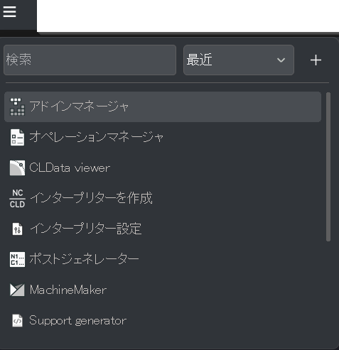
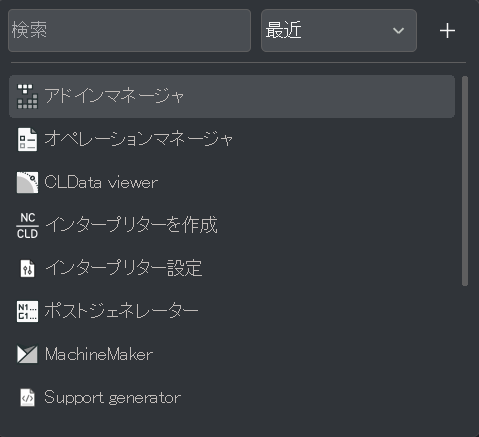
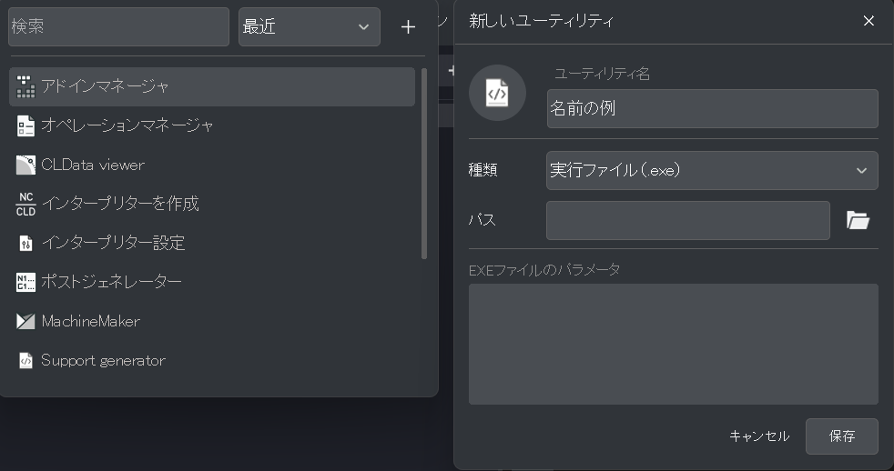

# Botão Utilitários do painel principal

## Área de aplicação:

A janela <strong>Utilities</strong> oferece acesso rápido às ferramentas integradas e definidas pelo usuário diretamente na janela principal do aplicativo. Ela reúne em um único painel a pesquisa, a ordenação, a execução, o gerenciamento de utilitários personalizados e o acesso ao gerenciador de extensões.

A janela é <strong>aberta</strong> pelo <strong>botão de menu (três linhas horizontais)</strong> do painel principal.

A janela é usada para localizar e iniciar ferramentas auxiliares sem sair do aplicativo principal.

Cenários típicos:

- Iniciar uma ferramenta integrada: Postprocessors generator, MachineMaker, CLData viewer, Create interpreter, Addin manager, Calculator, Open macros etc.
- Registrar e iniciar um programa, uma biblioteca ou um script externo como utilitário personalizado.
- Abrir o <strong>Extensions manager</strong> para gerenciar as extensões instaladas.

### Layout da janela.

A janela é composta por uma barra de controles superior e pela lista de utilitários.

- <strong>Search field.</strong> Campo de texto à esquerda da barra de controles para filtrar a lista.
- <strong>Sort selector.</strong> Lista suspensa para escolher a ordem de classificação.
- <strong>Add button (+).</strong> Botão à direita da barra de controles que abre a caixa de diálogo <strong>New Utility</strong>.
- <strong>Utilities list.</strong> Lista rolável de todos os utilitários disponíveis, cada um exibido com ícone e nome.
- <strong>Extensions manager.</strong> Link na parte inferior da janela. [Detalhes](/pages/createpage.action?spaceKey=SCUM20ENRC&title=Configure+utilities+window&linkCreation=true&fromPageId=157858745)

### Iniciar um utilitário.

<strong>Launch.</strong> Cada item da lista representa um utilitário. Para executar um utilitário, clique nele com o mouse ou selecione-o e pressione <em>Enter</em>. A janela é fechada automaticamente após a inicialização.

### Pesquisa.

<strong>Search field.</strong> O campo de pesquisa na parte superior da janela filtra a lista pelo nome do utilitário.

- A pesquisa não diferencia maiúsculas de minúsculas e encontra correspondências por substring, ou seja, por qualquer parte do nome.
- Ao digitar qualquer caractere imprimível, o foco passa automaticamente para o campo de pesquisa; assim, a pesquisa pode ser iniciada sem clicar antes no campo.

Para limpar o filtro, apague o texto do campo de pesquisa. A lista completa é então restaurada.

### Ordenação.

<strong>Sort selector.</strong> A lista suspensa à direita do campo de pesquisa alterna o modo de ordenação da lista:

- Recent — por frequência de uso, com os utilitários mais usados primeiro.
- A – Z — em ordem alfabética pelo nome.
- Z – A — em ordem alfabética inversa.

### Adicionar um utilitário personalizado.

<strong>Add button (+).</strong> O botão <strong>+</strong> abre a caixa de diálogo <strong>New Utility</strong> para criar um utilitário personalizado.

A caixa de diálogo contém os seguintes campos:

- <strong>Icon.</strong> Ícone exibido para o utilitário na lista. Clique na área do ícone para atribuir uma imagem personalizada.
- <strong>Utilities name.</strong> Nome do utilitário exibido na lista.
- <strong>Type.</strong> Tipo do utilitário. Os tipos compatíveis são:
  - <strong>Executable file</strong> — aplicativos com a extensão .exe.
  - <strong>Library</strong> — .dll.
  - <strong>Script</strong> — .spr.
- <strong>Path.</strong> Caminho do arquivo do utilitário. Clique no botão de pasta à direita do campo para selecionar o arquivo na caixa de diálogo padrão de abertura de arquivos.
- <strong>Parameters of exe-files.</strong> Parâmetros opcionais de linha de comando passados ao utilitário na inicialização. O campo está disponível para todos os tipos de utilitário e não muda quando o tipo é alterado.

Clique em <strong>Add</strong> para criar o utilitário e adicioná-lo à lista ou em <strong>Cancel</strong> para fechar a caixa de diálogo sem salvar.

### Editar e excluir utilitários personalizados.

Ao passar o ponteiro sobre um utilitário personalizado na lista, dois controles aparecem à direita da linha:

- <strong>More button (…).</strong> Abre a caixa de diálogo <strong>Utility parameters</strong>, onde é possível alterar nome, tipo, caminho, parâmetros e ícone.
- <strong>Delete button (×).</strong> Remove o utilitário personalizado da lista.

> Os utilitários integrados são protegidos contra alterações. Os controles de edição e exclusão estão disponíveis apenas para utilitários definidos pelo usuário.

### 

### Ferramentas integradas.

O menu Utilities contém itens para executar ferramentas internas adicionais e utilitários externos do usuário. Ele pode ser personalizado com o item de menu <strong>Configure utilities</strong>. Alguns itens podem ficar ocultos, dependendo da opção <strong>Show expert tools</strong> nas configurações do sistema.

| Botão | Descrição |
|---|---|
|  | <strong>Configure utilities</strong>: abre a [janela do gerenciador de utilitários](/pages/createpage.action?spaceKey=SCUM20ENRC&title=Configure+utilities+window&linkCreation=true&fromPageId=157858745). |
|  | <strong>MachineMaker</strong>: inicia o [aplicativo para criar esquemas da máquina](https://docs.encycam.com/MachineMaker/1/robots/en/1.html). |
|  | <strong>Calculator</strong>: executa a calculadora interna. |
|  | <strong>System logs:</strong> abre [uma janela com a lista dos eventos](10026.md) ocorridos no aplicativo desde a inicialização. |
|  | <strong>Postprocessors generator:</strong> inicia o [Postprocessors generator, aplicativo para gerar arquivos de configuração de pós-processadores.](730.md) |
|  | <strong>Create script operation:</strong> abre uma caixa de diálogo para [criar uma operação com script](10350.md). |
|  | <strong>Create interpreter</strong>: abre a ferramenta [Create interpreter](https://docs.encycam.com/Interpreters/1/en/10292.html). |
|  | <strong>Addin Manager</strong>: abre a [janela Addin Manager](900.md). |
|  | <strong>Operations manager</strong>: inicia o gerenciador que permite ativar ou desativar operações externas, cujos parâmetros são descritos em arquivos XML separados e em [contêineres stfc](10024.md). |
|  | <strong>CLData viewer</strong>: inicia o [CLData viewer](https://docs.encycam.com/Inp.Net/1/en/src/inpcoreorganization/devtools.html), aplicativo que ajuda a criar pós-processadores em C#. |
|  | <strong>Scripts IDE</strong>: abre uma janela para escrever e depurar arquivos de [script do sistema CAM](10348.md). |
