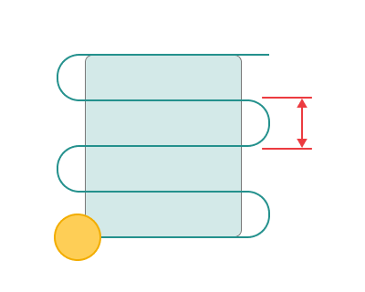

# 荒取りウォーターラインに基づくリンク

## 適用分野：

このグループは、切り込み時やエリア間の移動の設定を定義します。

### 距離が離れている場合は上昇

拡大

リンクの長さのチェックを有効にし、リンクの長さが定義された値より大きい場合、リンクは安全高さ経由で作成されます。

 

<strong>GF -</strong> 距離が離れている場合は上昇

### ショートリンクの最大距離

拡大

ショートリンクタイプでリンクが作成される最大距離を設定します。

###
