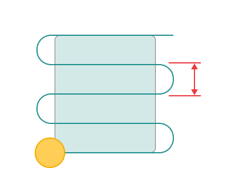

# Links based on the Roughing waterline

_1.png)

## Application Area:

This group defines the settings for cutting in or transitions between areas.

**Go up if farther.**

Click here to expand..

Enables checking the length of links, and if the length of the link is greater than defined value, then the link will be made via the safe level.

.png) .png)

**GF -** Go up if farther

**Short link max distance.**

Click here to expand..

Sets the maximum distance at which links are made by the short link type.

###
