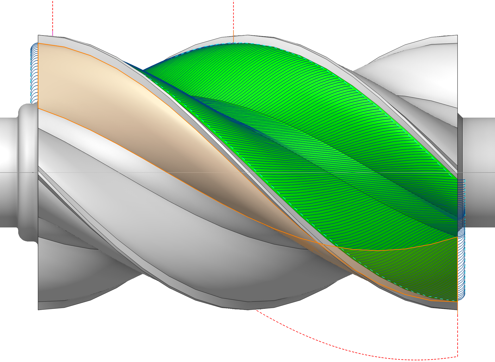
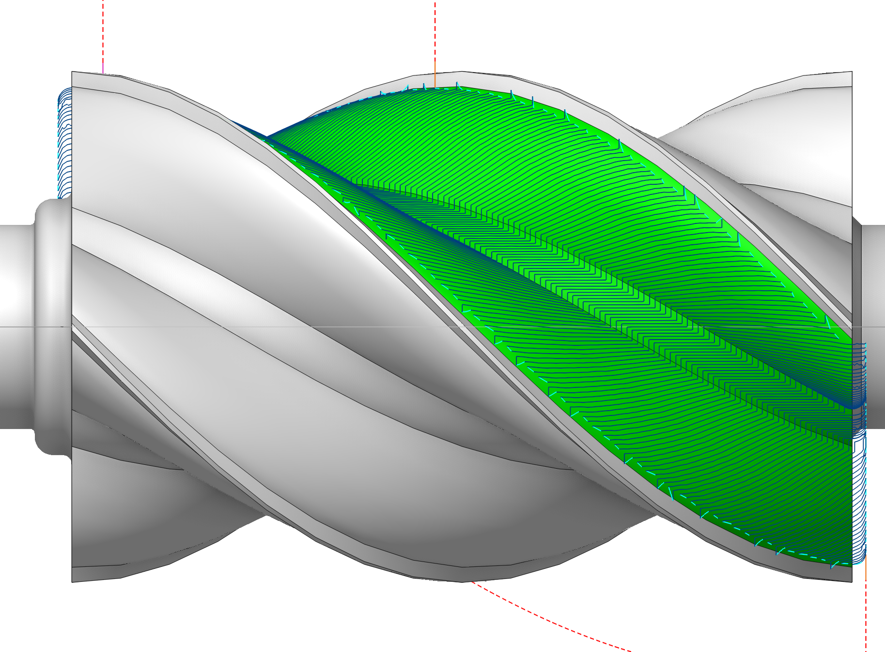

# ロータリー仕上げ加工で新しい計算方法を使用

## 

## 適用分野:

サーフェス法線方向におけるツールパス品質の問題を改善するため、ロータリー仕上げ加工の計算アルゴリズムを刷新しました。 [詳細を見る](10136.md)

このパラメータは<strong>パラメータタブ</strong>にあります。この設定を<strong>無効</strong>にすると従来の計算アルゴリズムが使用され、<strong>有効</strong>にすると新しい計算アルゴリズムが使用されます。

### 新しい計算アルゴリズムの利点

<strong>処理性能の向上</strong> 利用可能なすべてのCPUコアに計算処理を分散することで、ハードウェア性能を最大限に活用し、計算速度が大幅に向上します。

<strong>ツールパスの滑らかさを改善</strong> 工具軸の方向をサーフェス法線方向に設定した場合、より滑らかなツールパスを生成できます。また、法線円滑化距離パラメータを調整することで、円滑化の効果を細かく設定できます。 [詳細を見る](10136.md)

<strong>ツールパス形状の改善</strong> <strong>サイド</strong><strong>角度</strong>方法を使用した場合、ツールパスの品質が大幅に向上し、より効率的で高精度な加工を実現できます。

1.

1.
  1.  
