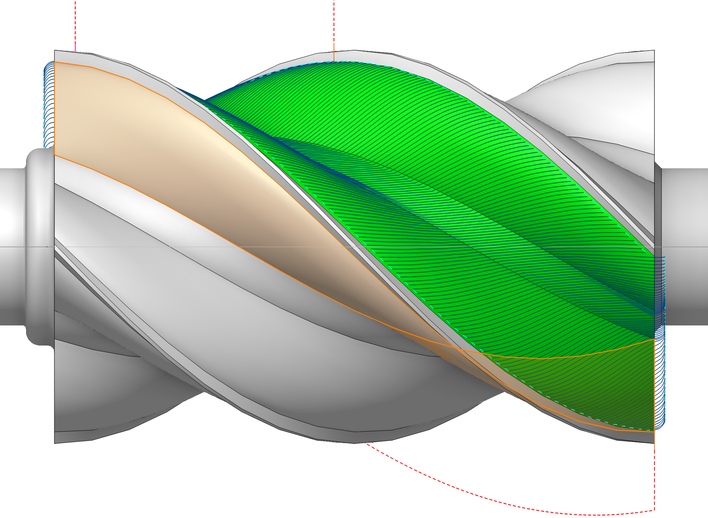
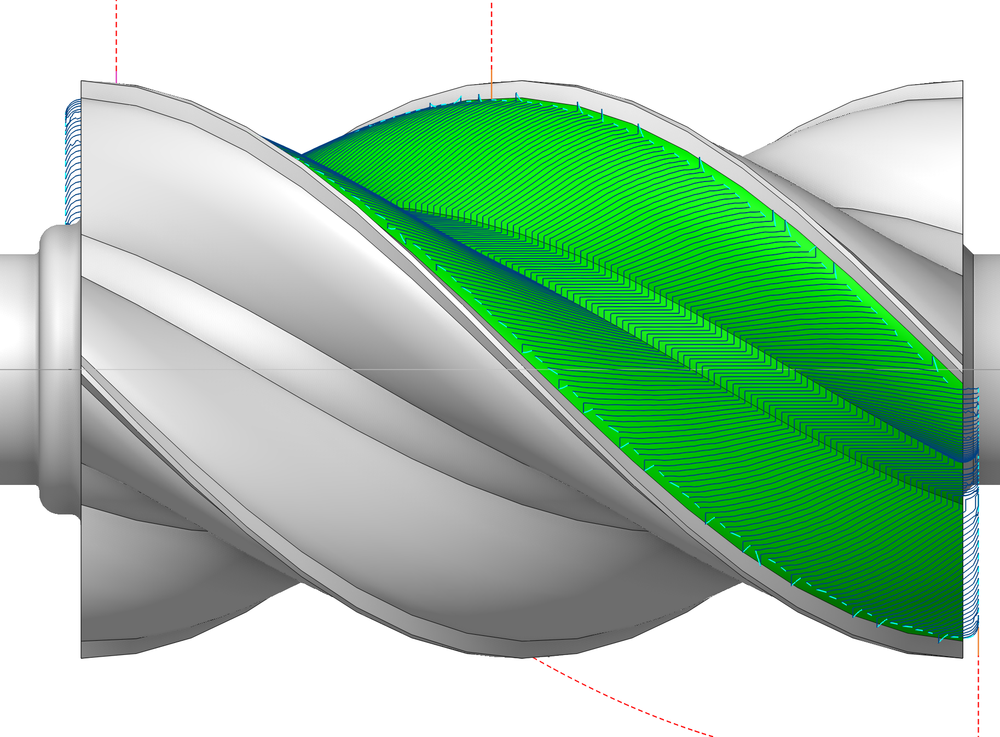

# Neues Berechnungsverfahren für Rotationsschruppen und -schlichten

## Anwendungsbereich:

Der Berechnungsalgorithmus für das Rotationsschlichten wurde überarbeitet, um die Werkzeugwegqualität bei einer Ausrichtung entlang der Flächennormalen zu verbessern. [Details](10136.md)

Die Option befindet sich auf der Registerkarte **Parameters**. Deaktiviert verwendet sie das bisherige, aktiviert das neue Verfahren.

### Vorteile des neuen Verfahrens

**Berechnungsleistung.** Die Berechnung wird auf alle verfügbaren Prozessorkerne verteilt.

**Gleichmäßigerer Werkzeugweg.** Bei einer Ausrichtung entlang der Flächennormalen wird die Werkzeugbewegung geglättet. Der Glättungseffekt kann über den Glättungsabstand der Normalen angepasst werden. [Details](10136.md)

**Verbesserte Bahngeometrie.** Bei Verwendung der Seitenwinkelstrategie wird die Qualität des Werkzeugwegs verbessert.

 

