# コンボ仕上げ

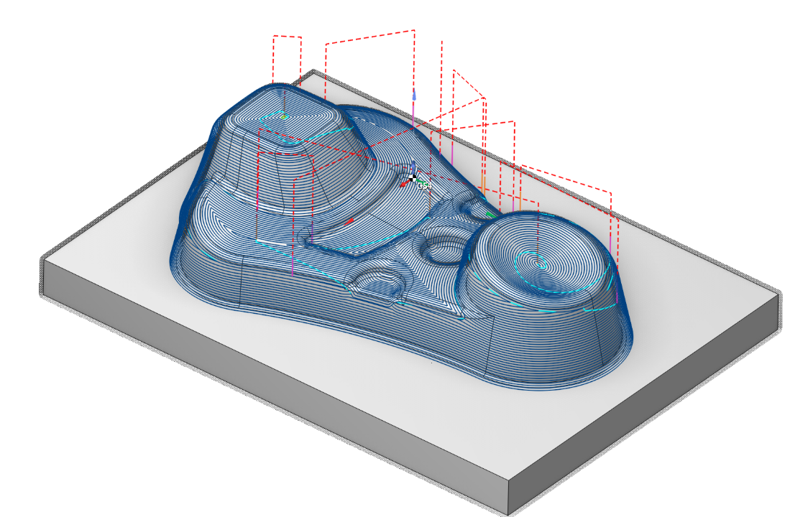

## 適用分野:

この操作は、旧式のレガシー操作を置き換え、関連する問題に対処できます。

利点:

• ウォーターラインパス用のヘリックス生成（ヘリカル加工）をサポートします。

• 複合加工方法では、緩やかな領域と急勾配の領域を異なるストラテジーで加工します。これにより、表面上のスキャロップパターンが均一になり、切削条件が改善されます。

• 複合加工方法には、円滑化距離パラメータに基づく加工ゾーンの平滑化／結合機能があります。これにより、不要なパスや移動を減らし、より安定したツールパスを生成できます。

• 複合加工方法向けのインテリジェントなツールパス結合が実装されています。

• 計算処理は完全に並列化されています。

## セットアップ：

<strong>セットアップ</strong>タブでは、プロジェクトの主要なパラメータの設定を行います。これには、装置上の部品の位置決め、部品の座標系などが含まれます。[詳細を見る](https://confluence.encycam.com/display/SC1/.Setup+v19)

## ジョブ割り当て:

<strong>加工面</strong> 部品のさまざまなサーフェスを加工対象として選択します。システムは、選択されたサーフェスに基づいて軌道を計算します。[詳細を見る](102121.md)

<strong>制限面</strong>

<strong>ジョブゾーン</strong> （加工領域） <strong>ジョブゾーン</strong> を使用して、指定された2D制限領域の外側のパスをトリムします。 <strong>ジョブゾーン</strong>に対する法線を選択できます。 [詳細を見る](10151.md)

<strong>制限領域</strong> システム内の<strong>ジョブゾーン</strong> に加えて、カーブやエッジから作成した <strong>制限領域</strong> の要素を使用して、現在のオペレーションで加工を避けるワーク領域を指定できます。 [詳細を見る](10152.md)

<strong>上部高さ</strong> モデル要素に基づいて上部高さを指定します。[詳細を見る](10153.md)

<strong>底部高さ</strong> モデル要素に基づいて底部高さ指定します。[詳細を見る](10153.md)

<strong>プロパティ</strong> 要素のプロパティを表示します。ストックを追加することも可能です。リスト内の項目をダブルクリックすることでも、このメニューを表示できます。

<strong>削除</strong> リストから項目を削除します。

<strong>制限</strong> 加工してはならない領域を制限することができます。[詳細を見る](101231.md)

## 加工設定：

### 加工設定：

このパラメータにより、複数の加工設定を使用したツールパスを作成できます。

拡大

<strong>平面 平面仕上げ</strong>は、モデル表面の滑らかな領域、および垂直に近い領域の加工を目的としており、その（急勾配）軌跡はツールパスに沿って生成されます。

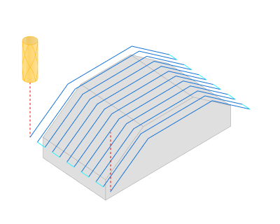

<strong>ウォーターライン ウォーターライン仕上げ</strong>は、主要なサーフェス領域が<strong>垂直</strong>に近いモデルまたはその一部を加工する場合に良好な結果を得られます。

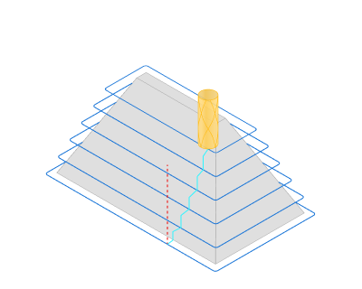

<strong>スキャロップ スキャロップ</strong>ツールパスは、パーツサーフェス上にある曲線から開始し、それらの曲線を内側へ繰り返しオフセットして、曲線が消滅するまで生成されます。この方法では、等距離方法に似たツールパスを作成します。

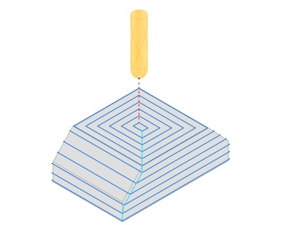

<strong>平面 + ウォーターライン</strong> 平面ツールパスは、傾斜角が分割傾斜角より小さい領域のみを加工し、ウォーターラインツールパスは、サーフェスの傾斜角が<strong>傾斜角度の分割</strong>より大きい領域を加工します。既定では、分割傾斜角は45度に設定されています。この加工方法により、<strong>浅い領域</strong>は<strong>平面ツールパス</strong>で加工され、<strong>急峻な領域</strong>は<strong>ウォーターラインツールパス</strong>で加工されます。

<strong>スキャロップ + ウォーターライン</strong> スキャロップツールパスは、傾斜角が分割傾斜角より小さい領域のみを加工し、ウォーターラインツールパスは、サーフェスの傾斜角度の分割より大きい領域を加工します。既定では、分割傾斜角は45度に設定されています。この加工方法により、<strong>浅い領域</strong>は<strong>スキャロップツールパス</strong>で加工され、<strong>急峻な領域</strong>はウォータラインツールパスで加工されます。

<strong>ステップ 上部高さ</strong>と<strong>底部高さ</strong>の間で、工具軸に沿って1パスで除去される材料量です。

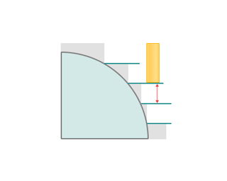

<strong>角度</strong> 平面加工における切削角度の方向を指定します。

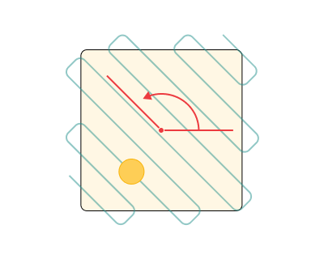

<strong>渦巻き加工</strong> フラグを設定すると、リンクを最小限に抑えるため、ツールパスが連続した渦巻として構成されます。

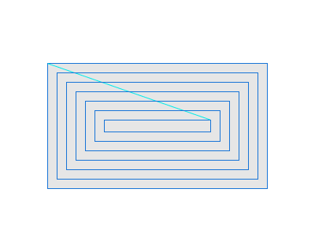 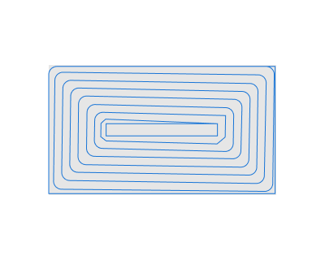

<strong>コーナーの円滑化</strong> フラグを設定すると、ツールパス内の鋭いコーナーが平滑化されます。

 

### ミーリングタイプ：

曲線加工オペレーションを除き、ほとんどすべての加工で設定可能です。これにより、ユーザーはツールパスの計算プロセス中に、必要なフライス加工タイプ（ダウンカットまたはアップカット）を設定できます。 ミーリングタイプのパラメータは <strong>ウォータライン荒加工オペレーション</strong>と同様です。[詳細を見る](736.md)

### 並べ替え

サーフェス加工中のツールパスの順序を設定します。

拡大

<strong>開始点</strong> プランジ開始位置を定義する点です。

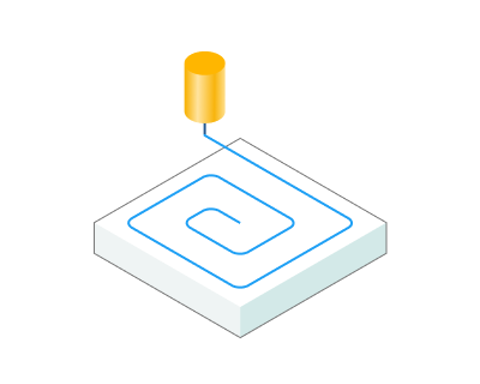 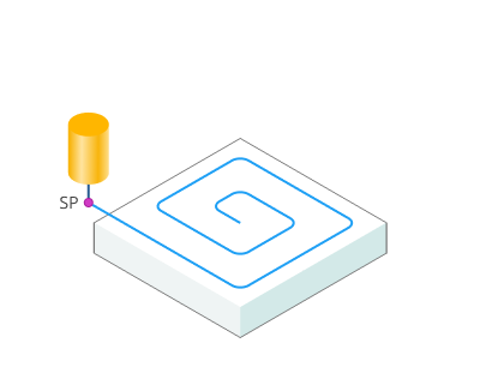

<strong>加工順序</strong>

<strong>下方向</strong> サーフェス領域が垂直に近いモデルでは、<strong>下方向</strong>の加工が推奨されます。

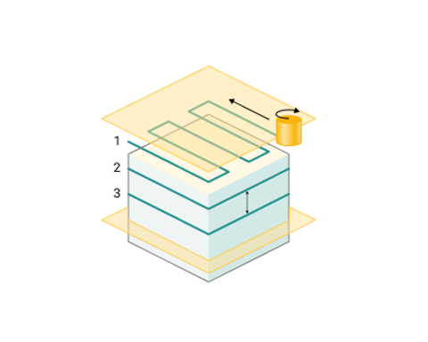

<strong>上方向</strong> 水平に近い形状生成サーフェスを持つモデルでは、<strong>上方向</strong>の加工が推奨されます。

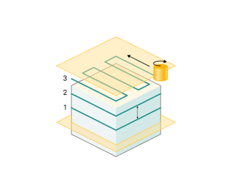

### ジョブゾーン

<strong>ジョブ割り当て</strong> タブで最初に選択した加工領域の追加修正が可能 です。

拡大

<strong>最小傾斜角度</strong> システムでは、サーフェスの法線と垂直Z軸との角度に応じて、モデルサーフェス領域の選択加工を実行できます。加工範囲は、<strong>最小</strong>傾斜角度と最大傾斜角度によって定義できます。

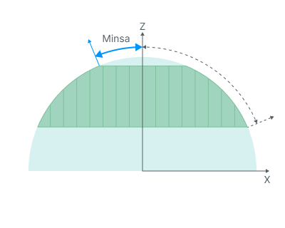

<strong>最大傾斜角度</strong> システムでは、サーフェスの法線と垂直Z軸との角度に応じて、モデルサーフェス領域の選択加工を実行できます。加工範囲は、最小傾斜角と<strong>最大</strong>傾斜角によって定義できます。

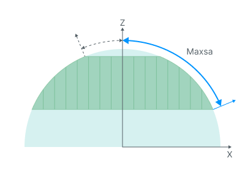

<strong>正面角度</strong> 正面角度とは、工具の移動方向と切削点におけるサーフェス法線を水平面に投影したものの間の角度です。 [詳細を見る](163.md)

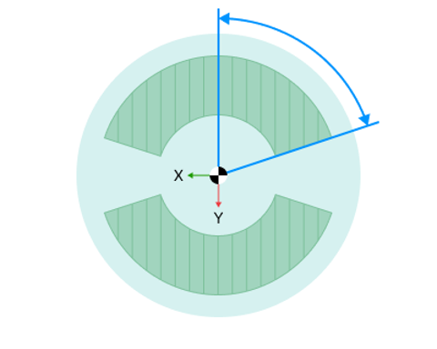

<strong>傾斜角度の分割</strong> 垂直パスと水平パスの間の角度です。

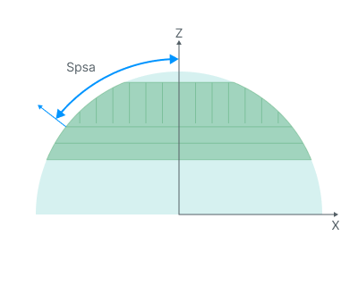

<strong>円滑化距離</strong> 複合加工方法（平面 + ウォーターライン、またはスキャロップ + ウォーターライン）で隣接する加工領域を平滑化して結合するために使用する距離を設定します。指定距離内にある隣接領域は単一の連続領域に結合され、短く断片化されたパスがなくなり、より滑らかで均一なツールパスが生成されます。

### 加工深さ：

工具軸方向の加工範囲を設定します。このパラメータは <strong>ウォータライン荒加工オペレーション</strong>と同様です。[詳細を見る](736.md)

### コーナーの円滑化：

工具方向が急変する場合、フライス制御は回転開始前に減速し、その後再び加速します。この動作により、振動が発生しやすくなり、工具およびフライス盤の摩耗が増大する可能性があります。ツールパスの途切れを極力減らすことで、この問題は解決できます。このため、システムにはモデルの内側や外側のコーナーを加工する際に、指定された半径を用いてツールパスを滑らかにする機能があります。

### トリミング

加工対象ではないサーフェスをスキップしたり、 ツールパスを延長したりできます。このグループのパラメータは、<strong>5Dサーフェシングオペレーション</strong>と同様です。[詳細を見る](10135.md)
