# Schaufelbearbeitung

  

## Anwendungsbereich:

Die Schaufelbearbeitung ist eine spezialisierte mehrachsige Schlichtoperation für einzelne Verdichter-, Turbinen- und Laufradschaufeln. Sie bearbeitet Schaufelprofil, Naben- bzw. Plattformflächen mit Verrundungen, Schaufelfußbereich sowie Eintritts- und Austrittskanten. Die Bahnen werden um eine benutzerdefinierte Drehachse erzeugt und auf die Bauteilflächen projiziert.

Typische Anwendungen:

- Schlichten des Schaufelprofils mit durchgehender Schraubenbahn (**Spiral**), einzelnen Umläufen (**Circular**) oder Längsbahnen (**Linear**).
- Bearbeiten der Naben- bzw. Strömungspfadflächen und angrenzender Verrundungen.
- Nachbearbeiten des Schaufelfußbereichs mit zusätzlichen Bahnen.
- Längsbearbeitung der Eintritts- und Austrittskanten mit gesteuerter Werkzeugkontakthöhe.
- Ausgleich der Durchbiegung dünner Schaufeln durch ein stetig veränderliches Schlichtaufmaß (**Bend compensation stock**).

### Einrichtung:

Auf **Setup** werden grundlegende Projektparameter wie Bauteillage und Werkstückkoordinatensystem festgelegt. [Details](1022.md)

### Auftragszuweisung:

**Blade surfaces (Schaufelflächen).** Druckseite, Saugseite und Kantenflächen des Schaufelprofils. Erforderlich für die Zielbereiche **Blade**, **Root zone of blade** und **Edges**.

**Hub surfaces (Nabenflächen).** Naben-, Plattform- bzw. Strömungspfadflächen einschließlich der Verrundungen zur Schaufel. Für **Hub** erforderlich. Bei **Root zone of blade** begrenzen sie den Bearbeitungsbereich; ohne Auswahl entfällt diese Nabenbegrenzung.

**Properties (Eigenschaften).** Öffnet die Elementeigenschaften, beispielsweise zur Eingabe eines Aufmaßes. Auch durch Doppelklick auf einen Listeneintrag erreichbar.

**Delete (Löschen).** Entfernt ein Element aus der Liste.

**Restrictions (Begrenzungen).** Definiert nicht zu bearbeitende Bereiche. [Details](101231.md)

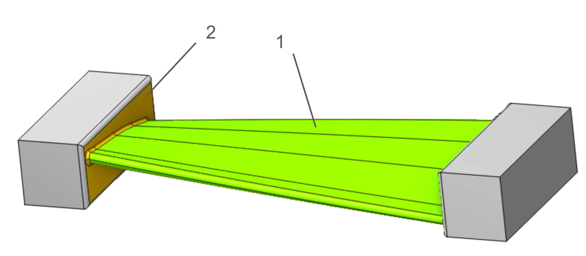

**1 – Schaufelflächen; 2 – Nabenflächen.**

### Strategie.

#### Zielbereich.

**Target zone (Zielbereich)** bestimmt das zu bearbeitende Schaufelmerkmal und damit Strategie, erforderliche Geometriegruppen und sichtbare Parameter.

Weitere Informationen anzeigen

**Blade (Schaufelprofil).** Erzeugt Bahnen um die Drehachse über den gesamten Arbeitsbereich und projiziert sie auf die Schaufelflächen. Verfügbar sind Spiral, Circular und Linear.

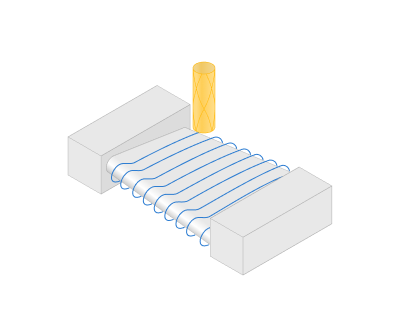

**Root zone of blade (Schaufelfußbereich).** Zusätzliche Bahnen im unteren, nabennahen Bereich der Schaufelflächen. **Zone height** begrenzt dessen Höhe von der Nabe aus. Der Bereich dient zur Nachbearbeitung nach dem Hauptschlichten mit einem anderen, meist kleineren oder konischen Werkzeug.

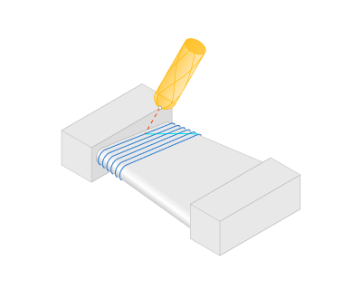

**Hub (Nabe).** Bearbeitet Nabenflächen und Verrundungen mit äquidistanten Bahnen, die von der Schaufelkontur mit konstantem **Step** nach außen versetzt werden. **Zone height** begrenzt das Bearbeitungsband entlang der Schaufelachse. Außerhalb der Nabenaußenkontur werden Bahnen automatisch verlängert; dort gilt der Vorschub für den Übergang zum nächsten Durchgang.

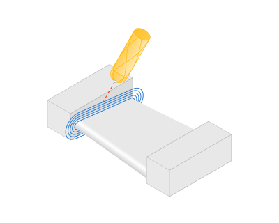

**Edges (Kanten).** Bearbeitet Eintrittskante (LE) und Austrittskante (TE) mit Längsbahnen. Die Kanten werden anhand der Krümmungsmaxima der Profilquerschnitte erkannt. **Pass count** und **Arc length** bestimmen die Verteilung der Bahnen über die Kante. **Tool contact point** steuert die Kontakthöhe entlang des Durchgangs.

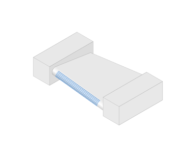

#### Bearbeitungsbereich.

Ermöglicht zusätzliche Anpassungen des in der Auftragszuweisung festgelegten Bereichs.

Weitere Informationen anzeigen

**Rotary axis (Drehachse).** Bezugsachse für die Werkzeugausrichtung. Ihre Lage kann im Inspektor, interaktiv über den Pfeil oder über die Auswahlliste festgelegt werden.

**Along X**, **Along Y** und **Along Z** richten die Drehachse entlang der entsprechenden Koordinatenachse aus.

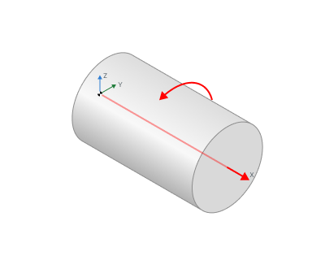

**Direction (Richtung).** Bei **Custom(WCS)** wird die Richtung über die Richtungskosinus X, Y und Z definiert.

**Origin (Ursprung).** Bezugspunkt für Positionsangaben entlang der Drehachse.

**Base CS (Bezugskoordinatensystem).** Wählt das globale oder lokale Werkstückkoordinatensystem.

**Start margin.** Abstand des Bearbeitungsanfangs vom Schaufelfuß.

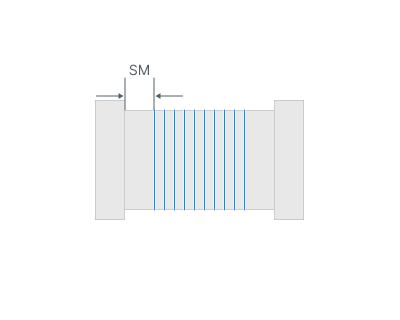

**End margin.** Abstand des Bearbeitungsendes von der Schaufelspitze.

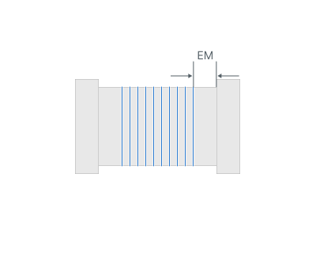

**Zone height.** Bei Root zone of blade und Hub die Höhe des Bearbeitungsbands, gemessen von der Nabe entlang der Schaufelachse.

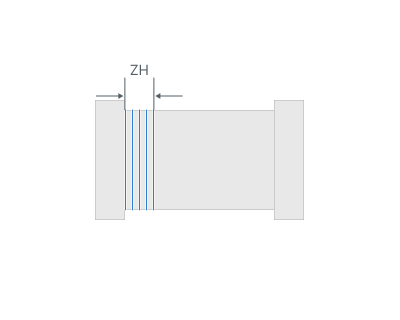

#### Bahnform.

Legt die Form der Werkzeugbahn fest.

Weitere Informationen anzeigen

Folgende Bahnformen stehen zur Verfügung:

**Linear.** Erzeugt Schnittlinien der Bearbeitungsflächen mit Ebenen durch die Drehachse.

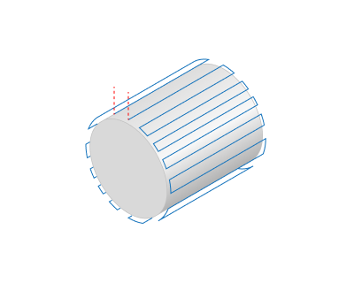

**Circular (Kreisförmig).** Erzeugt Schnittlinien mit Ebenen senkrecht zur Drehachse.

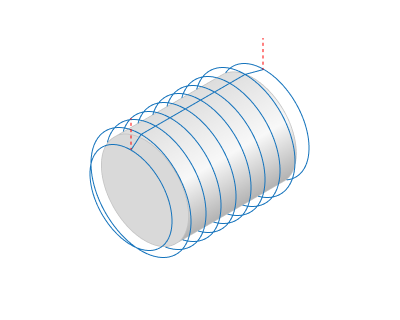

**Spiral (Schraubenförmig).** Erzeugt eine durchgehende Schraubenlinie. Diese Bahnform eignet sich beispielsweise auch für Schraubenformen und Laufräder.

**Step (Bahnabstand).** Abstand zwischen den Bahnen entlang der Drehachse.

**Axial direction (Axiale Richtung).** Bestimmt je nach Bahnform die Bewegungsrichtung oder Durchgangsreihenfolge. Bei einer Schraubenlinie mit Steigung gleich dem Bearbeitungsschritt beeinflusst sie die Windungsrichtung.

**Forward.** Ordnet Bahnen in Richtung des Drehachsenvektors an.

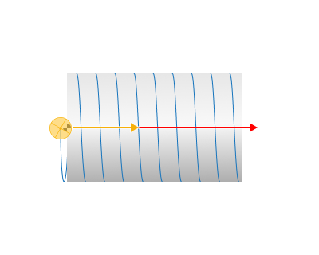

**Backward.** Ordnet Bahnen entgegen dem Drehachsenvektor an.

**Side (Seite).** Wählt bei Linear und Circular im Zielbereich Blade die Profilseite aus. Bei einseitiger Bearbeitung mit Circular entstehen offene Bögen, begrenzt durch die Randabstände an den Kanten.

**Both.** Bearbeitet beide Profilseiten.

**Convex (Saugseite).** Bearbeitet von der Seite der positiven Flächennormalen.

.png)

**Concave (Druckseite).** Bearbeitet von der entgegengesetzten Seite.

.png)

**LE margin.** Abstand von der Eintrittskantenspitze entlang des Profilbogens. Vorgabe ist der Werkzeugdurchmesser.

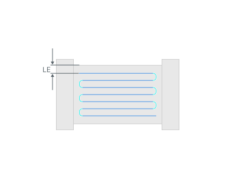

**TE margin.** Abstand von der Austrittskantenspitze entlang des Profilbogens.

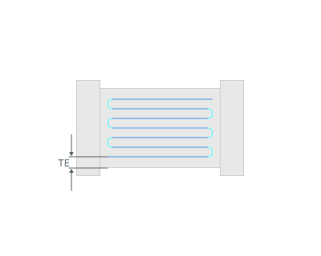

#### Werkzeugkontaktpunkt.

Verändert den Werkzeugkontaktpunkt.

Weitere Informationen anzeigen

**One point.** Hält den Kontaktpunkt entlang des gesamten Durchgangs konstant. Dieser Punkt definiert die Kontaktstelle zwischen Werkzeug und Bauteilgeometrie. Die Parameter entsprechen dem Werkzeugkontaktpunkt der 5D-Flächenbearbeitung. [Details](10135.md)

*Werkzeugkontaktpunkt entlang eines Durchgangs verändern.*

**Two point.** Verändert den Kontaktpunkt zwischen Anfangs- und Endlinie. Die Parameter entsprechen **Contact Points** der 5D-Flächenbearbeitung. [Details](10135.md)

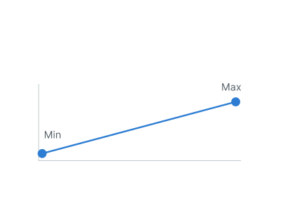

*Werkzeugkontaktpunkt entlang eines Durchgangs verändern.*

**Wave.** Verändert den Kontaktpunkt sinusförmig zwischen Start point und End point. **Wave period** bestimmt die Wellenlänge entlang der Bahn; Vorgabe sind 20 Längeneinheiten.

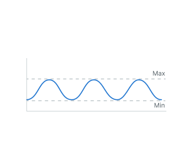

Werkzeugkontaktpunkt entlang eines Durchgangs verändern.

**Wave period.** Die wellenförmige Kontaktverlagerung verteilt den Verschleiß gleichmäßiger über den Werkzeugeckenradius.

> Hinweis
>
> Der Vorlaufwinkel wird an jedem Bahnpunkt aus der Kontakthöhe **h** und dem Werkzeugeckenradius **r** berechnet:
>
> lead = arccos(1 - h/r)
>
> Solange dieser Bereich aktiv ist, wird **Lead angle** unter Tool orientation ausgeblendet.
>
> 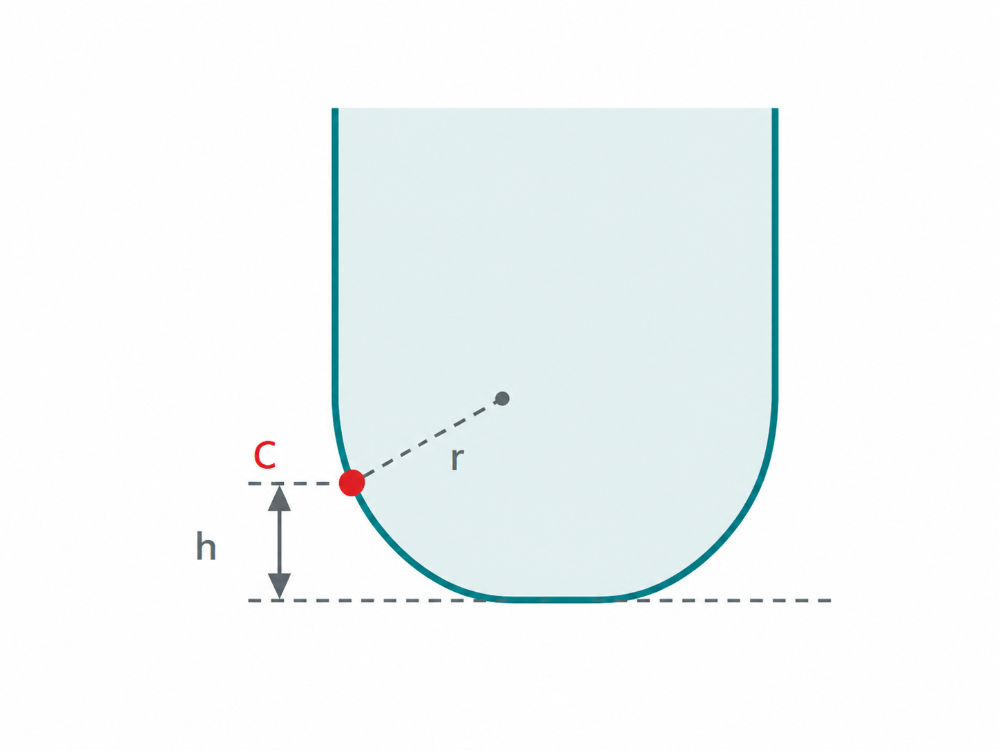

#### Werkzeugausrichtung.

Die Gruppe **Tool orientation** steuert die Werkzeugachse relativ zur bearbeiteten Fläche.

Weitere Informationen anzeigen

**To Rotary Axis.** Richtet die Werkzeugachse anhand der unter **Job zone** definierten Drehachse aus.

**In Rotary Axis Plane.** Die Werkzeugachse liegt in einer Ebene durch die Drehachse und wird gemäß der Flächennormalen geneigt.

**By Surface Normal.** Richtet das Werkzeug normal zur Bearbeitungsfläche aus. Dies ist der Standardmodus.

**Lead angle (Vorlaufwinkel).** Zusätzliche Neigung in Bewegungsrichtung. Verfügbar bei In Rotary Axis Plane und By Surface Normal. Vorgabe: 5°.

**Auto min lead angle.** Erhöht bei Aktivierung den Vorlaufwinkel, wenn die Fläche hinter dem Werkzeug ansteigt und der hintere Bereich des Fräserbodens die Fläche berühren würde. Verwendet wird der größere Wert aus Lead angle und erkanntem Flächenanstieg zuzüglich Back angle. Die automatische Erhöhung ist auf 60° begrenzt. Ohne erforderliche Anpassung bleibt Lead angle erhalten. Bei deaktivierter Option erfolgt keine automatische Anpassung. Die Funktion gilt für den Zielbereich Blade und wirkt nicht auf Kugelwerkzeuge ohne flachen Boden.

**Back angle.** Zusätzlicher Freistellwinkel, der zum erkannten Flächenanstieg addiert wird. Er wird in der Zeile Auto min lead angle bearbeitet und entspricht standardmäßig Lead angle.

**Side angle (Seitenwinkel).** Neigung der Werkzeugachse relativ zur Drehachse am Anfang des Arbeitsbereichs. Vorgabe: 0°.

**End angle.** Neigung am Ende des Arbeitsbereichs. Klappen Sie Side angle auf, um das Feld anzuzeigen. Standardmäßig sind beide Winkel gleich; unterschiedliche Werte werden entlang der Schaufelachse linear ineinander überführt.

Die entsprechenden Ausrichtungs- und Winkelparameter sind bei der Flächenbearbeitung beschrieben. [Details](10135.md#tool-orientation)

*Im Zielbereich Edges wird Lead angle ausgeblendet, wenn Tool contact point aktiviert ist. Der Vorlaufwinkel ergibt sich dann aus der vorgegebenen Kontakthöhe am Werkzeugeckenradius.*

#### Kantennormalen glätten.

**Edge normal smoothing** glättet die Werkzeugkontaktnormale beim Annähern an Eintritts- und Austrittskante. Die abrupte Krümmungsänderung dünner Kanten kann sonst beim Überfahren eine starke Änderung der Werkzeugachse verursachen. Die Glättung verteilt den Normalenwechsel über eine Strecke vor der Kante und vermeidet ruckartige Drehachsbewegungen.

**Bend compensation stock (Aufmaß zur Durchbiegungskompensation).**

Diese Funktion erzeugt ein stetig veränderliches Aufmaß entlang einer dünnen Schaufel, um deren elastische Durchbiegung zu berücksichtigen. Die Schnittkraft drückt das freie Ende vom Werkzeug weg, sodass ein gleichmäßiger Schlichtdurchgang dort Material stehen lassen kann. Ein gezielt wachsendes Aufmaß im nachgiebigen Bereich wird anschließend mit einem leichten Durchgang bei geringen Schnittkräften entfernt. Das maximale zusätzliche Aufmaß an der Spitzenposition wird in Längeneinheiten angegeben; Vorgabe: 0,05.

Weitere Informationen anzeigen

**Start position.** Relative Position von 0 bis 1, an der das zusätzliche Aufmaß beginnt. Vorgabe: 0,3. Der Bereich entspricht der Arbeitszone zwischen den wirksamen Anfangs- und Endrändern.

**Peak position.** Relative Position des maximalen Aufmaßes **Max. stock**. Vorgabe: 0,8.

**End position.** Relative Position, an der das zusätzliche Aufmaß endet. Vorgabe: 1,0.

**Profile.** Verlauf des Aufmaßes zwischen diesen Positionen: **Linear**, **Parabolic** (Vorgabe) oder **Sine**.

> Hinweis
>
> Die Funktion gilt für **Blade** und **Root zone of blade**. Bei **Hub** und **Edges** wird sie nicht berücksichtigt.

#### Fräsart.

Legt Gleich- oder Gegenlauf für die Bahnberechnung fest. Die Einstellung steht in den meisten Operationen außer der Kurvenbearbeitung zur Verfügung. Die Parameter entsprechen denen beim Wasserlinien-Schruppen. [Details](736.md)

#### Sortierung.

Steuert die Reihenfolge der Bearbeitungsbahnen.

Weitere Informationen anzeigen

**Start point (Startpunkt).** Legt den Beginn der Einfahrbewegung fest.

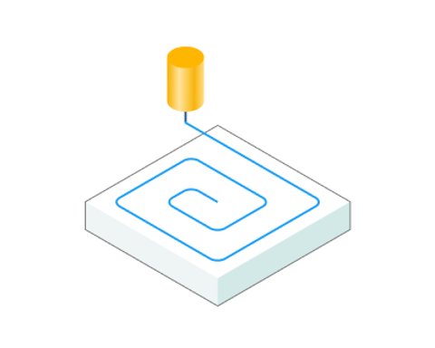 

#### Öffnungen überbrücken:

**Hole capping (Öffnungen überbrücken).** Ignoriert Öffnungen im Modell bei der Flächenbearbeitung. Die Bahnen werden erzeugt, als wären die Öffnungen geschlossen, und können darüber hinweggeführt werden.

Die Öffnungen können kreisförmig oder beliebig geformt sein. Der Größenwert entspricht dem Durchmesser einer Scheibe, die die jeweilige Öffnung vollständig abdecken kann.

Weitere Informationen anzeigen

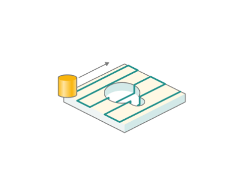 

### Parameter:

**Parameters.** Grundlegende Einstellungen dafür, wie Bauteil, Rohteil, Spannmittel und weitere Geometrie die Werkzeugbahn beeinflussen. [Details](100112.md)

### Verbindungen und An-/Abfahrbewegungen:

**Links/Leads.** Bewegungen vor, zwischen und nach Arbeitsbahnen: Anfahren von der Werkzeugwechselposition, Einfahren, Abfahren, Verbindungen und Rückkehr. Einstellbar sind Reihenfolge, Form und Abstände.

Weitere Informationen anzeigen

**Parametergruppen:**

**Approach/Return.** Steuert Bewegungen von der Werkzeugwechselposition zur Arbeitsbahn und zurück. [Details](100116.md)

**Links.** Regeln für Ein- und Ausfahrverbindungen sowie Verbindungen zwischen Arbeitsbahnen. [Details](100130.md)

**Leads.** Ergänzt Ein- und Ausfahrbewegungen mit festgelegter Form, Abmessung und zugehörigem Vorschub. [Details](100136.md)

**Safe motions.** Art und Rohteilabstand der Sicherheitsfläche für Verbindungen sowie Anfahren und Rückkehr. [Details](100117.md)

**Advanced links settings.** Erweiterte Verbindungsparameter für 5-Achsen-Bearbeitung unter Berücksichtigung der Drehachsbewegungen. [Details](100118.md)

**Distances.** Abstände für Verbindungsregeln, Vorschubwechsel und Rückzug. [Details](100140.md)

### Vorschübe und Drehzahlen:

**Feeds/Speeds.** Spindeldrehzahl, Eilgang und Vorschübe der Bahnabschnitte. Die Drehzahl kann direkt oder über die Schnittgeschwindigkeit vorgegeben werden. Der vorgegebene Wert ist unterstrichen; der andere wird anhand des Werkzeugdurchmessers berechnet. [Details](100142.md)

### Transformationen:

**Transformations.** Koordinatentransformationen der berechneten Werkzeugbahn. [Details](10168.md)

### Bauteil:

**Part.** Geometrie zur Prüfung der Bahn auf unerwünschte Einschnitte. [Details](330.md)

### Rohteil:

**Workpiece.** Material, das in der Operation bearbeitet wird. [Details](738.md)

### Spannmittel:

**Fixtures.** Spannfutter, Greifer, Spannpratzen und weitere gesperrte Geometrie, die bei der Bahnberechnung berücksichtigt wird. [Details](10283.md)