# ブレードミーリング

## 

## 適用分野:

ブレードミーリング加工は、<strong>コンプレッサー、タービン、インペラの単一ブレード</strong>を加工するための、専用の多軸仕上げ加工です。この加工では、回転軸を使用した加工モデルに基づき、ブレードの翼面（Airfoil）、フィレットを含むハブ（プラットフォーム）面、ブレード根元部、および前縁・後縁を加工します。ツールパスは、ユーザーが定義した回転軸を基準に作成され、部品の各面へ投影されます。

主な用途・一般的な加工例

- 翼面形状の仕上げ加工、<strong>らせん</strong>パスによる連続加工、個別の<strong>円形</strong>ループ、または前縁と後縁の間を走る<strong>直線</strong>パスによる加工。
- ハブ（流路）面およびブレードに隣接するフィレットの加工。
- ハブに隣接するブレード根元部の追加仕上げ加工。
- 前縁および後縁の専用縦方向加工。工具の接触点の高さを制御して加工できます。
- 薄肉ブレードのたわみを補正するための、滑らかに変化する仕上げ代 （<strong>Bend compensation stock：曲げ補正用仕上げ代</strong>）による補正。

## セットアップ：

<strong>セットアップ</strong>タブでは、プロジェクトの主要なパラメータの設定を行います。これには、装置上の部品の位置決め、部品の座標系などが含まれます。[詳細を見る](https://confluence.encycam.com/display/SC1/.Setup+v19)

<strong>ジョブ割り当て：</strong>

<strong>ブレード面</strong> ブレードの翼面を構成する面の集合（圧力面、負圧面、およびエッジ面）を指定します。<strong>ターゲットゾーン</strong>が<strong>ブレード</strong>、<strong>ブレードのルート領域</strong>、または<strong>エッジ</strong>の場合に必須です。

<strong>ハブ面</strong> ハブ（プラットフォーム、流路）を構成する面と、ハブとブレードの間にあるフィレットを含む面の集合を指定します。<strong>ターゲットゾーン</strong> が<strong>ハブ</strong>の場合に必須です。<strong>ブレードのルート領域</strong><strong>の場合</strong>、ハブ面は加工領域の制限図形として機能します。この場合、ハブ面の指定を省略することもできます。省略した場合は、ハブによる制限なしで計算が実行されます。

<strong>プロパティ</strong> 要素のプロパティを表示します。ストックを追加することも可能です。リスト内の項目をダブルクリックすることでも、このメニューを表示できます。

<strong>削除</strong> リストから項目を削除します。

<strong>制限</strong> 加工してはならない領域を制限することができます。[詳細を見る](101231.md)

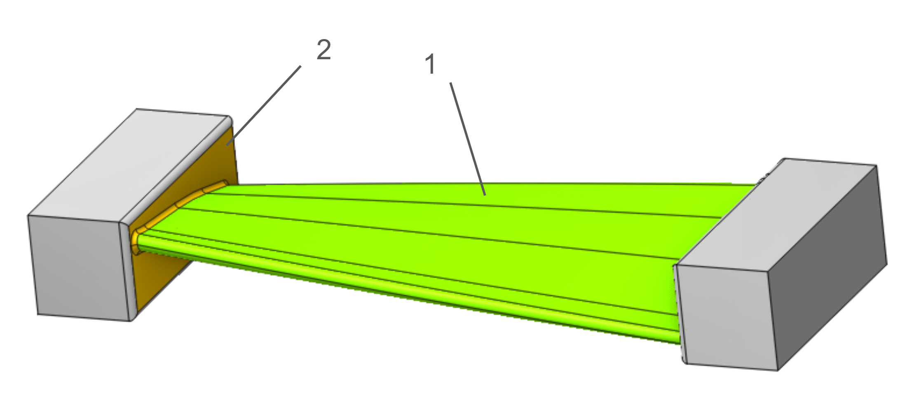

<strong>1-ブレード面、 2-ハブ面</strong>

## 加工設定

### ターゲットゾーン

<strong>ターゲットゾーン</strong>パラメータでは、ブレードのどの構造部を加工するかを選択します。これは本加工の主要な切り替え項目であり、選択内容によって、加工戦略、必要となるジオメトリグループ、および表示されるパラメータが決まります。

拡大

<strong>ブレード</strong> 翼面形状を加工します。ブレードの加工範囲全体にわたって、回転軸を中心にパスを生成し、<strong>ブレード面</strong>へ投影します。3種類すべての軌跡形式（<strong>らせん</strong><strong>、円形、直線</strong>）を使用できます。

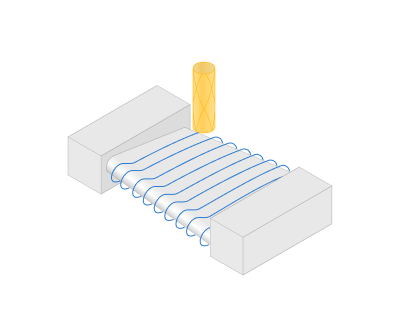

<strong>ブレードのルート領域</strong> ハブに隣接するブレード面の下部を追加加工します。加工する帯状領域は、ハブから測定した<strong>領域高さ</strong>の値によって制限されます。この領域は、ブレード翼面のメイン加工後に、別の工具（通常は、より小径またはテーパー工具）を使用して仕上げ、取り残し加工を行うことを目的としています。

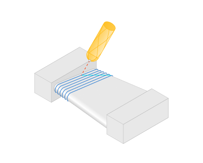

<strong>ハブ</strong> ハブ面およびフィレットを加工します。ブレード側の輪郭から外側に向かって、<strong>ハブ面</strong>上に一定の<strong>ステップ</strong>で等距離オフセットパスを順次生成します。ブレード軸方向の加工範囲は、<strong>領域高さ</strong>パラメータで設定します。ハブの外側輪郭を越えた部分では、パスが自動的に延長され、その延長部分には次のパスの送り速度が適用されます。

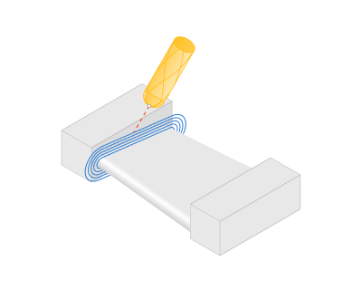

<strong>エッジ</strong> リードエッジ(LE) およびトレーリングエッジ(TE) を、縦方向のパスによって専用加工します。エッジは、翼面断面の曲率ピークとして自動的に検出されます。パスは各エッジに沿って生成され、パス数および円弧長）のパラメータに従ってエッジ上に配置されます。パスに沿った工具接触点の高さは、工具接触点によって制御できます。

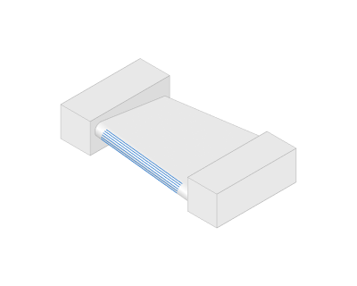

### ジョブゾーン

<strong>ジョブ割当て</strong>タブで最初に選択した加工領域に対して、追加の調整を行うことができます。

拡大

<strong>回転軸</strong> 指定した<strong>回転軸</strong>から工具軸ベクトルを定義します。回転軸の位置は、プロパティインスペクターで設定できます。回転軸は矢印を使用してインタラクティブに調整することも、ドロップダウンメニューから選択することもできます。

モードを<strong>Xに沿う、Yに沿う、</strong>または<strong>Zに沿う</strong>に設定した場合、回転軸は座標系の対応する軸方向に設定されます。

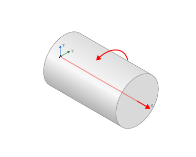

<strong>方向</strong> モードを<strong>カスタム</strong> <strong>(WCS)</strong>に設定した場合は、<strong>カスタム方向</strong><strong>グループの</strong><strong>X、Y、Z</strong>フィールドに軸ベクトルを手動で指定する必要があります。各軸に対する方向余弦を指定します。

<strong>原点 原点</strong>フィールドでは、選択した回転軸の座標の基準点となる位置を指定します。

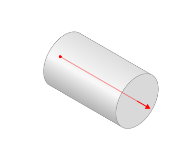

<strong>基準座標系</strong> 基準座標系は、部品のグローバル座標系とローカル座標系の間で座標系を切り替えるためのものです。

<strong>開始マージン</strong> ブレード根元からの加工開始位置のオフセット量。

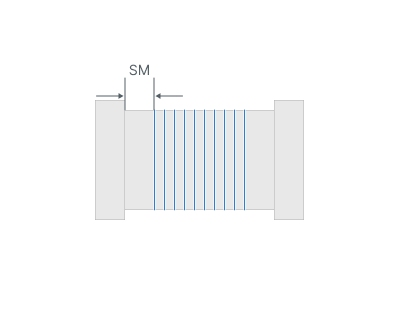

<strong>終了マージン</strong> ブレード先端からの加工終了位置のオフセット量。

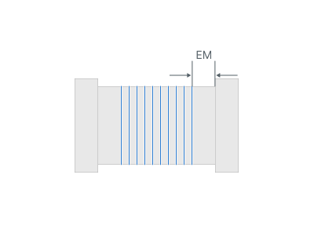

<strong>領域高さ</strong> <strong>ブレードのルート領域</strong> およ<strong>ハブ</strong>の加工対象の場合、ブレード軸方向に沿ってハブから測定した加工帯の高さを指定します。

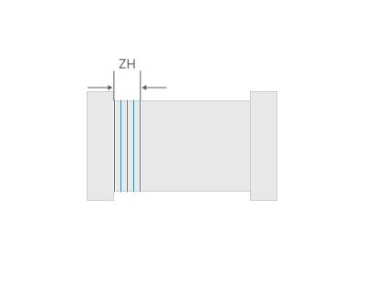

### 

### 軌跡形状

軌跡の出力形式

拡大

軌跡は、以下のいずれかの形式にすることができます。

<strong>直線</strong> このオプションを選択すると、加工パスは、加工面と<strong>回転軸</strong>を通る平面との交線として生成されます。

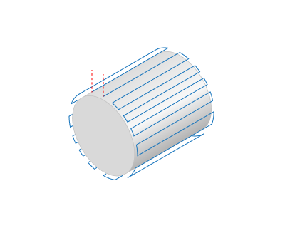

<strong>円形</strong> このオプションを選択すると、加工パスは、加工面と<strong>回転軸</strong>に垂直な平面との交線として生成されます。

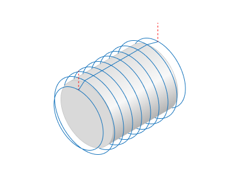

<strong>らせん</strong> このオプションを有効にすると、ツールパスが連続したらせん状の線になるように生成されます。このパターンは、ねじやインペラなどの部品の加工に適しています。

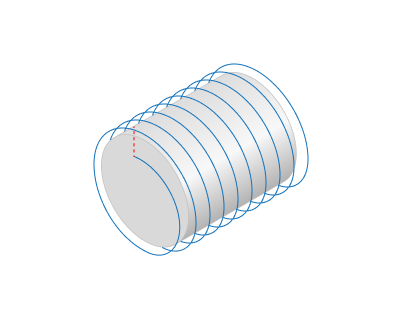

<strong>ステップ</strong> 回転軸方向における加工パス間の距離です。

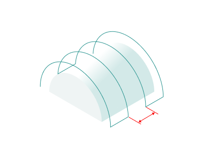

<strong>軸方向</strong> <strong>軌跡形状</strong>パラメータの設定に応じて、加工パス自体の方向、または複数の加工パスの並び順を定義します。ステップが加工のStepと一致する螺旋の場合、このパラメータによって螺旋のねじれ方向が決まります。

<strong>前方</strong> ツールパスは、<strong>回転軸</strong>ベクトルの方向に沿って並べられます。

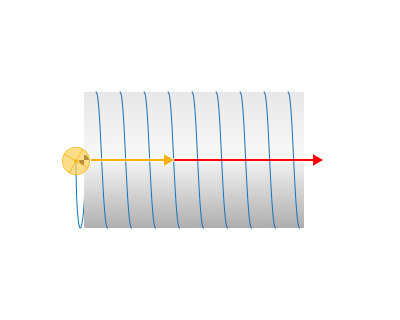

<strong>後方</strong> ツールパスは、<strong>回転軸</strong>ベクトルの<strong>逆</strong>方向に沿って並べられます。

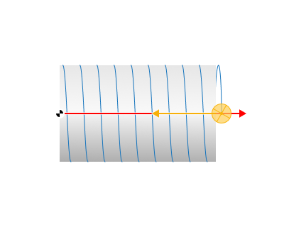

<strong>側面</strong> ブレード領域の<strong>直線</strong>および<strong>円形</strong>モードで、翼型のどちら側を加工するかを選択します。<strong>円形</strong>モードで片側のみを選択した場合、ループはエッジマージンによって制限された開いた円弧になります。

<strong>両方 サーフェスの両側から加工を行うことができます。</strong>

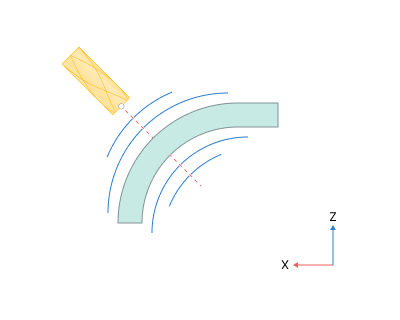

<strong>凸面</strong>（負圧面） 工具は、サーフェス法線ベクトルの正方向側からのみ加工できます。

<strong>凹面</strong>（圧力面） 工具は、サーフェス法線ベクトルとは反対側からのみ加工できます。

<strong>LE マージン</strong> 前縁の頂点から翼型の円弧に沿って設定するオフセット量です。デフォルト値は工具径と同じです。

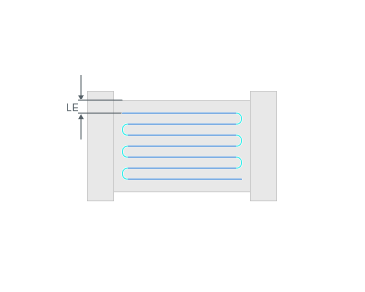

<strong>TE マージン</strong> 後縁の頂点から翼型の円弧に沿って設定するオフセット量です。

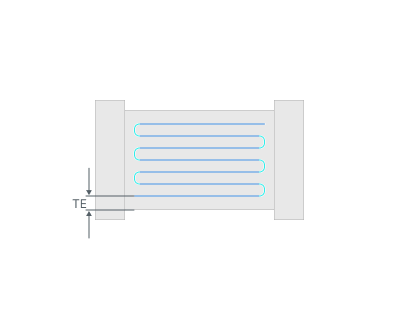

### 工具接触点

工具の接触点を変更します。

拡大

<strong>1点</strong> 加工パス全体を通して一定に保持される固定の接触点です。工具接触点（TCP）は、加工中に工具とワーク表面または形状との間で主な接触位置となる、切削工具上の特定の位置を指します。<strong>このグループは、「5Dサーフェシング」オペレーション</strong>の<strong>「工具接触点」と同様に機能します。</strong>[詳細を見る](10135.md)

<em>加工パスに沿って工具接触点を変更を変更した場合</em>

<strong>2点</strong> 初期ラインから最終ラインに向かって、加工パスに沿って工具の接触点を変更します。<strong>このグループは、「5Dサーフェシング」オペレーションの「接触点」と同様に機能します。</strong> [詳細を見る](10135.md)

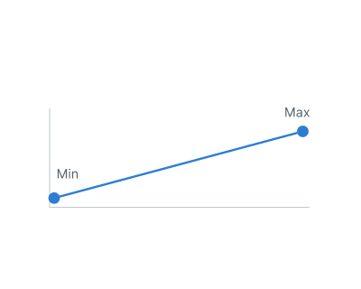

加工パスに沿って工具の接触点を変更した場合

<strong>波形</strong> 接触点は、指定した「波周期」に従って、「始点」と「終点」の値の間を正弦波状に変化します（波長は加工パスに沿って測定され、デフォルト値は20リニア単位です）。

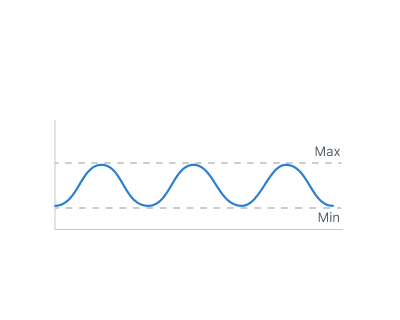

加工パスに沿って工具の接触点を変更した場合

<strong>波長</strong> 波形分布により、工具のコーナーRを最も均一に摩耗させることができます。

> 注記
>
> >
> 加工パス上の各点におけるリード角は、現在の接触高さ <strong>h</strong> と工具のコーナーR <strong>r</strong> から、次の式で算出されます。
>
> >
> lead = arccos(1 - h/r)
>
> >
> このブロックが有効な間、「工具の向き」グループの「リード角」フィールドは非表示になります。
>
> >
> 

### 工具の向き

<strong>工具の向き</strong>グループは加工中の工具軸の向きを制御します。

拡大

### エッジ法線スムージング

<strong>エッジ法線スムージング</strong>ブロックは、前縁および後縁付近のアプローチ領域において、工具の接触法線を滑らかにします。薄いエッジではサーフェスの曲率が急激に変化するため、加工パスがエッジを通過する際に工具軸が急激に「潜り込む」動きが発生します。スムージングによってエッジ手前の一定距離にわたって法線を滑らかに補間し、回転軸の急激な動きを抑えます。

<strong>曲げ補正仕上げ代</strong>

<strong>曲げ補正仕上げ代</strong>ブロックは、薄いブレードの弾性変形を補正するため、ブレードに沿って滑らかに変化する<strong>ストック</strong>を追加します。切削力がかかると、ブレードの自由端が工具から離れる方向にたわむため、一定の仕上げ加工を行うと、先端付近に未加工部分が残ります。このブロックでは、たわみやすい領域に意図的に滑らかに増加する取り代を残し、その取り代を小さな切削力で最終的な軽切削パスによって除去します。<strong>ピーク位置における最大追加仕上げ代（リニア単位）。デフォルト値は0.05です。</strong>

拡大

<strong>開始位置：</strong> 加工領域に沿った相対位置（0～1）で、追加取り代が開始される位置を指定します（デフォルト値：0.3）。0～1の範囲は、設定された開始マージンと終了マージンの間の加工領域に対応します。

<strong>ピーク位置：</strong> 追加ストックが「最大ストック」に達する相対位置を指定します（デフォルト値：0.8）。

<strong>終了位置：</strong> 追加取り代が終了する相対位置を指定します（デフォルト値：1.0）。

<strong>プロファイル：</strong> 各位置間における取り代の変化形状を指定します。<strong>線形、放物線</strong>（デフォルト）、または<strong>正弦</strong>から選択できます。

> 注記
>
> >
> このブロックは、<strong>「ブレード」</strong>および<strong>「ブレードのルート領域」</strong>の対象領域で使用できます。<strong>「ハブ」</strong>および<strong>「エッジ」</strong>領域では無視されます。

### ミーリングタイプ

曲線加工オペレーションを除き、ほとんどすべての加工で設定可能です。これにより、ツールパスの計算プロセス中に、必要なフライス加工タイプ（ダウンカットまたはアップカット）を設定できます。 ミーリングタイプのパラメータは <strong>ウォータライン荒加工オペレーション</strong>と 同様 です。[詳細を見る](https://confluence.encycam.com/display/SC1/.Waterline+roughing+operation+v19)

### 並べ替え

サーフェス加工中のツールパス順序を設定します。

拡大

<strong>開始点：</strong> プランジ加工の開始位置を定義する点です。

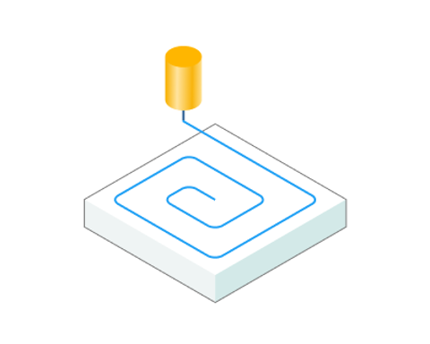 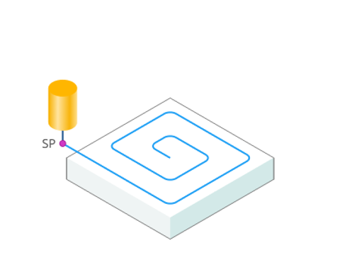

<strong>穴キャップ</strong> 幾何モデルには、すでに加工済みの穴や、後の工程で加工する予定の穴が含まれていることがよくあります。この場合、穴のあるサーフェスを加工する際に、その穴を無視することができます。無視する穴は、必ずしも円形とは限らず、任意の形状に対応します。設定したサイズは、穴を覆うことができる円盤の直径を表します。

拡大

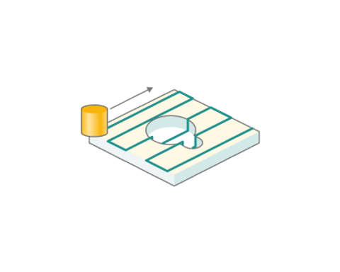 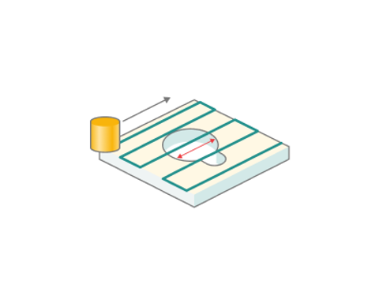

