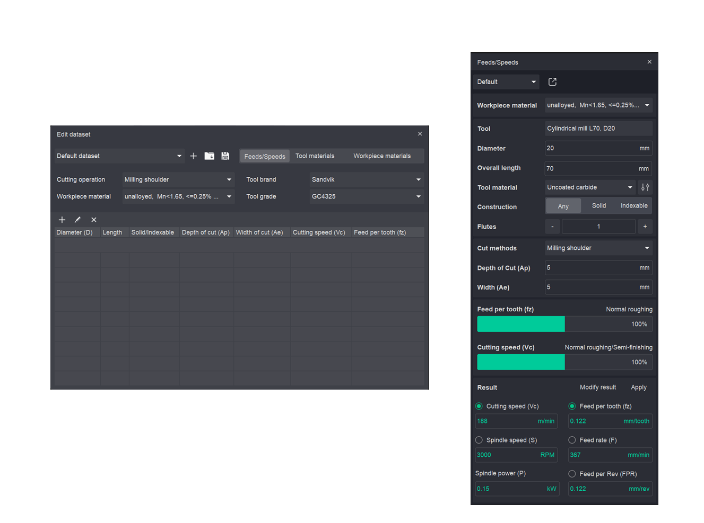
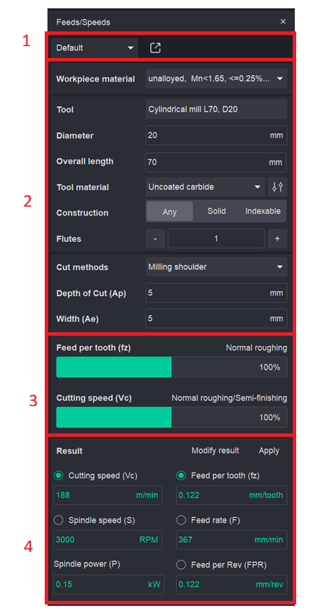
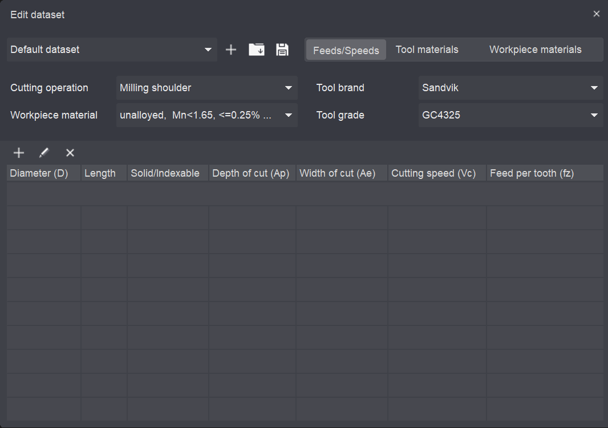

# 送り/回転 (計算)

## 適用分野:

送り/回転計算は、選択した工具、ワーク材質、加工方法に基づいて、切削速度、主軸回転数、1刃当たり送り量、送り速度などの切削条件を計算します。計算された値は加工オペレーションに反映され、適用する前に手動で微調整することができます。<strong>切削条件の計算は、専用の「計算」ボタンを押す必要はなく、いずれかのパラメータを変更するとリアルタイムで自動的に実行されます。</strong>

計算パネルは、上から順に以下の4つの領域に分かれています。

1. <strong>ツールバー</strong> 計算に使用するデータを設定するためのカスタムテーブルを管理します。
2. <strong>入力</strong> 工具、ワーク材質、切削条件を設定します。
3. <strong>計算スライダー</strong> 推奨範囲に対する切削負荷を設定します。
4. <strong>結果</strong> 計算された切削条件を表示します。

### ツールバー

<strong>データセットセレクター</strong> 使用する切削条件データのデータセットを選択します。初期設定では <strong>「デフォルトデータセット」</strong> が選択されています。これらのテーブルでは、ユーザー独自の切削条件、工具材質、ワーク材質を定義できます。

<strong>エディターを開く</strong> データセットを編集するウィンドウを開き、工具およびワーク材質のデータベースを管理します。

詳細を表示

<strong>フィルターと表示されるリストは、選択したテーブルの種類に応じて動的に切り替わります。(送り/回転、工具材質、ワーク素材)</strong>

<strong>ツールバー</strong>

<strong>データセットセレクター</strong> 編集するデータセットを選択します。

<strong>追加</strong> 新しいデータセットを作成します。

<strong>開く</strong> 既存のデータセットを読み込みます。

<strong>保存</strong> 現在のデータセットを保存します。

<strong>タブ</strong> 「送り/回転」「工具材質」「ワーク素材」の各編集画面を切り替えます。

<strong>送り/回転タブ</strong>

<strong>フィルター</strong>

表示・編集するレコードを指定します。

切削オペレーション 切削条件を適用する加工方法を指定します。

ワーク材質 フィルター対象となるワーク材質を指定します。

工具メーカー 工具のメーカーを指定します（例：Sandvik）。

工具グレード 工具メーカーのグレードを指定します（例：GC4325）。

ISO グループ 材質グループを指定します（P、M、K、N、S、H、O）。材質が属するグループを選択します。

サブグループ ISOグループをさらに細分化します（例：非合金鋼）。

<strong>リスト</strong> 選択したテーブルに応じたデータの一覧を表示します。

### 入力パラメータ

<strong>ワーク素材</strong> 加工対象となるワーク材質をデータセットから選択します。例：非合金鋼、Mn＜1.65、C≦0.25%

<strong>工具</strong> 計算対象となる工具を指定します（例：エンドミル L70、D20）。工具は現在の加工オペレーションから取得されます。

<strong>直径</strong> 工具の切削径を指定します。（mm）

<strong>全長</strong> 工具の全長を指定します。（mm）

<strong>工具材質</strong> 工具の切削部の材質を指定します（例：コーティングなし超硬）。右側のアイコンを使用して、工具材質のプリセットを切り替えます。

<strong>構造</strong> 工具本体のタイプを指定します。（任意、ソリッド、インサート式）

<strong>刃数</strong> 工具の切れ刃数を指定します。「－」／「＋」ボタンで調整します。

<strong>加工方法</strong> Mill加工の加工方法を指定します。例：肩削り

<strong>切込み深さ（Ap）</strong> 軸方向の切込み深さを指定します。（mm）

<strong>切込み幅（Ae）</strong> 半径方向の切込み幅を指定します。（mm）

### 計算スライダー

2つのスライダーを使用して、推奨範囲に対する加工負荷を設定します。各スライダーの上に表示されるラベルには、対応する加工条件が表示されます。

<strong>1刃当たり送り量（fz）</strong> 送り負荷を設定します。ラベルには、例えば「標準荒加工」などの加工条件が表示されます。設定範囲：0～100%

<strong>切削速度（Vc）</strong> 速度負荷を設定します。ラベルには、例えば「標準荒加工／中仕上げ加工」などの加工条件が表示されます。設定範囲：0～100%

<em>スライダーを移動すると、「<strong>計算</strong>」を実行した際に、関連する結果の値が再計算されます。</em>

### 結果

| パラメータ | 記号 | 単位 | 例 |
|---|---|---|---|
| 切削速度 | Vc | m/分 | 153 |
| 1刃当たり送り量 | fz | mm/刃 | 0.115 |
| 主軸回転数 | S | RPM | 2435 |
| 送り速度 | F | mm/分 | 280 |
| 主軸動力 | P | kW | 0.15 |
| 1回転当たり送り量 | FPR | rev/分 | 0.115 |

計算された値が表示されます。 <strong>結果を変更</strong>をクリックすると、値を手動で編集できます。

<strong>適用</strong>機能を使用すると、計算した切削条件を指定した加工工程へ反映できます。この画面では、加工工程へ出力するデータ形式を指定できます。 切削速度と送り速度をmm/分で指定する形式、または主軸回転数と1回転当たりの送り量をmm/回転で指定する形式を選択できます。
