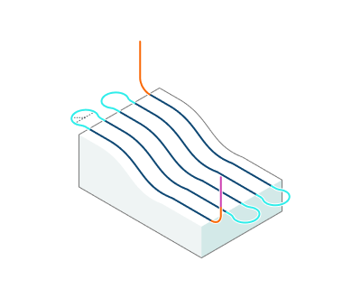
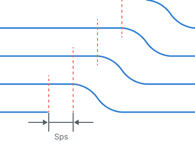
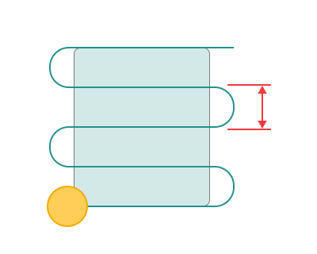
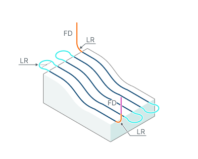
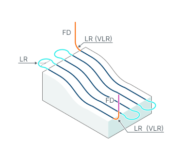

# Links for 3D/5D advanced operations

## Application Area:

Defines the rules governing Entry/Exit links and links between work moves.

**Start point shift (For additive operations).**

Click here to expand..

The start point shift relative to the previous layer allows to get a more even distribution of zones where the feed of material starts/stops and where the quality of the formed surface is usually lower.

*Note: For "Non-planar slicing" operation this option is available only if "Start points" parameter on the "Strategy" page is set to "Auto" or "Custom for first layers" mode.*

**Sps** - Start point shift

**Entry/Exit links.** Defines the general rule of approach/return.

Click here to expand..

**Straight.**

With this rule, the approach to the part is carried out: 1. **Tool change position** 2.**Appr**- Approach 3. **LD** - Leads (If they are enabled) The returnl is carried out in the reverse order: 1. **LD** - Leads (If they are enabled) 2.**Ret** - Return 3. **Tool change position**

.png)

**By Feed Distance.**

With this rule, the approach to the part is carried out: 1. **Tool change position** 2.**Appr**- Approach 3. **FD** - Feed distance 4. **LR** - Linking Radius (depends on the type of Leads. If the Leads is located vertically, then as a rule, the arc is not built) 5. **LD** - Leads (If they are enabled) The returnl is carried out in the reverse order: 1. **LD** - Leads (If they are enabled) 2. **LR** - Linking Radius (depends on the type of Leads. If the Leads is located vertically, then as a rule, the arc is not built) 3.**FD** - Feed distance 4.**Ret** - Return 5. **Tool change position**

.png)

**By Rapid Distance.**

With this rule, the approach to the part is carried out: 1. **Tool change position** 2. **Appr**- Approach 3. **RD** - Rapid distance 4. **FD** - Feed distance 5. **LR** - Linking Radius (depends on the type of Leads. If the Leads is located vertically, then as a rule, the arc is not built) 6. **LD** - Leads (If they are enabled) The returnl is carried out in the reverse order: 1. **LD** - Leads (If they are enabled) 2. **LR** - Linking Radius (depends on the type of Leads. If the Leads is located vertically, then as a rule, the arc is not built) 3. **FD** - Feed distance 4. **RD** - Rapid distance 5. **Ret** - Return 6. **Tool change position**

.png)

**On Safe Surface.**

With this rule, the approach to the part is carried out: 1. **Tool change position** 2.**Appr**- Approach 3.**SL** - Safe level 4. **FD** - Feed distance 5.**LR** - Linking Radius (depends on the type of Leads. If the Leads is located vertically, then as a rule, the arc is not built) 6. **LD** - Leads (If they are enabled) The returnl is carried out in the reverse order: 1. **LD** - Leads (If they are enabled) 2. **LR** - Linking Radius (depends on the type of Leads. If the Leads is located vertically, then as a rule, the arc is not built) 3. **FD** - Feed distance 4. **SL** - Safe level 5. **Ret** - Return 6. **Tool change position**

.png)

**Short links/Long links.** Defines the rule for transition between work moves.

Click here to expand..

**Straight.** Links are made by the shortest distance.

.png)

**Smooth.** Links are made by a smooth spline curve.

-1.png)

**High Speed.** Links are made by a smooth curve in such a way that the **Link radius** is nowhere exceeded.

-1.png)

**By Feed Distance.**

The links made from from the **Feed distance**. Additionally transition curves may be smoothed by the **Link radius**. **FD** - Feed distance **LR** - Link radius

.png)

**By Rapid Distance.**

The links made from from the **Linking Radius** and **Rapid distance**. **RD** - Rapid distance **LR** - Linking Radius

.png)

**On Safe Surface.**

The links made from from the **Linking Radius** + **Feed distance** to the **Safe level**. **LR** - Linking Radius **FD** - Feed distance **SL** - Safe level

.png)

**On Offset Surface.**

Works as a displacement of the treated surface by a distance Feed distance. Works with milling type: Climb, Conventional. **FD** - Feed distance

.png)

**Short link max distance.** Sets the maximum distance at which links are made by the short link type.

**Linking Radius.**

Click here to expand..

**Link radius** sets the radius of smoothing for

- **Highspeed links** - **Feed distance links** (depends on the type of Leads. If the **Leads** is located vertically, then as a rule, the arc is not built)

**FD -** Feed distance **LR -** Link radius

**Vertical Lead Radius.**

Click here to expand..

The Vertical Lead Radius parameter, in combination with the Linking Radius, expands the connection zone to include a vertical displacement, enabling "Frog Jump" transitions.

**FD -** Feed distance **LR -** Link radius **VLR -** Vertical Lead Radius

