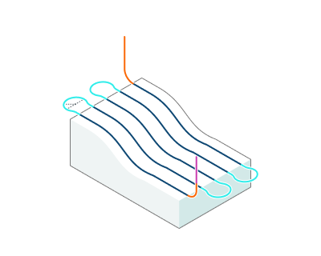
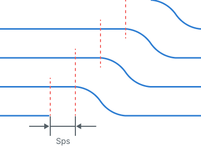
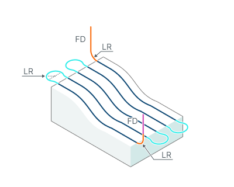
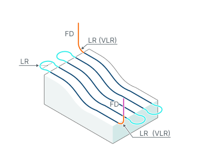

# Collegamenti per le operazioni avanzate 3D/5D

## Ambito di applicazione:

Definisce le regole che governano i collegamenti di entrata/uscita e i collegamenti tra i movimenti di lavoro.

<strong>Start point shift (For additive operations).</strong> (spostamento del punto iniziale, per le operazioni additive)

Fare clic qui per espandere..

Lo spostamento del punto iniziale rispetto allo strato precedente consente di ottenere una distribuzione più uniforme delle zone in cui l'alimentazione del materiale inizia/si interrompe e in cui la qualità della superficie formata è di solito inferiore.

<em>Nota: per l'operazione "Non-planar slicing" questa opzione è disponibile solo se il parametro "Start points" nella pagina "Strategy" è impostato sulla modalità "Auto" o "Custom for first layers".</em>

<strong>Sps</strong> - Spostamento del punto iniziale (Start point shift)

<strong>Entry/Exit links.</strong> (collegamenti di entrata/uscita) Definisce la regola generale di avvicinamento/ritorno.

Fare clic qui per espandere..

<strong>Straight.</strong> (diretto)

Con questa regola l'avvicinamento al pezzo avviene nel seguente ordine: 1. <strong>Tool change position</strong> (posizione di cambio utensile) 2.<strong>Appr</strong>- Avvicinamento (Approach) 3. <strong>LD</strong> - Attacchi (Leads, se abilitati) Il ritorno avviene nell'ordine inverso: 1. <strong>LD</strong> - Attacchi (Leads, se abilitati) 2.<strong>Ret</strong> - Ritorno (Return) 3. <strong>Tool change position</strong>

.png)

<strong>By Feed Distance.</strong> (per distanza di avanzamento)

Con questa regola l'avvicinamento al pezzo avviene nel seguente ordine: 1. <strong>Tool change position</strong> 2.<strong>Appr</strong>- Avvicinamento 3. <strong>FD</strong> - Distanza di avanzamento (Feed distance) 4. <strong>LR</strong> - Raggio di collegamento (Linking Radius; dipende dal tipo di attacchi: se l'attacco è disposto verticalmente, di norma l'arco non viene costruito) 5. <strong>LD</strong> - Attacchi (Leads, se abilitati) Il ritorno avviene nell'ordine inverso: 1. <strong>LD</strong> - Attacchi (Leads, se abilitati) 2. <strong>LR</strong> - Raggio di collegamento (Linking Radius; dipende dal tipo di attacchi: se l'attacco è disposto verticalmente, di norma l'arco non viene costruito) 3.<strong>FD</strong> - Distanza di avanzamento 4.<strong>Ret</strong> - Ritorno 5. <strong>Tool change position</strong>

.png)

<strong>By Rapid Distance.</strong> (per distanza in rapido)

Con questa regola l'avvicinamento al pezzo avviene nel seguente ordine: 1. <strong>Tool change position</strong> 2. <strong>Appr</strong>- Avvicinamento 3. <strong>RD</strong> - Distanza in rapido (Rapid distance) 4. <strong>FD</strong> - Distanza di avanzamento 5. <strong>LR</strong> - Raggio di collegamento (Linking Radius; dipende dal tipo di attacchi: se l'attacco è disposto verticalmente, di norma l'arco non viene costruito) 6. <strong>LD</strong> - Attacchi (Leads, se abilitati) Il ritorno avviene nell'ordine inverso: 1. <strong>LD</strong> - Attacchi (Leads, se abilitati) 2. <strong>LR</strong> - Raggio di collegamento (Linking Radius; dipende dal tipo di attacchi: se l'attacco è disposto verticalmente, di norma l'arco non viene costruito) 3. <strong>FD</strong> - Distanza di avanzamento 4. <strong>RD</strong> - Distanza in rapido 5. <strong>Ret</strong> - Ritorno 6. <strong>Tool change position</strong>

.png)

<strong>On Safe Surface.</strong> (sulla superficie di sicurezza)

Con questa regola l'avvicinamento al pezzo avviene nel seguente ordine: 1. <strong>Tool change position</strong> 2.<strong>Appr</strong>- Avvicinamento 3.<strong>SL</strong> - Livello di sicurezza (Safe level) 4. <strong>FD</strong> - Distanza di avanzamento 5.<strong>LR</strong> - Raggio di collegamento (Linking Radius; dipende dal tipo di attacchi: se l'attacco è disposto verticalmente, di norma l'arco non viene costruito) 6. <strong>LD</strong> - Attacchi (Leads, se abilitati) Il ritorno avviene nell'ordine inverso: 1. <strong>LD</strong> - Attacchi (Leads, se abilitati) 2. <strong>LR</strong> - Raggio di collegamento (Linking Radius; dipende dal tipo di attacchi: se l'attacco è disposto verticalmente, di norma l'arco non viene costruito) 3. <strong>FD</strong> - Distanza di avanzamento 4. <strong>SL</strong> - Livello di sicurezza 5. <strong>Ret</strong> - Ritorno 6. <strong>Tool change position</strong>

.png)

<strong>Short links/Long links.</strong> (collegamenti corti/lunghi) Definisce la regola di transizione tra i movimenti di lavoro.

Fare clic qui per espandere..

<strong>Straight.</strong> I collegamenti vengono eseguiti lungo la distanza più breve.

.png)

<strong>Smooth.</strong> I collegamenti vengono eseguiti lungo una curva spline raccordata.

-1.png)

<strong>High Speed.</strong> I collegamenti vengono eseguiti lungo una curva raccordata in modo che il <strong>Link radius</strong> (raggio di collegamento) non venga superato in alcun punto.

-1.png)

<strong>By Feed Distance.</strong>

I collegamenti vengono costruiti a partire dalla <strong>Feed distance</strong> (distanza di avanzamento). Le curve di transizione possono inoltre essere raccordate con il <strong>Link radius</strong>. <strong>FD</strong> - Distanza di avanzamento <strong>LR</strong> - Raggio di collegamento

.png)

<strong>By Rapid Distance.</strong>

I collegamenti vengono costruiti a partire dal <strong>Linking Radius</strong> e dalla <strong>Rapid distance</strong> (distanza in rapido). <strong>RD</strong> - Distanza in rapido <strong>LR</strong> - Raggio di collegamento

.png)

<strong>On Safe Surface.</strong>

I collegamenti vengono costruiti a partire dal <strong>Linking Radius</strong> + <strong>Feed distance</strong> fino al <strong>Safe level</strong> (livello di sicurezza). <strong>LR</strong> - Raggio di collegamento <strong>FD</strong> - Distanza di avanzamento <strong>SL</strong> - Livello di sicurezza

.png)

<strong>On Offset Surface.</strong> (sulla superficie offset)

Funziona come uno spostamento della superficie lavorata della distanza Feed distance. Funziona con i tipi di fresatura Climb (concorde) e Conventional (discorde). <strong>FD</strong> - Distanza di avanzamento

.png)

<strong>Short link max distance.</strong> (distanza massima del collegamento corto) Imposta la distanza massima entro la quale i collegamenti vengono eseguiti con il tipo di collegamento corto.

<strong>Linking Radius.</strong> (raggio di collegamento)

Fare clic qui per espandere..

<strong>Link radius</strong> imposta il raggio di raccordo per

- <strong>Highspeed links</strong> - <strong>Feed distance links</strong> (dipende dal tipo di attacchi: se l'attacco (<strong>Leads</strong>) è disposto verticalmente, di norma l'arco non viene costruito)

<strong>FD -</strong> Distanza di avanzamento <strong>LR -</strong> Raggio di collegamento

<strong>Vertical Lead Radius.</strong> (raggio di attacco verticale)

Fare clic qui per espandere..

Il parametro Vertical Lead Radius, in combinazione con il Linking Radius, estende la zona di collegamento includendo uno spostamento verticale e consente le transizioni a "salto di rana" ("Frog Jump").

<strong>FD -</strong> Distanza di avanzamento <strong>LR -</strong> Raggio di collegamento <strong>VLR -</strong> Raggio di attacco verticale (Vertical Lead Radius)

