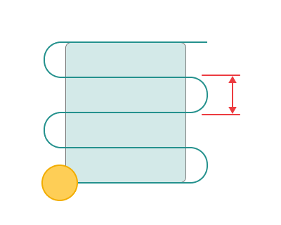

# 3Dオペレーションに関するリンク

## 適用分野：

このグループでは、領域間の切り込みや移行動作の設定を定義します。

### ショートリンクの最大距離

拡大

ショートリンクタイプでリンクが作成される最大距離を設定します。

### ショートリンクタイプ

拡大

<strong>直接</strong> リンクは最短距離で作成されます。

<strong>LD -</strong> リード

<strong>退避–切り込み</strong> リンクは<strong>リード</strong>と最短距離によって設定されます。

<strong>LD -</strong> リード

<strong>安全平面経由</strong>

リターン時のリンク: <strong>1. リード (LD)</strong> <strong>2. 安全高さ (SL)</strong> <strong>安全平面上での移動</strong> アプローチ時のリンク: <strong>1. 安全高さ(SL)</strong> <strong>2. 送り距離（高さ）(FD)</strong> <strong>3. リード (LD)</strong>

