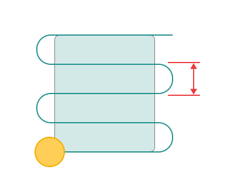

# Links for 3D operations

_1.png)

## Application Area:

This group defines the settings for cutting in or transitions between areas.

**Short link max distance.**

Click here to expand..

Sets the maximum distance at which links are made by the short link type.

**Short link type.**

Click here to expand..

**Direct.** Links are made by the shortest distance.

.png)

**LD -** Leads

**Retract-engage.** Links are set by **Leads** and shortest distance

.png)

**LD -** Leads

**Via safe plane.**

Links on the return: **1.Leads (LD)** **2.Safe level (SL)** **Movement on the plane of safety** Links on the approach: **1.Safe level (SL)** **2. Feed distance (level) (FD)** **3. Leads (LD)**

.png)

