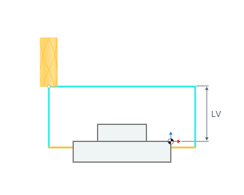
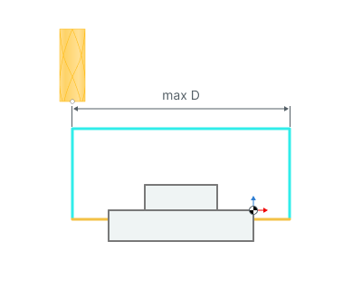
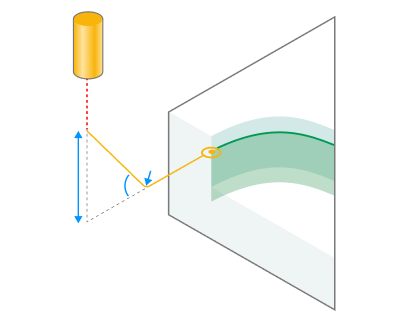
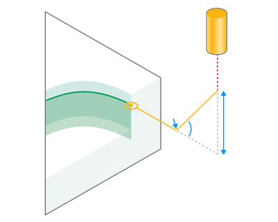

# 輪郭加工のリンク

.png)

## 適用分野：

このグループでは、領域間の切り込みや移行時の設定を定義します。

<strong>移動。</strong>

詳細を表示

<strong>安全平面経由</strong> 移行は安全な高さで行われます。

2.png)

<strong>FD</strong> - 送り距離 <strong>SL</strong> - 安全高さ <strong>LD</strong> - リード

<strong>ワーク周囲</strong> 移行動作はツールパスの高さで行われます。この機能を動作させるには、 <strong>パラメータ</strong>タブで<strong>ワークチェック</strong>を有効にする必要があります。このアルゴリズムは、加工物に衝突することなく最短の工具経路を構築します。

.png)

<strong>FD</strong> - 送り距離 <strong>LD</strong> - リード

<strong>移行高さ</strong> この移行は、<strong>ワーク座標系</strong>から測定される高さを通して行われます。

.png)

<strong>FD</strong> - 送り距離 <strong>LD</strong> - リード

<strong>高さ</strong> <strong>ワーク座標系</strong>から測定される高さを指定します。

<strong>最大距離</strong> 高さを経由する際の移行距離を定義します。距離がパラメータの値より大きい場合、安全高さを経由して移行が実行されます。

<strong>リードイン時の突き込み／リードアウト時の上昇。</strong>

詳細を表示

プランジ/ライズ方式を設定できます。

.png)  .png) 

<strong>高さ</strong> 傾斜したプランジ／上昇動作の高さを設定します。

<strong>ランプの角度</strong> プランジ（下降）／ライズ（上昇）の角度を設定します。

<strong>円弧半径の円滑化</strong> プランジ／上昇時の軌跡を、指定した半径の円弧で滑らかにつなぎます。

