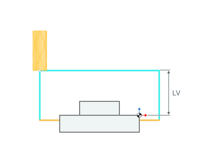
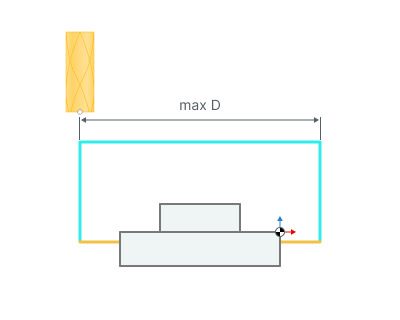
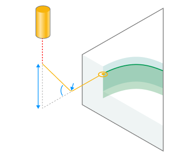
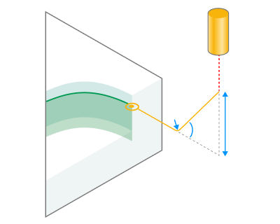

# 輪郭のリンク

## 適用分野：

このグループでは、領域間の切り込みや移行時の設定を定義します。

### 移行

拡大

<strong>安全平面経由</strong> 移行は安全な高さで行われます。

<strong>FD</strong> - 送り距離 <strong>SL</strong> - 安全高さ <strong>LD</strong> - リード

<strong>ワーク周囲</strong> 移行動作はツールパスの高さで行われます。この機能を動作させるには、 <strong>パラメータ</strong>タブで<strong>ワークチェック</strong>を有効にする必要があります。このアルゴリズムは、加工物に衝突することなく最短の工具経路を構築します。

<strong>FD</strong> - 送り距離 <strong>LD</strong> - リード

<strong>移行高さ</strong> この移行は、<strong>ワーク座標系</strong>から測定される高さを通して行われます。

<strong>FD</strong> - 送り距離 <strong>LD</strong> - リード</strong>

<strong>高さ</strong> <strong>ワーク座標系</strong>から測定される高さを指定します。

<strong>最大距離</strong> 高さを経由する際の移行距離を定義します。距離がパラメータの値より大きい場合、安全高さを経由して移行が実行されます。

### リードインでのプランジ(下降)/リードアウトでのライズ(上昇)

拡大

プランジ/ライズ方式を設定できます。

   

<strong>高さ</strong> プランジ/ライズ の角度の高さを決定します。

<strong>ランプの角度</strong> プランジ（下降）／ライズ（上昇）の角度を設定します。

<strong>円弧半径の円滑化</strong> プランジ/ライズ時に半径を通る軌道を滑らかにできます。

