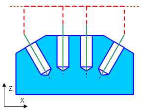
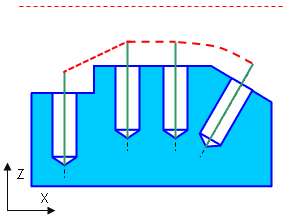
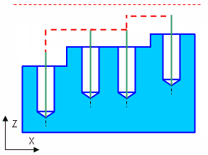

# Verbindungen bei Bohrungsoperationen

_(Via_safe_surface).png)

## Anwendungsbereich:

Diese Parameter bestimmen die Anschlussstellen der An- und Rückfahrt sowie die Hilfsbewegungen zwischen Bohrungen.

**First link type (Erster Verbindungstyp).** Legt die Anfahrt zur ersten Bohrung fest.

Weitere Informationen anzeigen

**Via safe surface (Über Sicherheitsfläche).** Die Bahn wird entlang der Bohrungsachse bis zur angegebenen Sicherheitsfläche, also Ebene, Zylinder oder Kugel, geführt.

_(Via_safe_surface).png)

Die Folge zur ersten Bohrung lautet: Werkzeugwechselposition → **Appr** → **SL** → **Amsl**, wenn **Start cycles at air move safety level** aktiviert ist, andernfalls **RD** → **FD**. Amsl bezeichnet die Sicherheitshöhe für Leerbewegungen, RD den Eilgangabstand und FD den Vorschubabstand. Die Rückfahrt zur Werkzeugwechselposition erfolgt über **Ret**.

**Via Air Move Safety Level (Über Sicherheitshöhe für Leerbewegungen).** Die Bahn führt entlang der Bohrungsachse bis zu dieser Höhe.

_(Via_air_move_safety_level).png)

Die Folge lautet: Werkzeugwechselposition → **Appr** → **Amsl** → **RD**, falls **Start cycles at air move safety level** deaktiviert ist, → **FD**. Die Rückfahrt erfolgt über **Ret**.

**Straight (Direkt).** Direkte Verbindung zwischen den ersten Zykluspunkten der Bohrungen.

_(Straight).png)

Die Folge lautet: Werkzeugwechselposition → **Appr** → **Amsl** bei aktiviertem Zyklusstart auf dieser Höhe, andernfalls **RD** → **FD**. Die Rückfahrt erfolgt über **Ret**.

**Last link type (Letzter Verbindungstyp).** Legt den Rückzug von der zuletzt bearbeiteten Bohrung fest.

Weitere Informationen anzeigen

**Via safe surface (Über Sicherheitsfläche).** Verlängert die Bahn entlang der Bohrungsachse bis zur Sicherheitsfläche.

_(Via_safe_surface).png)

Die dargestellte Folge an der letzten Bohrung lautet: **SL** → **Amsl** bei aktiviertem Zyklusstart auf dieser Höhe, andernfalls **RD** → **FD**. Die Rückfahrt zur Werkzeugwechselposition erfolgt über **Ret**.

**Via Air Move Safety Level (Über Sicherheitshöhe für Leerbewegungen).** Führt entlang der Bohrungsachse bis zu dieser Höhe.

_(Via_air_move_safety_level).png)

Die dargestellte Folge lautet: **Amsl** → **RD**, falls **Start cycles at air move safety level** deaktiviert ist, → **FD**. Die Rückfahrt erfolgt über **Ret**.

**Straight (Direkt).** Direkte Verbindung zwischen den ersten Zykluspunkten der Bohrungen.

_(Straight).png)

Die dargestellte Folge lautet: **Amsl** bei aktiviertem Zyklusstart auf dieser Höhe, andernfalls **RD** → **FD**. Die Rückfahrt erfolgt über **Ret**.

**Long Link Type (Typ langer Verbindungen).** Bestimmt Übergänge zwischen aufeinanderfolgenden Bohrungen, deren Abstand **Short Link Max Distance** überschreitet.

Weitere Informationen anzeigen

**Via Air Move Safety Level.** Führt auf kürzestem Weg zur nächsten Bohrung auf der eingestellten Sicherheitshöhe für Leerbewegungen und anschließend entlang der Werkzeugachse zum Vorschubabstand.

**Via safe surface.** Führt auf der Sicherheitsfläche zur nächsten Bohrung und anschließend entlang der Werkzeugachse zum Vorschubabstand.

**Straight.** Führt auf kürzestem Weg zur nächsten Bohrung auf den unter **Rapid Distance** festgelegten Abstand und anschließend entlang der Werkzeugachse zum Vorschubabstand.

**Orthogonal.** Liegt die Eilgangposition der nächsten Bohrung höher, zieht sich das Werkzeug zunächst entlang seiner Achse auf diese Höhe zurück. Danach bewegt es sich auf kürzestem Weg zur nächsten Bohrung und senkt sich entlang seiner Achse bis zum Vorschubabstand ab.

**Short Link Type (Typ kurzer Verbindungen).** Bestimmt Übergänge, deren Abstand unter **Short Link Max Distance** liegt. Es stehen dieselben Varianten wie für lange Verbindungen zur Verfügung.

**Short link max angle / Short link max distance (Maximaler Winkel / Abstand kurzer Verbindungen).**

Weitere Informationen anzeigen

Die Grenzwerte unterscheiden kurze und lange Verbindungen, damit unterschiedliche Regeln verwendet werden können. Überschreitet der Übergang die für kurze Verbindungen zulässigen Abstände oder Winkel, wird **Long Link Type** verwendet; andernfalls **Short Link Type**.

.png) .png)

**SLMD –** Maximaler Abstand kurzer Verbindungen

**SLMA –** Maximaler Winkel kurzer Verbindungen

**SLT –** Typ kurzer Verbindungen

**LLT –** Typ langer Verbindungen

