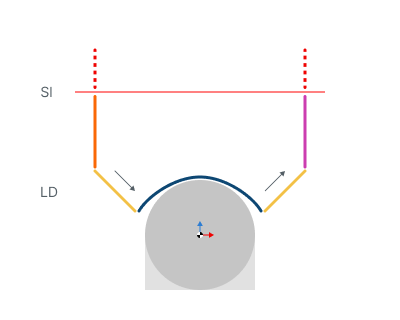

# Leads for 3D operations

**Sl** - Safe level

**LD** - Leads

## Application Area:

Allows you to add additional engage and retract to the working moves using their feed.

**Engage.**

Click here to expand..

**Off.** The Engage and Retract toolpath parts is not generated.

.png)

**Vertical.** The engage is performed vertical to the first point of the work pass.

.png)

**Horizontal.** The engage is performed perpendicular to the tool axis to the first point of the work pass

.png)

**Angle to Z Axis.** The engage is performed by angle to vertical to the first machining point

.png)

**By Normal.** The engage is performed along the normal to surface at the first point of the work pass

.png)

**By Tangent.** The engage is performed tangentially to the first machining point

.png)

**Angle to Tangent.** The engage is performed by angle to tangent to the first machining point

.png)

**By Arc.** The system adds an arc to the first point on the curve using the defined radius.

.png)

**By Arc (Angle).** The system adds an arc to the first point on the curve using the defined radius. The arc angle is constructed from the tangent of the work pass.

).png)

**Depending on the engage, it becomes possible to control additional parameters:**

**Length (Radius).** Changes the length

.png) .png)

**Angle.** Changes the vertical angle

.png)

**Retract.**

Click here to expand..

**Off.** The Engage and Retract toolpath parts is not generated.

.png)

**Vertical.** The retract is performed vertical to the last point of the work pass.

.png)

**Horizontal.** The retract is performed perpendicular to the tool axis to the last point of the work pass

.png)

**Angle to Z Axis.** The retract is performed by angle to vertical to the last machining point

.png)

**By Normal.** The retract is performed along the normal to surface at the last point of the work pass

.png)

**By Tangent.** The retract is performed tangentially to the last machining point

.png)

**Angle to Tangent.** The retract is performed by angle to tangent to the last machining point

.png)

**By Arc.** The system adds an arc to the last point on the curve using the defined radius.

.png)

**By Arc (Angle).** The system adds an arc to the last point on the curve using the defined radius. The arc angle is constructed from the tangent of the work pass.

).png)

**Depending on the engage, it becomes possible to control additional parameters:**

**Length (Radius).** Changes the length

.png) .png)

**Angle.** Changes the vertical angle

.png)

