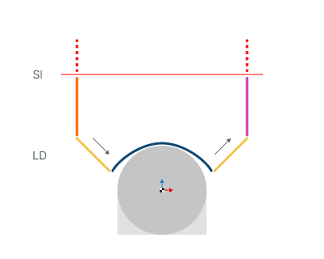

# Attacchi per le operazioni 3D

<strong>Sl</strong> - livello di sicurezza (Safe level)

<strong>LD</strong> - attacchi (Leads)

## Ambito di applicazione:

Consente di aggiungere ai movimenti di lavoro ulteriori movimenti di attacco e di uscita eseguiti con il relativo avanzamento.

<strong>Engage.</strong> (attacco)

Fare clic qui per espandere..

<strong>Off.</strong> (disattivato) Le parti di percorso utensile di attacco e di uscita non vengono generate.

.png)

<strong>Vertical.</strong> (verticale) L'attacco viene eseguito in direzione verticale verso il primo punto della passata di lavoro.

.png)

<strong>Horizontal.</strong> (orizzontale) L'attacco viene eseguito perpendicolarmente all'asse utensile verso il primo punto della passata di lavoro

.png)

<strong>Angle to Z Axis.</strong> (angolo rispetto all'asse Z) L'attacco viene eseguito con un angolo rispetto alla verticale verso il primo punto di lavorazione

.png)

<strong>By Normal.</strong> (lungo la normale) L'attacco viene eseguito lungo la normale alla superficie nel primo punto della passata di lavoro

.png)

<strong>By Tangent.</strong> (lungo la tangente) L'attacco viene eseguito tangenzialmente al primo punto di lavorazione

.png)

<strong>Angle to Tangent.</strong> (angolo rispetto alla tangente) L'attacco viene eseguito con un angolo rispetto alla tangente al primo punto di lavorazione

.png)

<strong>By Arc.</strong> (ad arco) Il sistema aggiunge un arco fino al primo punto della curva utilizzando il raggio definito.

.png)

<strong>By Arc (Angle).</strong> (ad arco, con angolo) Il sistema aggiunge un arco fino al primo punto della curva utilizzando il raggio definito. L'angolo dell'arco viene costruito a partire dalla tangente della passata di lavoro.

).png)

<strong>A seconda dell'attacco, diventa possibile controllare parametri aggiuntivi:</strong>

<strong>Length (Radius).</strong> (lunghezza, raggio) Modifica la lunghezza

.png) .png)

<strong>Angle.</strong> (angolo) Modifica l'angolo verticale

.png)

<strong>Retract.</strong> (uscita)

Fare clic qui per espandere..

<strong>Off.</strong> (disattivato) Le parti di percorso utensile di attacco e di uscita non vengono generate.

.png)

<strong>Vertical.</strong> (verticale) L'uscita viene eseguita in direzione verticale dall'ultimo punto della passata di lavoro.

.png)

<strong>Horizontal.</strong> (orizzontale) L'uscita viene eseguita perpendicolarmente all'asse utensile dall'ultimo punto della passata di lavoro

.png)

<strong>Angle to Z Axis.</strong> (angolo rispetto all'asse Z) L'uscita viene eseguita con un angolo rispetto alla verticale dall'ultimo punto di lavorazione

.png)

<strong>By Normal.</strong> (lungo la normale) L'uscita viene eseguita lungo la normale alla superficie nell'ultimo punto della passata di lavoro

.png)

<strong>By Tangent.</strong> (lungo la tangente) L'uscita viene eseguita tangenzialmente all'ultimo punto di lavorazione

.png)

<strong>Angle to Tangent.</strong> (angolo rispetto alla tangente) L'uscita viene eseguita con un angolo rispetto alla tangente all'ultimo punto di lavorazione

.png)

<strong>By Arc.</strong> (ad arco) Il sistema aggiunge un arco fino all'ultimo punto della curva utilizzando il raggio definito.

.png)

<strong>By Arc (Angle).</strong> (ad arco, con angolo) Il sistema aggiunge un arco fino all'ultimo punto della curva utilizzando il raggio definito. L'angolo dell'arco viene costruito a partire dalla tangente della passata di lavoro.

).png)

<strong>A seconda dell'attacco, diventa possibile controllare parametri aggiuntivi:</strong>

<strong>Length (Radius).</strong> (lunghezza, raggio) Modifica la lunghezza

.png) .png)

<strong>Angle.</strong> (angolo) Modifica l'angolo verticale

.png)

