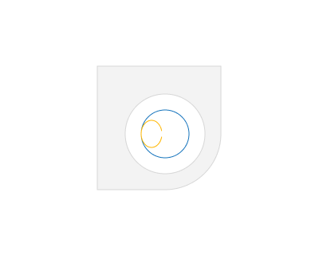
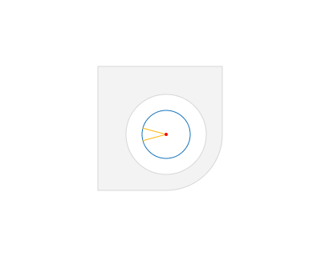
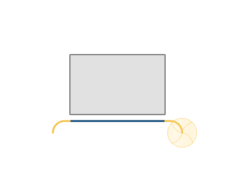
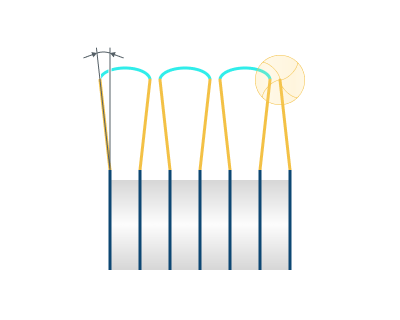

# Entradas e saídas para operações avançadas 3D/5D

<strong>Sl</strong> - Safe level (nível seguro)

<strong>LD</strong> - Leads (entradas e saídas)

## Área de aplicação:

Permite adicionar aos movimentos de trabalho movimentos adicionais de entrada e de saída, executados com o avanço correspondente.

<strong>Lead from hole center (disponível para a operação de chanfro).</strong>

Clique aqui para expandir..

<strong>Enable:</strong> A entrada/saída é formada a partir do centro do furo.

<strong>Disable:</strong> A entrada/saída é formada de acordo com a regra <strong>Lead in/out for closed curves</strong> ou <strong>Lead in/out for open curves</strong>.

 

<strong>Engage.</strong>

Clique aqui para expandir..

<strong>Off.</strong> Os trechos de entrada e de saída do percurso da ferramenta não são gerados.

.png)

<strong>By Vertical Normal.</strong> A entrada é executada ao longo do eixo da ferramenta até o primeiro ponto da passada de trabalho.

.png)

<strong>By Surface Normal.</strong> A entrada é executada ao longo da normal à superfície no primeiro ponto da passada de trabalho

.png)

<strong>By Horizontal Normal.</strong> A entrada é executada perpendicularmente ao eixo da ferramenta até o primeiro ponto da passada de trabalho

.png)

<strong>By Tangent.</strong> A entrada é executada tangencialmente ao primeiro ponto de usinagem.

.png)

<strong>By Line.</strong> A entrada é executada com um ângulo em relação à tangente no primeiro ponto de usinagem.

.png)

<strong>By Vertical Arc.</strong> O sistema adiciona um arco com o raio definido ao primeiro ponto da curva. O arco fica no plano vertical e é tangente ao primeiro percurso da ferramenta aplicado ao contorno. O ângulo da curva é definido pelo usuário. A descida da ferramenta é executada na extremidade vertical do arco; em seguida, a ferramenta se desloca ao longo do arco e depois para a passada de trabalho.

.png)

<strong>By Normal Arc.</strong> O sistema adiciona um arco com o raio definido ao primeiro ponto da curva. O arco fica no plano vertical e é tangente ao primeiro percurso da ferramenta aplicado ao contorno. O ângulo da curva é calculado de forma que a tangente na outra extremidade do arco seja vertical. A descida da ferramenta é executada na extremidade vertical do arco; em seguida, a ferramenta se desloca ao longo do arco e depois para a passada de trabalho.

.png)

<strong>By Horizontal Arc.</strong> Usado ao construir uma trajetória na direção horizontal. O sistema adiciona uma tangente com um ângulo na direção horizontal.

<strong>Dependendo do tipo de entrada, é possível controlar parâmetros adicionais:</strong>

<strong>Length (Radius).</strong> Altera o comprimento

.png)

<strong>Angle.</strong> Altera o ângulo vertical

.png)

<strong>Plane angle.</strong> Altera o ângulo horizontal

<strong>Retract.</strong>

Clique aqui para expandir..

<strong>Off.</strong> Os trechos de entrada e de saída do percurso da ferramenta não são gerados.

.png)

<strong>By Vertical Normal.</strong> A saída é executada ao longo do eixo da ferramenta a partir do último ponto da passada de trabalho.

.png)

<strong>By Surface Normal.</strong> A aproximação é executada ao longo da normal à superfície no primeiro ponto da passada de trabalho

.png)

<strong>By Horizontal Normal.</strong> A saída é executada perpendicularmente ao eixo da ferramenta a partir do último ponto da passada de trabalho.

.png)

<strong>By Tangent.</strong> A aproximação é executada tangencialmente ao primeiro ponto de usinagem.

.png)

<strong>By Line.</strong> A aproximação é executada com um ângulo em relação à tangente no primeiro ponto de usinagem.

.png)

<strong>By Vertical Arc.</strong> O sistema adiciona um arco com o raio definido ao primeiro ponto da curva. O arco fica no plano vertical e é tangente ao primeiro percurso da ferramenta aplicado ao contorno. O ângulo da curva é definido pelo usuário. A descida da ferramenta é executada na extremidade vertical do arco; em seguida, a ferramenta se desloca ao longo do arco e depois para a passada de trabalho.

.png)

<strong>By Normal Arc.</strong> O sistema adiciona um arco com o raio definido ao primeiro ponto da curva. O arco fica no plano vertical e é tangente ao primeiro percurso da ferramenta aplicado ao contorno. O ângulo da curva é calculado de forma que a tangente na outra extremidade do arco seja vertical. A descida da ferramenta é executada na extremidade vertical do arco; em seguida, a ferramenta se desloca ao longo do arco e depois para a passada de trabalho.

.png)

<strong>By Horizontal Arc.</strong> Usado ao construir uma trajetória na direção horizontal. O sistema adiciona uma tangente com um ângulo na direção horizontal.

<strong>Dependendo do tipo de entrada, é possível controlar parâmetros adicionais:</strong>

<strong>Length (Radius).</strong> Altera o comprimento

.png)

<strong>Angle.</strong> Altera o ângulo vertical

.png)

<strong>Plane angle.</strong> Altera o ângulo horizontal

<strong>Use leads for short links. Enable:</strong> Quando ativada, as entradas e saídas são adicionadas a todas as ligações, inclusive às curtas.

<strong>Disable:</strong> Quando desativada, as entradas e saídas são adicionadas apenas às ligações longas e às ligações de entrada/saída.

.png) .png)
