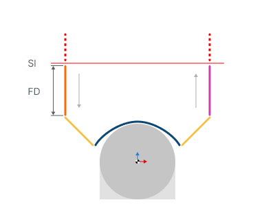

# Distância para operações 3D

## Área de aplicação:

Distâncias necessárias para alternar os avanços.

<strong>Feed distance (level).</strong> Distância medida ao longo do eixo da ferramenta desde a ativação do avanço de aproximação até o ponto em que ele muda para o avanço de trabalho ou para o avanço de entrada.

Clique aqui para expandir..

<strong>SL</strong> - Safe Surface (superfície de segurança)

<strong>FD</strong> - Feed Distance (distância de avanço)

O avanço de aproximação começa durante o movimento em direção ao bruto a partir da <strong>Safe Surface</strong> ou da <strong>Rapid Distance</strong>. Dentro dessa distância, o avanço de aproximação está ativo. A mudança para o avanço de trabalho ocorre no nível das passadas de trabalho ou quando começa o movimento de entrada com avanço de entrada. Este valor pode ser definido:

- em unidades de comprimento a partir do ponto inicial da entrada;

- em unidades de comprimento em relação ao nível do bruto;

- como porcentagem do diâmetro da ferramenta;

- como porcentagem da distância entre passadas.

