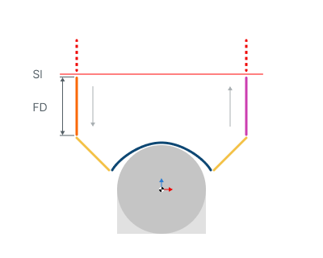

# 3Dオペレーションの距離

## 適用分野：

送りの切り替えに必要な距離

### 送り距離

アプローチ送りの開始位置から、ワーク送りまたは切込み送りに切り替わる点まで、工具軸方向に沿った距離です。

拡大

<strong>SL</strong> - 安全サーフェス

<strong>FD</strong> - 送り距離

アプローチ送りは、<strong>安全サーフェス</strong>または<strong>早送り距離</strong>からワークに向かって移動する間に、開始されます。この距離内では、アプローチの送りが有効になります。ワークの送りへの切り替えは、ツールパスの高さ、または切込み送りを伴う切込み動作開始時に行われます。この値は以下の方法で設定できます。

-切込み開始点からの長さ単位

-ワークの高さに対する長さ単位

-工具径に対する割合

-パス間の距離に対する割合

