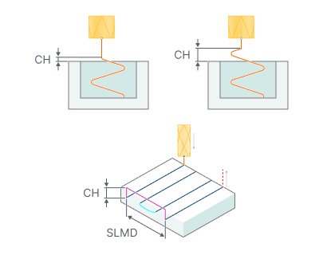
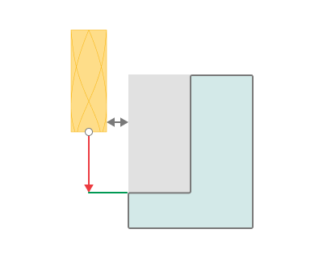

# 荒取りウォーターラインに基づく距離

## 適用分野：

送り速度切替に必要な距離

<strong>クリアランス高さ。</strong>

詳細を表示

この距離は、工具が加工済みの領域を移動する際に、工具を退避させるために使用されます（移行値が`*Short link max distance*`の値より大きい場合）。また、閉じた領域に切り込みを入れる際のクリアランス値としても使用されます。

<strong>CH</strong> - クリアランス高さ <strong>SLMD</strong> - ショートリンクの最大距離

<strong>安全距離。</strong>

詳細を表示

早送り、ロングリンク送りの切り替え時のワークとの距離です。

アプローチ送りの動作開始時から、ワークの送りまたは切込みの送りに切り替わるまでの工具軸に沿って測定される距離です。

詳細を表示

アプローチ送りは、<strong>安全サーフェス</strong>または <strong>早送り距離</strong>からワークに向かって移動する間に、開始されます。この距離内では、アプローチの送りが有効になります。ワークの送りへの切り替えは、ツールパスの高さの到達時、または切込みの送りを伴う切込み動作の開始時に行われます。この値は以下の方法で設定できます。

- 切込み開始点からの長さ単位
- ワークの高さに対する長さ単位
- 工具径に対する割合
- パス間の距離に対する割合

