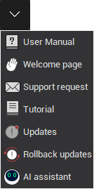

# Hilfemenü der Hauptleiste

Das Menü **Help** bietet Zugriff auf Dokumentation, Lernmaterial und Support.

| Schaltfläche | Funktion |
|---|---|
|  | **User manual:** Öffnet die Hilfe des CAM-Systems. |
|  | **Welcome page:** Zeigt aktuelle Informationen der Produktwebsite. |
|  | **Support request:** Bereitet eine Anfrage an ENCY SOFTWARE LTD., support@encycam.com, vor. |
|  | **Tutorial:** Startet das Lernprogramm. |
|  | **Updates:** Sucht nach Aktualisierungen. |
|  | **Rollback updates:** Kehrt bei Bedarf zu einer früheren Programmversion zurück. |
|  | **[AI Assistant](10428.md):** Unterstützt bei verschiedenen Aufgaben im CAM-Arbeitsablauf. |
