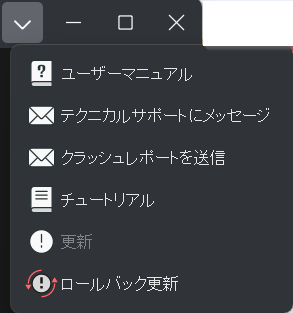

# メインパネルのヘルプボタン

<strong>ヘルプ</strong>メニューには、発生する可能性のある質問に対する回答を検索できる操作が備わっています。

| ボタン | 説明 |
|---|---|
|  | <strong>ユーザーマニュアル：</strong> CAMシステムのヘルプを表示します。 |
|  | <strong>ウェルカムページ：</strong> CAMシステムのウェブサイトから最新情報のページを開きます。 |
|  | <strong>サポート依頼：</strong> ENCY SOFTWARE LTD.のテクニカルサポートサービス宛へのメッセージを作成します。e-mail: support@encycam.com |
|  | <strong>チュートリアル：</strong> CAMシステムのチュートリアルを実行します。 |
|  | <strong>アップデート：</strong>利用可能なアップデートをチェックします。 |
|  | <strong>ロールバック更新：</strong>必要に応じて、以前のバージョンにロールバックします。 |
|  | <strong>[AIアシスタント](10428.md):</strong> CAMワークフローの様々な面でユーザーをサポートするバーチャルアシスタント。 |
