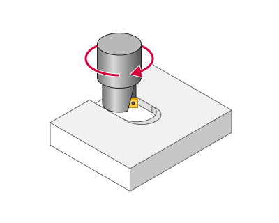
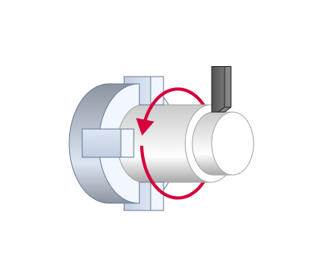
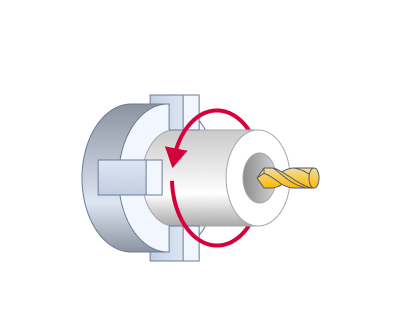
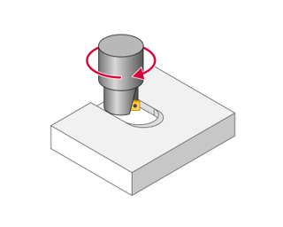
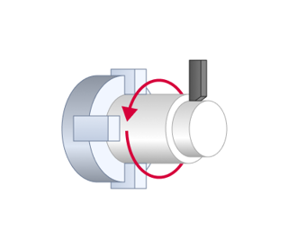
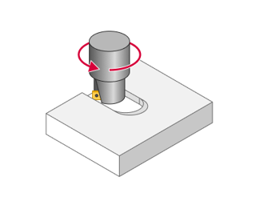
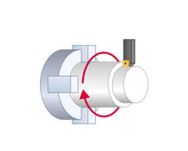

# Avanzamenti/Velocità

  

## Ambito di applicazione:

In questa finestra di dialogo l'utente può definire la velocità di rotazione del mandrino, la velocità dei movimenti rapidi e i valori di avanzamento per le diverse zone del percorso utensile. La velocità di rotazione del mandrino può essere definita come numero di giri al minuto oppure come velocità di taglio. Il valore determinante è sottolineato. Il secondo valore viene ricalcolato in base al valore determinante, tenendo conto del diametro dell'utensile.

## Avanzamenti/Velocità (calcolo).

Il calcolatore consente agli utenti di impostare e calcolare automaticamente le velocità del mandrino e le velocità di avanzamento. [Dettagli](100128.md)

## Mandrino.

Questo gruppo di parametri configura le proprietà di rotazione del mandrino.

Fare clic qui per espandere..

<strong>Spindle Speed.</strong> (velocità del mandrino)

Specificare direttamente la velocità del mandrino in giri al minuto (RPM) oppure la velocità di taglio in metri al minuto (CSS). Nel secondo caso il controllo CNC calcola e regola continuamente i giri al minuto del mandrino in base al diametro attuale del pezzo. Invece di un numero di giri al minuto fisso, si specifica solo il valore massimo ammesso.

<strong>Max RPM.</strong> (numero massimo di giri)

Se la velocità del mandrino è impostata tramite la velocità di taglio, è necessario specificare la velocità di rotazione massima per limitarne l'aumento al variare del diametro.

<strong>RPM before CSS.</strong> (RPM prima di CSS)

Nelle operazioni di tornitura questo parametro attiva la modalità RPM nella posizione di cambio utensile e attiva la modalità CSS dopo i movimenti di avvicinamento.

Se l'utensile si trova nel punto di cambio utensile e il mandrino viene attivato in modalità CSS, la sua rotazione sarà lenta, poiché l'utensile è lontano dall'asse di rotazione del pezzo. Durante il primo movimento rapido, quando l'utensile si avvicina al pezzo, il mandrino accelera notevolmente, causando carichi estremi sulla macchina. Per evitarlo, alcuni costruttori di macchine raccomandano di avviare inizialmente il mandrino in modalità a giri costanti (RPM) e di passare a CSS dopo che l'utensile si è avvicinato al pezzo. Quando l'opzione "RPM before CSS" è attivata, il mandrino ruota dapprima in modalità RPM alla velocità corrispondente al primo punto di avanzamento di taglio, quindi viene eseguito il movimento di avvicinamento e infine la modalità passa a CSS.

<strong>Range.</strong> (gamma)

Specificare il numero della gamma necessaria per ottenere la velocità del mandrino desiderata su una macchina con cambio meccanico.

<strong>Rotation direction.</strong> (senso di rotazione)

Configurare il senso di rotazione del mandrino.

<strong>Forward.</strong> (orario)

È la rotazione del mandrino in senso orario vista dal lato del motore, rappresentata nel programma NC da M3. Se è montato un utensile, questo senso corrisponde all'avvitamento di una vite destrorsa. Nelle operazioni di tornitura il mandrino ruota verso l'operatore.

 

<strong>Reverse.</strong> (antiorario)

È la rotazione del mandrino in senso antiorario vista dal lato del motore, rappresentata nel programma NC da M4. Se nel mandrino è montato un utensile, questo senso corrisponde all'avvitamento di una vite sinistrorsa. Nelle operazioni di tornitura il mandrino ruota allontanandosi dall'operatore.

 

<strong>Grip RPM.</strong> (giri per la presa) Il contromandrino esegue la presa del pezzo a questo numero di giri.

<strong>Plunge speed.</strong> (velocità di affondamento)

In un'operazione <strong>Roughing Waterline</strong> (sgrossatura a Z costante) è possibile definire una velocità del mandrino specifica per il movimento di affondamento della fresa nel materiale durante la fresatura di superfici chiuse, come le tasche. [Dettagli.](744.md)

## Refrigerante:

Questo gruppo di parametri controlla l'adduzione del refrigerante nella zona di taglio. Il postprocessore utilizza questi parametri per generare nel programma NC i comandi appropriati di attivazione e disattivazione del flusso di refrigerante. Gli utenti possono definire i metodi di adduzione del refrigerante e configurarne i parametri nella sezione <strong>Coolants</strong> della scheda <strong>Equipment</strong>. [Dettagli.](1021.md)

Fare clic qui per espandere..

<strong>Flood</strong>. (refrigerazione abbondante)

L'attivazione di questo parametro avvia l'adduzione del refrigerante tramite l'ugello.

<strong>Mist</strong>. (nebulizzazione)

L'aria compressa nebulizza il liquido e trasporta la miscela aria-liquido nella zona di taglio.

<strong>Tool</strong>. (attraverso l'utensile)

L'attivazione del parametro abilita l'adduzione del refrigerante in pressione attraverso i canali dell'utensile.

<strong>Coolant 4</strong>. (refrigerante 4)

L'attivazione del parametro abilita l'adduzione del refrigerante all'utensile con un metodo alternativo, ad esempio un getto d'aria.

## Avanzamenti di taglio:

Questo gruppo di parametri determina le velocità di avanzamento per il taglio, l'attacco, l'avvicinamento e la retrazione dell'utensile. Ogni parametro può essere specificato in unità di velocità come mm/giro, mm/min e, per le operazioni di fresatura, anche in mm/dente. Tutte le velocità, ad eccezione della velocità di avanzamento di lavoro, possono essere definite come percentuale della velocità di avanzamento di lavoro.

Fare clic qui per espandere..

<strong>Work feed</strong> (avanzamento di lavoro; nelle operazioni di tornitura <strong>Cut Feed</strong>).

Il valore principale della velocità di avanzamento, mantenuto durante il processo per un taglio stabile. Nelle operazioni di sgrossatura a questa velocità avviene l'asportazione del materiale, in quelle di finitura la lavorazione delle superfici del pezzo.

<strong>Calculable.</strong> (calcolato)

Nelle operazioni di fresatura il valore di avanzamento può essere costante oppure calcolato in funzione dell'angolo di inclinazione di ciascun tratto elementare del percorso utensile. Quando si assegna un avanzamento calcolato, sono determinanti i valori di avanzamento e i coefficienti per il movimento verso il basso, orizzontale e verso l'alto. I valori di avanzamento reali nel movimento verso il basso, orizzontale o verso l'alto sono pari al prodotto del coefficiente di correzione corrispondente per il valore di avanzamento. Per valori intermedi dell'angolo di inclinazione di un tratto elementare del percorso utensile, il valore di avanzamento reale viene calcolato in proporzione ai valori limite definiti. Ad esempio, con valori di avanzamento pari a 300 verso l'alto, 200 in orizzontale e 100 verso il basso, il valore di avanzamento reale su un tratto con movimento dell'utensile verso l'alto con un angolo di 45 gradi sarà pari a 250. L'uso dell'avanzamento calcolato consente all'utente di ridurre il tempo di lavorazione grazie a un controllo più flessibile delle condizioni di taglio.

<strong>Up feed value.</strong> (avanzamento verso l'alto)

Velocità di avanzamento durante il movimento verticale dell'utensile verso l'alto.

<strong>Down feed value.</strong> (avanzamento verso il basso)

Velocità di avanzamento durante il movimento verticale dell'utensile verso il basso.

<strong>Engage feed.</strong> (avanzamento di attacco)

Il valore della velocità di avanzamento utilizzato per il movimento di attacco. [Dettagli.](100135.md)

<strong>Retract feed.</strong> (avanzamento di uscita)

Il valore della velocità di avanzamento utilizzato per il movimento di uscita. [Dettagli.](100135.md)

<strong>First feed</strong> (primo avanzamento; nelle operazioni di tornitura <strong>First Cut Feed</strong>).

La velocità di avanzamento applicata durante le passate di lavoro alla profondità di taglio iniziale. Il primo avanzamento è utile nella lavorazione di un grezzo con uno strato esterno iniziale duro (crosta).

<strong>Finish feed</strong> (avanzamento di finitura; nelle operazioni di tornitura <strong>Finish Cut Feed</strong>).

Il valore della velocità di avanzamento utilizzato per le passate di finitura nelle operazioni con fasi separate di sgrossatura e finitura. Se ne consiglia l'uso quando occorre ottenere una superficie di alta qualità dopo un'operazione di sgrossatura.

<strong>Plunge feed.</strong> (avanzamento di affondamento)

Avanzamento applicato ai movimenti di affondamento dell'utensile; viene applicato, ad esempio, per l'affondamento in uno strato di lavorazione inferiore nelle operazioni di sgrossatura a Z costante e di svuotamento tasche. [Dettagli.](744.md)

<strong>Chip Breaking Feed.</strong> (avanzamento di rottura del truciolo)

Nelle operazioni di tornitura questo valore specifica la velocità di allontanamento dal pezzo e di riposizionamento durante la rottura del truciolo.[Dettagli.](316.md)

<strong>Adaptive feedrate.</strong> (avanzamento adattivo)

La funzione regola automaticamente la velocità di avanzamento del percorso utensile in base all'impegno effettivo dell'utensile. In questo modo riduce l'avanzamento negli angoli stretti, dove l'impegno dell'utensile si avvicina al 100%, e lo aumenta quando l'impegno dell'utensile si avvicina allo 0% (taglio in aria).

<strong>La condizione principale per l'attivazione di questo parametro è la larghezza di sovrapposizione.</strong>

L'impegno dell'utensile si avvicina al 100% (Ae~100%). L'opzione è attiva. Nel sistema CAM le zone sono contrassegnate in nero.

.png) .png)

<strong>Full Cut Feed.</strong> (avanzamento a pieno taglio) Avanzamento finale minimo, in percentuale di <strong>Work Feed.</strong>

.png)

<strong>Fmin -</strong> Full Cut Feed

<strong>No Cut Feed.</strong> (avanzamento senza taglio) Velocità di avanzamento all'uscita dalla zona (senza taglio), in percentuale di <strong>Work Feed.</strong>

.png)

<strong>Fnot -</strong> No Cut Feed

<strong>Feed Increment.</strong> (incremento dell'avanzamento) Passo di variazione dell'avanzamento.

_1.png)

<strong>Mark overloads.</strong> (evidenzia sovraccarichi) Consente di evidenziare nella scheda Simulation i tratti in cui l'impegno dell'utensile è massimo. Nel parametro è possibile specificare il valore, riferito al <strong>work feed</strong>, da evidenziare. [Dettagli](742.md)

<strong>Override Feeds.</strong> (sostituzione degli avanzamenti)

Questo parametro è disponibile nelle operazioni di tornitura e la sua attivazione consente di definire impostazioni separate della velocità di avanzamento (avanzamenti <strong>Cutting</strong>, <strong>Engage</strong>, <strong>Retract</strong>, <strong>Finish Cutting</strong> e <strong>Traversal</strong>) per i cicli designati in <strong>Job Assignment</strong>.

## Avanzamenti senza taglio:

Questo gruppo di parametri definisce le velocità dei movimenti ausiliari, compresi l'avvicinamento, il ritorno e le transizioni tra le passate di lavoro. Ogni parametro può essere impostato in unità di velocità come mm/giro, mm/min e, per le operazioni di fresatura, anche in mm/dente. Inoltre, le velocità possono essere specificate come percentuale della velocità di avanzamento di lavoro o come avanzamento rapido.

Fare clic qui per espandere..

<strong>Rapid feed.</strong> (avanzamento rapido)

L'avanzamento con cui vengono eseguiti tutti gli spostamenti rapidi dell'utensile (posizionamento). Il suo valore è la velocità dei movimenti rapidi della macchina corrente. I movimenti a questa velocità vengono emessi nel programma NC con l'indirizzo G00. Questo valore viene utilizzato per calcolare con precisione il tempo del processo di lavorazione. I tratti del percorso utensile eseguiti in avanzamento rapido sono visualizzati in rosso. Al passaggio all'avanzamento rapido, il sistema crea il comando RAPID nel programma CLDATA.

<strong>Short link feed.</strong> (avanzamento dei collegamenti brevi)

La velocità di avanzamento applicata ai movimenti di collegamento eseguiti secondo la regola <strong>Short Links</strong>. [Dettagli.](100131.md)

<strong>Long link feed.</strong> (avanzamento dei collegamenti lunghi)

La velocità di avanzamento applicata ai movimenti di collegamento eseguiti secondo la regola <strong>Long Links</strong>. [Dettagli.](100130.md)

<strong>Approach feed.</strong> (avanzamento di avvicinamento)

La velocità di avanzamento applicata al movimento di avvicinamento, che copre la distanza da <strong>Feed Distance</strong> all'inizio di <strong>Plunge</strong> o di <strong>Engage</strong>. [Dettagli.](100135.md)

<strong>Approach from safe surface feed.</strong> (avanzamento di avvicinamento dalla superficie di sicurezza)

Il valore della velocità di movimento da <strong>Safe Surface</strong> a <strong>Feed Distance</strong>. [Dettagli.](100117.md)

<strong>Return to safe surface feed.</strong> (avanzamento di ritorno alla superficie di sicurezza)

Il valore della velocità di movimento da <strong>Feed Distance</strong> al livello di <strong>Safe Surface</strong>. [Dettagli.](100117.md)

<strong>Transition on safe surface feed.</strong> (avanzamento di spostamento sulla superficie di sicurezza)

Il valore della velocità di movimento durante i collegamenti sulla <strong>Safe Surface</strong>. [Dettagli.](100117.md)

<strong>Traversal Feed</strong>. (avanzamento di traslazione)

Nelle operazioni di tornitura questa velocità definisce la velocità di transizione da una passata di lavoro alla successiva.

<strong>Return feed</strong>. (avanzamento di ritorno)

Nelle operazioni di fresatura è la velocità di movimento dalla fine del movimento <strong>Retract</strong> al livello di <strong>Feed Distance</strong>. Nelle operazioni di lavorazione dei fori è la velocità di retrazione in alcuni cicli di foratura, ad esempio nei cicli di foratura profonda con scarico o rottura del truciolo. [Dettagli.](10100.md)

<strong>Rapid idle moves (<strong>Rapid non-work moves)</strong>.</strong> (movimenti a vuoto in rapido)

Quando questo parametro è attivato, tutti i movimenti di retrazione dell'utensile dalla zona di lavorazione che dovrebbero essere eseguiti alla velocità <strong>Return feed</strong> vengono invece eseguiti a <strong>Rapid feed</strong>.

## Controllo degli angoli:

Questo gruppo di parametri consente di aggiungere un comportamento specifico agli angoli del percorso utensile. Si trova nella parte inferiore della pagina "Feeds/Speeds". [Dettagli](100144.md)
